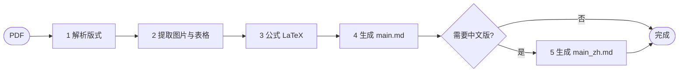

<div align="center">

# pdf-parse-x

**把学术 PDF 转成干净、可复现的 Markdown**

正文 · 章节 · 图片 · 表格 · 公式 · 参考文献，可选中文对照与浏览器预览。

[](#快速开始)
[](#测试)
[](#可选-llm-配置)
[](#限制)

[功能](#功能) · [快速开始](#快速开始) · [输出结构](#输出结构) · [配置](#配置) · [Web API](#web-api) · [实测结果](#实测结果) · [实现要点](#实现要点) · [限制](#限制)

</div>

---

`pdf-parse-x` 面向**带文本层的学术 PDF**。它用 `pdf-parse` + `pdfjs-dist` 还原阅读顺序，用矢量线条重建表格，用 Sharp 裁剪图片与公式，并可选择接入任意 OpenAI 兼容视觉模型，补全 LaTeX、兜底混排公式、生成中文版。所有产物落在同一个目录里，方便直接入库、检索或发布。



## 功能

| 能力 | 说明 |
| --- | --- |
| **版式还原** | 双栏阅读顺序、跨栏元素定位、跨页段落合并、断词连字符处理，自动清理期刊页眉、页码与 DOI 页脚 |
| **章节结构** | `1 Introduction`、`2.1 ...`、IEEE `II. OVERVIEW` / `A. Retrieval Source`、`References` 等层级识别 |
| **首页信息** | 区分页眉、标题、作者、机构、收稿信息、摘要、关键词与正文起始；支持 `Abstract—`、`Index Terms—` 行内标签 |
| **图片提取** | 按 `Figure 1.` / `Fig. 1` 图注裁切内嵌位图与矢量插图，多图块自动拼接并保留原始分块 |
| **表格重建** | 矢量横竖线 + 表头分隔线 + 列中心聚类 + 行标签还原表格；输出 Markdown、CSV、JSON 与高清截图 |
| **公式输出** | 行内公式按字号/基线重建；编号与无编号公式统一输出 `$$ ... $$`，可选视觉模型转写并通过 KaTeX 校验 |
| **参考文献** | IEEE `[1]`、MDPI `1.` 与作者-年份三种格式；跨页续行并回同一条目，编号不重排 |
| **中文翻译** | 按子章节批量生成 `main_zh.md`，保留结构、公式、链接、加粗与硬换行 |
| **实时预览** | 服务端按需渲染 `main.md`：KaTeX 公式、目录、图片灯箱、表格原图、中英切换与实时进度条 |
| **完整性报告** | `report.json` 记录文本覆盖率、图表数量、表格置信度、公式来源与所有警告 |

<details>
<summary><b>更多细节</b></summary>

- **表格与资源双保险**：每张表同时输出 Markdown、CSV、JSON 和表格区域高清截图。`tables/table-XX.md` 与正文一致：有可用行列时优先 Markdown，并在下方附「查看表格原图」链接（预览中为胶囊按钮，点击打开灯箱）；没有行列时只保留截图。只有“没有可用单元格网格”的表才回退为截图，即使单元格大量重复（如打勾矩阵）也不会被密度阈值抛弃。
- **行内公式整理**：文本层里小于正文号的数学片段（如 `p` + 下标 `ij`）按字号与基线偏移重建为 `$p_{ij}$`；相邻碎片用数学标点合并成一个公式，`]T` 还原为转置 `^{\mathsf{T}}`，孤立撇号并回下标（`p_{i} _{'}` → `p_{i'}`），`k = 1, 2, · · ·, K` 这类列表包成数学。
- **混排公式转写（兜底）**：文本层把公式与正文搅乱（如 `∑ ∑ j in K-dimensional space ...`）、或留下 `=j` 求和下限、`]T`、`1_{2}` 分数碎片时，裁剪该行交给视觉模型重排为 `$...$`，结果缓存到 `math-lines.llm.json`。跨行公式被拆成分子/分母/孤立 `∑` 时，会把相关行连同相邻正文裁剪成段落图，按“内容与顺序不可变”的约束重排。`MATH_LLM_ENABLED=false` 可关闭。
- **页级救援（只处理失败项）**：某条公式或某个跨行片段单独调用失败时，把该页**所有失败项的 id** 与整页截图一起再送一次模型，成功项不经过这条路径；救援结果同样经过 KaTeX/长度校验，不通过则维持原图或原文回退。
- **翻译修复合并**：主批次之后，把“未译、仍英文、数学密集”三类问题合并成每个子章节一次修复请求；批量修复仍失败的条目再逐条重试，失败较多的文档调用数明显减少。
- **进度日志**：整个流程分 5 个阶段，命令行与网页都只显示最新一条日志，字段为 `[阶段/总数] 名称 · 结果摘要 · 耗时`；公式与翻译阶段显示“已处理/总数”，网页进度条按“已完成步骤 + 当前步骤进度”实时填满。

</details>

## 快速开始

**环境要求**：Node.js ≥ 20（Windows / macOS / Linux）。

```bash
git clone <repo-url>
cd pdf-parse-x
npm install
cp .env.example .env      # Windows: copy .env.example .env
```

> 模型配置是可选的。不填 `LLM_*` 时转换完全离线，公式回退为 PDF 原图裁剪。

**命令行**

```bash
npm run convert:sample                                        # 转换示例 PDF
npm run convert -- "pdfs/paper.pdf" "output/paper"            # 转换任意 PDF
npm run convert -- "pdfs/paper.pdf" "output/paper" --zh       # 同时生成中文版
npm run convert -- "pdfs/paper.pdf" "output/paper" --preview  # 额外生成静态 preview.html
```

输出目录可省略，默认使用 `output/<pdf 文件名>`。

**Web 界面**

```bash
npm start
```

- 上传与转换：<http://localhost:3000>
- 预览示例：<http://localhost:3000/preview/software-05-00038>
- 中文预览：`/preview/<id>?lang=zh`

<details>
<summary>命令行输出示例</summary>

```text
[1/5] 解析 PDF · 36 页 · 2 图 · 12 表 · 30 公式 · 101,306 字符 · 1.4s
[3/5] 公式 LaTeX · 行内 22 · 跨行 22 · 救援 2 · 缓存 30
[5/5] 生成中文版 · 162/167 段 · 337 字符 · 18.3s

✔ 转换完成 · 36 页 · 2 图 · 12 表 · 30 公式 · 覆盖 94.02% · 总耗时 2m28s
  标题: ...
  Markdown: output/paper/main.md
  中文版: output/paper/main_zh.md
  预览:   npm start 后访问 /preview/<文档 ID>（按需从 main.md 渲染）
  资源:   output/paper/figs · output/paper/tables
```

输出被重定向到文件或管道时（`> log.txt`、`| tee`），每个阶段各占一行，便于事后排查。

</details>

## 输出结构

```text
pdfs/                     # 待转换的 PDF
output/<document>/
├── main.md               # 完整 Markdown 正文（唯一正文产物）
├── main_zh.md            # 可选：中文版（--zh / 勾选“同时生成中文版”时）
├── metadata.json         # PDF 元数据
├── report.json           # 页数、图表数量、文本覆盖率、警告
├── formulas.json         # 有公式时生成：LaTeX 与 sources 来源标记，可直接当作 sidecar 复用
├── formulas.llm.json     # 可选：公式模型结果缓存（仅启用公式模型时生成）
├── math-lines.llm.json   # 可选：行内/跨行公式转写缓存
├── translations.json     # 可选：翻译缓存（与 main_zh.md 配套）
├── preview.html          # 可选：--preview / PERSIST_PREVIEW=true 时才生成
├── figs/
│   ├── figure-01.png
│   ├── ...
│   ├── equations/        # 未识别为 LaTeX 的公式原图回退
│   └── parts/            # 多图块图（如 2×2 图）的原始分块
└── tables/
    ├── table-01.md       # 表格 Markdown
    ├── table-01.csv      # 表格 CSV
    ├── table-01.json
    ├── table-01.png      # 表格高清截图（核对用）
    └── ...
```

> 默认**不生成 `preview.html`**：网页预览由服务端在请求时从 `main.md` 实时渲染，输出目录只保留正文和资源，避免同一内容保存两份。需要可双击打开的静态预览时用 `--preview`。

## 配置

复制 `.env.example` 后按需修改；`src/cli.js` 与 `src/server.js` 都会通过 `dotenv` 自动读取项目根目录的 `.env`。

### 可选 LLM 配置

| 变量 | 默认值 | 说明 |
| --- | --- | --- |
| `LLM_BASE_URL` | — | OpenAI 兼容接口地址，需支持 `POST /chat/completions`，末尾不带斜杠 |
| `LLM_API_KEY` | — | API Key；本地无鉴权服务可留空并设置 `LLM_ALLOW_NO_KEY=true` |
| `LLM_MODEL` | — | 支持图片输入的模型名，例如 `mimo-v2.6-flash` |
| `LLM_VISION` | `true` | `false` 时只发送文本层，适用于纯文本模型 |
| `LLM_TIMEOUT_MS` | `120000` | 单条公式请求超时（毫秒） |
| `LLM_CONCURRENCY` | `3` | 公式与翻译的并发请求数 |
| `LLM_MAX_IMAGES` | `0` | 单次转换最多调用多少个公式，`0` 表示不限 |
| `LLM_ALLOW_NO_KEY` | `false` | 允许不带 API Key 调用本地服务 |
| `MATH_LLM_ENABLED` | `true` | 混排/跨行公式转写开关 |
| `MATH_LLM_MAX_LINES` | `80` | 单次转换最多转写多少行，`0` 表示不限 |
| `FIGURE_LLM_ENABLED` | `false` | 坐标规则无法关联图片时，让视觉模型定位并裁剪 |
| `TRANSLATE_ENABLED` | `false` | 每次转换都生成中文版；平时建议在网页/CLI 按需触发 |
| `TRANSLATE_MODEL` | 同 `LLM_MODEL` | 翻译模型 |
| `TRANSLATE_CONCURRENCY` | 同 `LLM_CONCURRENCY` | 翻译并发 |
| `PERSIST_PREVIEW` | `false` | 额外生成可直接双击打开的 `preview.html` |

> 模型输出存在幻觉风险：所有 LaTeX 都必须通过 KaTeX 校验，仍建议人工抽查关键公式。网络失败、超时、HTTP 错误与语法错误会分别写入 `report.json`。

<details>
<summary><b>公式来源与 Sidecar</b></summary>

代码中没有“某篇论文第 N 个公式对应某段 LaTeX”的硬编码。LaTeX 来源按优先级依次为：

1. 调用方传入的 `options.formulaLatex`；
2. PDF 同目录的 sidecar：`paper.formulas.json`、`paper.pdf.formulas.json` 或 `formulas/paper.json`；
3. **输出目录里的 `formulas.json`**。

```json
{
  "1": "E = mc^2",
  "3": "\\sum_{i=1}^{n} x_i"
}
```

每次转换结束会把最终 LaTeX 写回 `output/<文档>/formulas.json`，并记录来源与生成时间：

```json
{
  "version": 1,
  "source": "paper.pdf",
  "generatedAt": "2026-11-17T...",
  "sources": { "1": "llm" },
  "formulas": { "1": "E = mc^2 \\tag{1}" }
}
```

`sources` 取值包括 `sidecar`、`llm`、`llm-cache`、`llm-rescue`。传 `refresh: true` 时忽略输出目录副本，强制重新求解。

</details>

<details>
<summary><b>中文翻译策略</b></summary>

- 网页：上传前勾选「同时生成中文版」；已有文档点卡片上的「翻译中文」，调 `POST /api/documents/:id/translate`（带 SSE 进度）；完成后按钮变成「中文预览」。
- 命令行：`--zh` 开启，`--no-zh` 显式关闭。
- 分批：按小节对齐打包，**同一子章节一次请求**；标题/段落/列表/表格单元在同一请求中按顺序逐项返回，行数与英文严格一致。
- 结构保护：只翻译标题/段落/列表/表格单元；`$...$`、`$$...$$`、图片、链接地址、引用编号、代码围栏、HTML 片段与参考文献列表原样保留。
- 格式保持：译文强制单行（长度不对时只修复该条，不重发整节）；英文的硬换行（行末两空格）、加粗/斜体、标题层级都会保留；`**关键词**：中文` 这类写法会把冒号/句号移到加粗之外，避免 `**` 原样显示。
- 数学密集句子也会翻译：公式保留，只把句子里的英文单词换成中文。
- 失败处理：每节先做一次统一修复（缺失条目/未翻译/数学密集），剩余的逐条兜底；仍失败的条目保留英文并在 `report.json` 的 `translation.warnings` 中计数。
- 缓存按模型 + 原文哈希命中；重复标题样式（如重复表头）只付一次费用。

</details>

## Web API

| 方法 | 路径 | 说明 |
| --- | --- | --- |
| `GET` | `/api/documents` | 已转换文档列表 |
| `POST` | `/api/convert` | `multipart/form-data`，字段名 `pdf` |
| `POST` | `/api/convert-sample` | 转换工作区示例 PDF |
| `GET` | `/api/documents/:id` | 元数据与完整性报告 |
| `POST` | `/api/documents/:id/translate` | 为已有文档生成中文版（可传 `progressId` 订阅 SSE 进度） |
| `DELETE` | `/api/documents/:id` | 删除文档及其图表资源 |
| `GET` | `/preview/:id` | 从 `main.md` 实时渲染预览页（`Cache-Control: no-store`） |
| `GET` | `/api/progress/:id` | SSE 转换进度流（事件 `progress` / `done`） |

## 实测结果

四份 PDF 的实测对比：

| PDF | 页数 | 图片 | 表格 | 公式 (LaTeX/总数) | 文本覆盖 |
| --- | ---: | ---: | ---: | ---: | ---: |
| `software-05-00038.pdf` | 22 | 6 | 8 | 9/9（sidecar） | 99.89% |
| `s10844-026-01076-1.pdf` | 36 | 2 | 12 | 30/30（模型） | 94.02% |
| `2102.08942v1.pdf` | 23 | 0 | 0 | 0/0 | 99.89% |
| `2312.10997v5.pdf` | 21 | 6 | 4 | 0/0 | 99.47% |

- `software-05-00038.pdf`：MDPI 模板，9 个编号公式由 sidecar 提供 LaTeX，8 张表格置信度全部为 `1.0`。
- `s10844-026-01076-1.pdf`：Springer 期刊，30 个公式（17 个带编号 + 13 个无编号）全部由视觉模型重建；12 张表中 3 张重建为 Markdown，其余 9 张无完整框线，保留截图。
- `2102.08942v1.pdf`：单栏纯文字综述，图表与编号公式均为 0，字符按页统计确认没有整页图形区域。
- `2312.10997v5.pdf`：IEEE 双栏模板，罗马数字章节、字母子章节、`TABLE III` 标题与 `Fig. 1.` 图注均正确识别；4 张表中 Table IV 重建为 Markdown，其余（含稀疏打勾矩阵 TABLE III）只保留截图。
- 覆盖率缺口主要来自图注排版差异（例如 `Fig. 1.` 在 Markdown 中规范为 `Figure 1.`）以及插图内部的文字。

## 实现要点

### 文本与版式

- `pdf-parse` 负责元数据、完整文本、内嵌图片和页面截图；`pdfjs-dist` 提供逐项文本坐标、字号、字体和矢量线条。
- 文本项按基线聚合成视觉行，再依据首行缩进、行距、标题正则重建段落。
- 双栏页面先用“窄文本项的 x 区间”寻找装订线：整页通栏行（标题、摘要、跨栏图）会跨过中线，因此不参与判定；同一基线上出现跨装订线的明显空白时，该行拆成左右两段。
- 单栏页面要求“跨栏窄项比例”足够低才会启用分栏，避免把居中的短行误判成两栏。
- 分栏结果传给 Markdown 构建阶段：标题、图注和表格按左栏 → 右栏的阅读顺序插入。

### 表格

表格识别不依赖 `pdf-parse.getTable()`（对带框线的学术 PDF 常返回空表），而是：

1. 从 PDF 绘图操作中提取横向/纵向线条；
2. 找到表格上方最近的 `Table N.` 图注；
3. 用顶线、表头分隔线和底线确定区域；
4. 合并表头碎片（`T` + `p` + `(s)` → `Tp (s)`）；
5. 以表头列中心为锚点分配数据单元格；
6. 用第一列行标签的纵坐标把多行单元格归入正确行；
7. 同时生成 Markdown、CSV、JSON 和截图。

没有框线的表格使用文本布局回退，并在 `report.json` 中标记 `fallback: true`。回退为截图的判据**不是页面宽度**，而是“是否重建出可用单元格网格”：没有行列或全部单元格为空时才只保留截图。

### 图片

- 单张内嵌图直接转 PNG。
- 同一图注下的多个图块按尺寸自动纵向/横向拼接；无法判断时按 2 列网格拼接。
- 没有检测到内嵌位图时（例如矢量绘制的插图），按图注与上下正文的空白间隔估算区域并裁剪，不写入整页截图。
- 实在无法定位时跳过该图并在 `report.json` 中说明。
- 无框线/旋转表格按标题位置与内容边界裁剪；旋转表会自动旋转并裁掉白边。
- 所有图片与表格块都插入到对应正文位置：双栏按左栏 → 右栏的行序，单栏按纵坐标，不会堆到页首页尾。

### 公式

- 行内公式由字号/基线几何重建，不依赖模型；纯脚注数字不会被误判。
- 编号公式以 `$$ ... $$` 写入并用 `\tag{N}` 右对齐编号；无编号但独占一行的公式同样输出 `$$ ... $$`（不带 `\tag`）。
- 视觉模型会收到公式区域截图（可选）和文本层上下文，返回的 LaTeX 必须通过 KaTeX 校验，失败则回退原图。多行公式自动包裹为 `gathered` 环境，模型直接返回 `aligned` 时保持原样。
- 提示词要求保留求和/求积的上下限（包括印在符号下方的一行），并对 `p_{i+p+j}`（两个边缘合计被写成一个下标）、`p_{i+}-p_{+j}`（乘法误读成减法）自动带提示重试一次。
- 无编号公式（尤其拆成分子/分母/求和限多行的）会被聚簇识别，超出单行高度的求和限也并入公式裁剪。
- 页级救援只针对失败项：把该页失败公式的 id 与整页截图一起再发一次模型，结果来源记为 `llm-rescue`；行内/跨行转写失败则把该页失败片段合并成一次救援请求。
- `formulas.llm.json` 缓存与 PDF 内容、模型、服务地址和视觉模式绑定；旧版无身份信息的缓存不会自动复用。

### 翻译

- 主流程按子章节打包请求，携带章节标题作为上下文；不设字符预算，同一小节只发一次请求。
- 返回结果按条目对位校验：数量、行数、公式与链接完整性；不合格项先做一次统一修复，再逐条兜底。
- 译文强制单行并保留硬换行、加粗/斜体与标题层级；模型额外插入的换行会被折叠，保证行数与英文一致。
- 结果缓存在 `translations.json`，重复转换不再付费。

### 预览

- `marked` 解析 Markdown，`sanitize-html` 清洗，KaTeX 在服务端把公式转成 MathML（无需外部字体或 CDN）。
- 块级 `$$ ... $$` 渲染为居中公式 + 右对齐编号，无编号公式同样居中；行内 `$ ... $` 渲染为行内 MathML，`$` 不会出现在页面上。
- 公式字体使用系统数学字体回退链：Cambria Math → STIX Two Math → Latin Modern Math → DejaVu Math TeX Gyre → Times New Roman。
- 「查看表格原图」渲染为胶囊按钮，点击打开灯箱；进度条按“已完成步骤 + 当前步骤进度”实时推进（包括翻译阶段）。
- 响应头 `Cache-Control: no-store`，修改 `main.md` 后刷新即可看到最新内容；目录、图片画廊和表格画廊都从 Markdown 现场提取。
- 需要分享单个 HTML 时，用 `--preview`（或 `PERSIST_PREVIEW=true`）额外生成自包含的 `preview.html`。

## 项目结构

```text
src/
├── cli.js                  # 命令行入口
├── server.js               # Express 上传/预览服务
├── lib/
│   ├── pdf-parser.js       # 转换流水线：图片、表格、Markdown、报告
│   ├── pdf-layout.js       # PDF.js 文本坐标、矢量线条、表格/图注检测
│   ├── markdown-builder.js # 段落/标题/图表块 → Markdown
│   ├── formula-latex.js    # sidecar/映射加载与 KaTeX 校验
│   ├── formula-llm.js      # OpenAI 兼容公式模型（页级救援）
│   ├── math-llm.js         # 行内/跨行公式转写与救援
│   ├── translate.js        # 子章节批量翻译（格式保持、修复与缓存）
│   ├── figure-llm.js       # 可选：图片定位（FIGURE_LLM_ENABLED）
│   ├── preview.js          # Markdown → HTML 渲染（服务端按需调用）
│   ├── progress.js         # 单行进度日志（CLI 原地刷新，SSE 共用）
│   ├── report.js           # 文本覆盖率与完整性报告
│   └── text-utils.js       # 文本拼接、断词、行内公式、表格工具
└── web/
    ├── index.html          # 上传界面
    ├── app.js
    ├── styles.css
    └── preview.css         # 预览页样式
```

> 样例 PDF 放在 `pdfs/`；测试会在 `pdfs/` 与项目根目录两处查找样例（见 `test/fixtures.js`）。

## 测试

```bash
npm test
```

当前 84 项测试全部通过，覆盖版式识别、表格/图注定位、行内公式整理、公式模型重试与救援、翻译批量与修复、预览渲染等。

## 限制

- 当前版本针对**带文本层的 PDF**。扫描件需要先做 OCR（例如 Tesseract）再转换。
- 旋转页面、跨页表格、复杂合并单元格与复杂公式排版可能需要人工核对；表格原图会一并保留。
- 表格只有在重建不出可用行列（或全部单元格为空）时才回退为截图；无完整框线的稀疏表格仍会尝试 Markdown，数量多时需核对列对齐。
- 公式 LaTeX 需要通过 sidecar、调用方映射或可选视觉模型提供；未配置时默认使用 PDF 原版裁剪图片，避免乱码。行内公式由字号/基线几何重建，不依赖模型。
- 少数把公式与正文排在同一基线上的杂志（公式嵌在段落中间）仍可能留下无法恢复的碎片行；这类行会被模型转写或按残留规则丢弃，必要时请对照原图。
- 页级救援只在个别公式失败时发起，需要额外的视觉调用；`LLM_MAX_IMAGES` 只统计正常公式调用，不阻断救援。
- 单文件上传上限 100 MB。

## 技术栈

| 组件 | 用途 |
| --- | --- |
| Node.js 20+ | 运行时 |
| `pdf-parse` 2.x | 元数据、文本、内嵌图片 |
| `pdfjs-dist` | 文本坐标、字体、矢量线条 |
| `sharp` | 图片裁剪、拼接与旋转 |
| `express` + `multer` | 上传与预览服务 |
| `marked` + `sanitize-html` | Markdown 渲染与清洗 |
| `katex` | 公式校验与服务端 MathML 渲染 |
