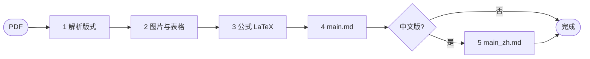

<div align="center">

# pdf-parse-x

**把学术 PDF 转成干净、可复现的 Markdown**

正文 · 章节 · 图片 · 表格 · 公式 · 参考文献，可选中文对照与浏览器预览。

[](#快速开始)
[](#测试)
[](#配置)
[](#限制)

[功能](#功能) · [快速开始](#快速开始) · [输出结构](#输出结构) · [配置](#配置) · [API](#api) · [MCP](#mcp) · [实测结果](#实测结果) · [限制](#限制)

</div>

---

`pdf-parse-x` 面向**带文本层的学术 PDF**：还原阅读顺序，提取图片、表格、公式与参考文献，输出可复现的 Markdown；可选接入任意 OpenAI 兼容视觉模型补全公式，并生成中文版。



## 功能

| 能力 | 说明 |
| --- | --- |
| **版式还原** | 双栏阅读顺序、跨页段落合并、断词处理，自动清理期刊页眉、页码与 DOI 页脚 |
| **章节结构** | 识别数字、IEEE 罗马数字/字母子章节与 `References` 等层级 |
| **图片提取** | 按 `Figure 1.` / `Fig. 1` 图注裁切，多图块自动拼接 |
| **表格重建** | 输出 Markdown、CSV、JSON 与高清截图；无可用网格时才回退截图 |
| **公式输出** | 行内公式自动重建；编号与无编号公式统一为 `$$ ... $$`，可选视觉模型转写 |
| **参考文献** | 支持 IEEE `[1]`、MDPI `1.` 与作者-年份格式，跨页续行并回同一条目 |
| **中文翻译** | 按子章节批量生成 `main_zh.md`，保留结构、公式、链接与格式 |
| **实时预览** | 服务端渲染 `main.md`：KaTeX 公式、目录、图片灯箱、表格原图、中英切换 |
| **集成接口** | REST API 与 MCP（stdio / HTTP），共用同一文档层 |

## 快速开始

**环境要求**：Node.js ≥ 20（Windows / macOS / Linux）。

```bash
git clone <repo-url>
cd pdf-parse-x
npm install
cp .env.example .env      # Windows: copy .env.example .env
```

> 模型配置是可选的。不填 `LLM_*` 时转换完全离线，公式回退为 PDF 原图裁剪。

**命令行**

```bash
npm run convert:sample                                        # 转换示例 PDF
npm run convert -- "pdfs/paper.pdf" "output/paper"            # 转换任意 PDF
npm run convert -- "pdfs/paper.pdf" "output/paper" --zh       # 同时生成中文版
npm run convert -- "pdfs/paper.pdf" "output/paper" --preview  # 额外生成静态 preview.html
```

输出目录可省略，默认使用 `output/<pdf 文件名>`。

**Web 界面**

```bash
npm start
```

- 上传与转换：<http://localhost:3000>
- 预览示例：<http://localhost:3000/preview/software-05-00038>
- 中文预览：`/preview/<id>?lang=zh`

<details>
<summary>命令行输出示例</summary>

```text
[1/5] 解析 PDF · 36 页 · 2 图 · 12 表 · 30 公式 · 101,306 字符 · 1.4s
[3/5] 公式 LaTeX · 行内 22 · 跨行 22 · 救援 2 · 缓存 30
[5/5] 生成中文版 · 162/167 段 · 337 字符 · 18.3s

✔ 转换完成 · 36 页 · 2 图 · 12 表 · 30 公式 · 覆盖 94.02% · 总耗时 2m28s
  标题: ...
  Markdown: output/paper/main.md
  中文版: output/paper/main_zh.md
  预览:   npm start 后访问 /preview/<文档 ID>（按需从 main.md 渲染）
  资源:   output/paper/figs · output/paper/tables
```

输出被重定向到文件或管道时（`> log.txt`、`| tee`），每个阶段各占一行，便于事后排查。

</details>

## 输出结构

```text
output/<document>/
├── main.md               # Markdown 正文
├── main_zh.md            # 可选：中文版
├── metadata.json         # PDF 元数据
├── report.json           # 页数、图表数量、文本覆盖率、警告
├── formulas.json         # 公式 LaTeX 与来源（可直接复用）
├── translations.json     # 可选：翻译缓存
├── figs/                 # 图片、公式原图回退、多图块分块
└── tables/               # 表格 Markdown / CSV / JSON / 截图
```

> 默认不生成 `preview.html`：网页预览由服务端按需从 `main.md` 渲染。需要静态文件时用 `--preview`。

## 配置

复制 `.env.example` 后按需修改；CLI、REST 与 MCP 都会读取项目根目录的 `.env`。

| 变量 | 默认值 | 说明 |
| --- | --- | --- |
| `LLM_BASE_URL` | — | OpenAI 兼容接口地址（`POST /chat/completions`） |
| `LLM_API_KEY` | — | API Key；本地无鉴权服务可配合 `LLM_ALLOW_NO_KEY=true` |
| `LLM_MODEL` | — | 支持图片输入的模型名 |
| `LLM_VISION` | `true` | `false` 时只发送文本层 |
| `LLM_CONCURRENCY` | `3` | 公式与翻译的并发数 |
| `LLM_MAX_IMAGES` | `0` | 单次转换的公式调用上限，`0` 表示不限 |
| `MATH_LLM_ENABLED` | `true` | 混排/跨行公式转写开关 |
| `FIGURE_LLM_ENABLED` | `false` | 坐标规则无法关联图片时由模型定位 |
| `TRANSLATE_ENABLED` | `false` | 每次转换都生成中文版；平时按需触发 |
| `PERSIST_PREVIEW` | `false` | 额外生成静态 `preview.html` |
| `MCP_HTTP_TOKEN` | — | 设置后 `/mcp` 需携带 Bearer Token |
| `PDF_PARSE_X_OUTPUT` | `output` | 文档输出目录 |

> 不填 `LLM_*` 时转换完全离线，公式回退为 PDF 原图裁剪。模型输出的 LaTeX 必须通过 KaTeX 校验。

## API

服务启动后监听 `http://localhost:3000`，完整规范可在首页下载 `openapi.json`。

| 方法 | 路径 | 说明 |
| --- | --- | --- |
| `GET` | `/api/documents` | 文档列表 |
| `POST` | `/api/documents` | 上传并转换（multipart：`pdf`，可选 `translate`） |
| `POST` | `/api/documents/sample` | 转换示例 PDF |
| `GET` | `/api/documents/:id` | 摘要、元数据、报告与资源 |
| `GET` | `/api/documents/:id/markdown` | 正文；`?lang=zh` 读取中文版 |
| `GET` | `/api/documents/:id/report` | 完整性报告 |
| `GET` | `/api/documents/:id/formulas` | 公式 LaTeX 与来源 |
| `PUT` | `/api/documents/:id/translation` | 生成或刷新中文版 |
| `DELETE` | `/api/documents/:id` | 删除文档及资源 |
| `GET` | `/preview/:id` | HTML 预览（`?lang=zh`） |
| `GET` | `/api/openapi.json` | OpenAPI 3.1 规范 |
| `POST` | `/mcp` | MCP Streamable HTTP 端点 |

```bash
curl -F "pdf=@paper.pdf" -F "translate=true" http://localhost:3000/api/documents
curl "http://localhost:3000/api/documents/<id>/markdown?lang=zh" -o main_zh.md
```

## MCP

| 方式 | 地址 / 命令 |
| --- | --- |
| stdio | `npm run mcp` |
| Streamable HTTP | `npm start` 后访问 `http://localhost:3000/mcp` |

VS Code 可直接使用仓库内的 `.vscode/mcp.json`（已含 stdio 与远程两项）。首页「接入与接口」可切换方式并复制配置或 URL。

| 工具 | 参数 | 功能 |
| --- | --- | --- |
| `convert_pdf` | `path`；可选 `translate` | 转换本地 PDF |
| `convert_sample` | 可选 `translate` | 转换示例 PDF |
| `list_documents` | — | 列出文档 |
| `get_document` | `id` | 元数据、报告与资源 |
| `read_markdown` | `id`；可选 `lang` | 读取正文 |
| `translate_document` | `id` | 生成中文版 |
| `delete_document` | `id` | 删除文档 |

资源：`pdfx://documents`、`pdfx://documents/{id}/markdown`、`markdown-zh`、`report`、`formulas`。

> `/mcp` 默认无鉴权，建议仅在可信网络使用；对外暴露时设置 `MCP_HTTP_TOKEN`。

## 实测结果

四份 PDF 的实测对比：

| PDF | 页数 | 图片 | 表格 | 公式 (LaTeX/总数) | 文本覆盖 |
| --- | ---: | ---: | ---: | ---: | ---: |
| `software-05-00038.pdf` | 22 | 6 | 8 | 9/9（sidecar） | 99.89% |
| `s10844-026-01076-1.pdf` | 36 | 2 | 12 | 30/30（模型） | 94.02% |
| `2102.08942v1.pdf` | 23 | 0 | 0 | 0/0 | 99.89% |
| `2312.10997v5.pdf` | 21 | 6 | 4 | 0/0 | 99.47% |

- `software-05-00038.pdf`：MDPI 模板，9 个编号公式由 sidecar 提供 LaTeX，8 张表格置信度全部为 `1.0`。
- `s10844-026-01076-1.pdf`：Springer 期刊，30 个公式（17 个带编号 + 13 个无编号）全部由视觉模型重建；12 张表中 3 张重建为 Markdown，其余 9 张无完整框线，保留截图。
- `2102.08942v1.pdf`：单栏纯文字综述，图表与编号公式均为 0，字符按页统计确认没有整页图形区域。
- `2312.10997v5.pdf`：IEEE 双栏模板，罗马数字章节、字母子章节、`TABLE III` 标题与 `Fig. 1.` 图注均正确识别；4 张表中 Table IV 重建为 Markdown，其余（含稀疏打勾矩阵 TABLE III）只保留截图。
- 覆盖率缺口主要来自图注排版差异（例如 `Fig. 1.` 在 Markdown 中规范为 `Figure 1.`）以及插图内部的文字。

## 实现要点

- **版式**：文本项按基线聚合成行，依据缩进与行距重建段落；双栏页面先找装订线，再按左栏 → 右栏插入标题、图注和表格。
- **表格**：从 PDF 矢量线条定位表格区域，用表头分隔线与列中心分配单元格；只有重建不出可用网格时才回退截图。
- **图片**：按图注裁切内嵌位图；同一图注下的多个图块自动拼接；矢量插图按空白间隔估算区域。
- **公式**：行内公式由字号/基线几何重建；编号与无编号公式统一输出 `$$ ... $$`，模型结果必须通过 KaTeX 校验，失败则回退原图。
- **翻译**：同一子章节一次请求，逐条对位校验；不合格项先统一修复再逐条兜底；结果缓存到 `translations.json`。

## 测试

```bash
npm test
```

107 项测试全部通过，覆盖版式识别、图表定位、公式处理、翻译、预览、REST、OpenAPI 与 MCP。

## 限制

- 仅支持**带文本层的 PDF**；扫描件需先 OCR。
- 旋转页面、跨页表格、复杂合并单元格与复杂公式排版可能需要人工核对，表格原图会一并保留。
- 未配置模型时公式回退为 PDF 原图裁剪，不会输出可能错误的 LaTeX。
- 单文件上传上限 100 MB。

## 技术栈

Node.js 20+ · `pdf-parse` · `pdfjs-dist` · `sharp` · `express` + `multer` · `marked` + `sanitize-html` · `katex` · `@modelcontextprotocol/sdk`
