<!-- page: 1 -->

# Correspondence analysis and PMI-based word embeddings: a comparative study

Qianqian Qi1,2 · Robert A. Bagheri2 · David J. Hessen2 · Peter G. M. van der Heijden2,3

> **Received:** 10 March 2026 / Revised: 9 July 2026 / Accepted: 9 July 2026 /  
> **Published online:** 23 July 2026  
> © The Author(s) 2026, modified publication 2026

## Abstract

Popular word embedding methods such as GloVe and Word2Vec are related to the factorization of the pointwise mutual information (PMI) matrix. In this paper, we establish a formal connection between correspondence analysis (CA) and PMI-based word embedding methods. CA is a dimensionality reduction method that uses singular value decomposition (SVD), and we show that CA is mathematically close to the weighted factorization of the PMI matrix. We further introduce variants of CA for word-context matrices, namely CA applied after a square-root transformation (ROOT-CA) and after a fourth-root transformation (ROOTROOT-CA). We analyze the performance of these methods and examine how their success or failure is influenced by extreme values in the decomposed matrix. Although our primary focus is on traditional static word embedding methods, we also include a comparison with a transformer-based encoder (BERT) to situate the results relative to contextual embeddings. Empirical evaluations across multiple corpora and word-similarity benchmarks show that ROOT-CA and ROOTROOT-CA sometimes perform slightly better than standard PMI-based methods and BERT. Experimental results on text classification for the BBCNews dataset show that ROOTROOT-CA and ROOT-CA outperform other methods under certain experimental settings.

**Keywords:** Correspondence analysis · Natural language processing · Word embedding · Pointwise mutual information · Embedding evaluation

## 1 Introduction

Word embeddings, i.e., dense and low dimensional word representations, are useful in various natural language processing (NLP) tasks (Jurafsky & Martin, 2023; MohammadiBaghmolaei & Ahmadi, 2023; Johnson et al., 2024; Zhang et al., 2025; Orebi & Naser, 2025; Ravenda et al., 2025). Three successful methods to derive such word representations are related to the factorization of the pointwise mutual information (PMI) matrix, an important matrix in NLP (Egleston et al., 2021; Bae et al., 2021; Alqahtani & Al-Twairesh, 2023; Toprak & Toprak, 2025). A word-context matrix is a matrix with counts, in which the rows and columns are labeled by terms and each entry records the number of co-occurrences between a target (row) word and a context (column) word in a text (Jurafsky & Martin, 2023). Let X denote a word-context matrix with elements $x_{ij}$, where i = 1, 2, · · ·, I and

<!-- page: 2 -->

∑ ∑ j = 1, 2, · · ·, J. The joint observed proportion is $p_{ij}$ = $x_{ij}$ $/x_{++}$ with $x_{++}$ =i j $x_{ij}$

∑ , and the marginal proportions of target word i and context word j are $p_{i+}$ =j $p_{ij}$ and

∑ $p_{+j}$ =i $p_{ij}$, respectively. The PMI matrix measures how often two words, a target word and a context word, co-occur, compared with what we would expect if the two words were independent, and is defined as:

$$
\mathrm{PMI}(i, j) = \log \frac{p_{ij}}{p_{i+} p_{+j}}. \tag{1}
$$

If $p_{ij}$ = 0, then PMI(i, j) = log 0 = −∞, and it is usual to set PMI(i, j) = 0 in this situation (Levy & Goldberg, 2014).

In practice, a positive PMI (PPMI) transformation is often used, where negative values are set to zero (Bullinaria & Levy, 2007; Turney & Pantel, 2010; Levy & Goldberg, 2014; Salle et al., 2016; Zhang et al., 2022; Alqahtani & Al-Twairesh, 2023; Toprak & Toprak, 2025), i.e.,

$$
\mathrm{PPMI}(i, j)=\max \left( \mathrm{PMI}(i, j), 0 \right), \tag{2}
$$

The reason that one uses PPMI instead of PMI includes the following (Levy & Goldberg, 2014). First, one often focuses on positive relations (similarity) rather than negative relations (dissimilarity). Second, in the PMI matrix, if the $p_{ij}$ = 0, then PMI(i, j) = 0. However, when 0 $&lt;p_{ij}$ $&lt;p_{i+}$ $p_{+j}$, then the PMI(i, j) would be negative. Thus, the PMI(i, j) is not monotonous of observed counts divided by counts under independence. Third, by setting negative values to 0, the resulting PPMI is more sparse than the PMI matrix. Fourth, PPMI generally leads to a better performance in semantic tasks.

The first method, PPMI-SVD, decomposes the PPMI matrix with a singular value decomposition (SVD) (Levy & Goldberg, 2014; Levy et al., 2015; Stratos et al., 2015; Zhang et al., 2022; Kiyama et al., 2025). The second one is GloVe (Pennington et al., 2014). GloVe factorizes the logarithm of the word-context matrix with an adaptive gradient algorithm (AdaGrad) (Duchi et al., 2011). According to Shi and Liu (2014); Shazeer et al. (2016), GloVe is almost equivalent to factorizing a PMI matrix shifted by the logarithm of the sum of the elements of a word-context matrix. The third method is Word2Vec’s skip-gram with negative sampling (SGNS) (Mikolov et al., 2013a, b). SGNS uses a neural network model to generate word embeddings. Levy and Goldberg (2014) proved that SGNS implicitly factorizes a PMI matrix shifted by the logarithm of the number of negative samples in SGNS.

In this paper we study what correspondence analysis (CA) (Greenacre, 2017; Beh & Lombardo, 2021; Fačevicová et al., 2025; Handan-Nader, 2026) has to offer for the analysis of word-context co-occurrence matrices. CA is an exploratory statistical method that is often used for visualization of a low dimensional approximation of a matrix. It is close to the T-test (TTEST) weighting scheme (Curran & Moens, 2002; Curran, 2004), where standardized residuals are studied, as CA is based on the SVD of the matrix of standardized residuals. In the context of document-term matrices, CA has been compared earlier with latent semantic analysis (LSA), where the document-term matrix is also decomposed with an SVD (Dumais et al., 1988; Deerwester et al., 1990). Although CA is similar to LSA, there

1 3 is theoretical and empirical research showing that CA is preferable to LSA for text categorization and information retrieval (Qi et al., 2024a, b).

<!-- page: 3 -->

A document-term matrix has some similarity to a word-context matrix, as they both use counts, and, as mentioned above, the PMI matrix is a weighted version of the word-context matrix. In this paper, mathematically, we show that CA is close to a weighted factorization of the PMI matrix. We also propose a direct weighted factorization of the PMI matrix (PMI- GSVD). We further compare the performance of CA with the performance of PMI-based methods on word similarity tasks and a text classification task, and analyze their success and failure in terms of extreme values in the decomposed matrices.

In the context of CA, Nishisato et al. (2021) point out, generally speaking, a two-way contingency table is prone to overdispersion, which may negatively affect the performance of CA (Beh et al., 2018; Nishisato et al., 2021). To deal with this overdispersion, a fourth-root transformation is commonly used (Field et al., 1982; Greenacre, 2009, 2010). A word-context matrix can be taken as a two-way contingency table. Accordingly, in addition to applying CA to the raw word-context matrix, CA is also applied to its fourth-root transformation (ROOTROOT-CA). The square-root transformation, which helps stabilize the variance of Poisson-distributed counts, can also be beneficial for word–context matrices (Stratos et al., 2015); we therefore apply CA to the square-root transformation matrix (ROOT-CA) as well, an approach previously explored in biology (Hsu & Culhane, 2023). We further compare them with ROOT-CCA, proposed by Stratos et al. (2015), which is similar to ROOT-CA. Importantly, ROOT-CA and ROOTROOT-CA represent CA variants that have not yet been explored in the NLP context.

Transformer-based encoders, such as BERT, are currently popular approach in NLP (Devlin et al., 2019; Khan et al., 2025). While transformer-based encoders are powerful for contextual embeddings, they often struggle with tasks which are related to single word embeddings. For example, Aida et al. (2021) shows PMI-based methods are better than BERT in the measuring semantic differences. This paper focuses on traditional PMI-based word embedding methods. To enhance the contribution of this paper, we also incorporate comparison of BERT with these traditional methods.

Considering the foregoing, this study focuses on word embeddings in NLP. First, we investigate the relationship between CA and PMI-based methods and compare their performance on word similarity and text classification tasks. Second, we introduce two variants of CA, namely ROOT-CA and ROOTROOT-CA, which have not previously been explored in the NLP literature. Third, we analyze the success and failure of these methods in terms of extreme values in the matrix before SVD, thereby providing insights into how to improve SVD-based methods. Additionally, we compare the performance of TTEST, PMI, PPMI, WPMI, ROOT-TTEST, ROOTROOT-TTEST, and STRATOS-TTEST, where SVD has not yet been applied.

In Section 2, CA, the three variants of CA, and the T-Test weighting scheme are introduced. The three PMI-based methods (PPMI-SVD, GloVe, and SGNS) and BERT are described in Section 3. Theoretical relationships between CA and the PMI-based methods as well as BERT are shown in Section 4, where PMI-GSVD is also introduced. In Section 5 we present three corpora to build word vectors and four word similarity datasets to evaluate word vectors. Section 6 illustrates the setup of the empirical study using these three corpora. Section 7 presents the results for these methods on word similarity tasks and analyzes the reason of these methods’performance in terms of extreme values. Section 8 presents experi- 1 3 ments on text classification for BBCNews dataset. Section 9 and Section 10 discuss and conclude this paper, respectively.

<!-- page: 4 -->

## 2 Correspondence analysis

In this section, first we describe correspondence analysis (CA) using a distance interpretation (Benzécri, 1973; Greenacre & Hastie, 1987), which is a popular way to present CA. Then we present CA making use of an objective function, thus making the later comparison with PMI-based methods straightforward. Third, we present three variants of CA in word embedding. Finally, the T-Test weighting scheme (Curran & Moens, 2002; Curran, 2004) is described, as it turns out to be remarkably similar to CA.

### 2.1 Introduction to CA

CA is an exploratory method for the analysis of two-way contingency tables. It allows to study how the counts in the contingency table depart from statistical independence. Here we introduce CA in the context of the word-context matrix X, the same notation as in Section 1 Introduction, where rows represent target words and columns represent context words. In CA of the matrix X, first the elements $x_{ij}$ are converted to joint observed proportions

∑ ∑ $p_{ij}$ = $x_{ij}$ /i j $x_{ij}$, and these are transformed into standardized residuals (Greenacre, 2017)

$$
\frac{p_{ij} - p_{i+p+j}}{\sqrt{p_{i+p+j}}}, \tag{3}
$$

∑ ∑ where $p_{i+}$ =j $p_{ij}$ and $p_{+j}$ =i $p_{ij}$ are the marginal proportions of target word i and context word j, respectively. Then an SVD is applied to this matrix of standardized residuals, yielding

$$
\frac{p_{ij}-p_{i+p+j}}{\sqrt{p_{i+p+j}}}=\sum_{k=1}^{\min(I-1,\,J-1)}\sigma_{k}u_{ik}v_{jk}, \tag{4}
$$

where $\sigma_{k}$ is the kth singular value, with singular values in the decreasing order, and [ $u_{1k}$ $,u_{2k}$, · · · $,u_{Ik}$ ]T and [ $v_{1k}$ $,v_{2k}$, · · · $,v_{Jk}$ ]T are the kth left and right singular vectors, respectively. When X has full rank, the maximum dimensionality is min (I − 1, J − 1), where the′′ − 1′′ is due to the subtraction of elements $p_{i+}$ $p_{+j}$, that leads to a centering of

∑ ∑ the elements of X asi( $p_{ij}$ − $p_{i+}$ $p_{+j}$ ) = 0 =j( $p_{ij}$ − $p_{i+}$ $p_{+j}$ ). Multiplying the singular vectors consisting of elements $u_{ik}$ and $v_{jk}$ by $p_{i+}$ and $p_{+j}$, respectively, leads to

$$
\frac{p_{ij}}{p_{i+}+p_{+j}}-1=\sum_{k=1}^{\min(I-1,\,J-1)}\sigma_k\phi_{ik}\gamma_{jk}, \tag{5}
$$

where $\varphi_{ik}$ = $p_{i+}$ $u_{ik}$ and $\gamma_{jk}$ = $p_{+j}$ $v_{jk}$. Scores $\varphi_{ik}$, k = 1, 2, · · ·, K and $\gamma_{jk}$, k = 1, 2, · · ·, K provide the standard coordinates of row point i and column point

1 3

<!-- page: 5 -->

∑ ∑ j in K-dimensional space, respectively, because ofi $p_{i+}$ $\varphi_{ik}$ =j $p_{+j}$ $\gamma_{jk}$ = 0 and ∑ ∑

2 2 i $p_{i+}$ $\varphi_{ik}$ =j $p_{+j}$ $\gamma_{jk}$ = 1. Scores $\varphi_{ik}$ $\sigma_{k}$, k = 1, 2, · · ·, K and $\gamma_{jk}$ $\sigma_{k}$, k = 1, 2, · · ·, K provide the principle coordinates of row point i and column point j in K-dimensional space, respectively. When K &lt; min(I − 1, J − 1), the Euclidean distances between these row (column) points approximate so-called $\chi^{2}$ -distances between rows (columns) of X. The squared $\chi^{2}$ -distance between rows i and $i^{'}$ of X is

$$
\delta_{ii'}^{2}=\sum_{j}\frac{\left(\frac{p_{i j}}{p_{i+}}-\frac{p_{i^{\prime} j}}{p_{i^{\prime}+}}\right)^{2}}{p_{+j}}, \tag{6}
$$

and similarly for the chi-squared distance between columns j and $j^{'}$. (6) shows that the $\chi^{2}$ −distance $\delta_{ii}$ ′ measures the difference between the ith vector of conditional proportions $p_{ij}$ $/p_{i+}$ and the $i^{'}$ th vector of conditional proportions $p_{i}$ $_{'}j$ $/p_{i}$ $_{'}+$, where more weight is given to the differences in elements j if $p_{+j}$ is relatively smaller compared to other columns.

Although the use of Euclidean distance is standard in CA, Qi et al. (2024b) show that for information retrieval cosine similarity leads to the best performance among Euclidean distance, dot similarity, and cosine similarity. The superiority of cosine similarity also holds in the context of word embedding studies (Bullinaria & Levy, 2007). Therefore, in this paper we use cosine similarity to calculate the similarity of row points and of column points. It is

− $1_{2}$ − $1_{2}$ − $1_{2}$ − $1_{2}$ worth noting that $p_{i+}$ in $\varphi_{ik}$ = $p_{i+}$ $u_{ik}$ and $p_{+j}$ in $\gamma_{jk}$ = $p_{+j}$ $v_{jk}$ have no effects on the cosine similarity. This is because for row points i and $i^{'}$, with coordinates $\sigma_{k}$ $\varphi_{ik}$ and $\sigma_{k}$ $\varphi_{i}$ $_{'}k$ on dimension k in K−dimensional space, we have

∑K $k=1$ ( $\varphi_{ik}$ $\sigma_{k}$ ) ( $\varphi_{i}$ $_{'}k$ $\sigma_{k}$ ) cosine( $row_{i}$, $row_{i}$ ′) = √ ∑K 2 ∑K 2 $k=1$ ( $\varphi_{ik}$ $\sigma_{k}$ ) · $k=1$ ( $\varphi_{i}$ $_{'}k$ $\sigma_{k}$ ) ∑K ( $-_{1}$ ) ( $-_{1}$ ) 2 2 ′ $k=1$ $p_{i+}$ $u_{ik}$ $\sigma_{k}$ $p_{i'+}$ $u_{ik}$ $\sigma_{k}$ = √ ∑K ( $-_{1}$ )2 ∑ ( $-_{1}$ )2 2 K $2_{'}$ $k=1$ $p_{i+}$ $u_{ik}$ $\sigma_{k}$ · $k=1$ $p_{i'+}$ $u_{ik}$ $\sigma_{k}$ ∑K $k=1$ ( $u_{ik}$ $\sigma_{k}$ ) ( $u_{i}$ $_{'}k$ $\sigma_{k}$ ) = √, ∑K 2 ∑K 2 $k=1$ ( $u_{ik}$ $\sigma_{k}$ ) · $k=1$ ( $u_{i}$ $_{'}k$ $\sigma_{k}$ )

− $1_{2}$ so the terms $p_{i+}$ drop out of the equation. A similar result is found for column points. We coin scores $u_{ik}$ $\sigma_{k}$, k = 1, 2, · · ·, K and $v_{jk}$ $\sigma_{k}$, k = 1, 2, · · ·, K an alternative coordinates system for CA directly suited for cosine similarity.

The so-called total inertia is

∑ ∑ (p $_{2} min(I$ ∑−1,J−1) $ij$ − $p_{i+}$ $p_{+j}$ )2 = $\sigma_{k}$. $p_{i+}$ $p_{+j}$ i j k=1

This illustrates that CA decomposes the total inertia over min (I − 1, J − 1) dimensions. The total inertia equals the well-known Pearson $\chi^{2}$ statistic divided by $x_{++}$, so that the total

1 3 inertia does not depend on the sample size $x_{++}$. The relative contribution of cell (i, j) to the

<!-- page: 6 -->

2 ∑ ∑2 ( $p_{ij}$ − $p_{i+}$ $p_{+j}$ ) ( $p_{ij}$ − $p_{i+}$ $p_{+j}$ ) total inertia is calculated asp /. The relative contribution

$i+$ $p_{+j}$ i j $p_{i+}$ $p_{+j}$ of the ith row (jth column) to the kth dimension is calculated as $u_{ik}^{2}$ ( $v_{jk}^{2}$ ).

### 2.2 The objective function of CA

To simplify the later comparison of CA with the other models, we present the objective function that is minimized in CA. The objective function is (Greenacre 1984, pp. 345-349):

$$
\sum_{i,j} p_i + p_j \left( \frac{p_{ij}}{p_i + p_j} - 1 - e_i^{\mathrm{T}} o_j \right)^2 , \tag{7}
$$

where $e_{i}$ and $o_{j}$ are parameter vectors for target word i and context word j, with respect to which the objective function is minimized. The vectors have length K ≤ min (I − 1, J − 1) . We call the part of the formula to be approximated, i.e. ( $p_{ij}$ $/p_{i+}$ $p_{+j}$ − 1), the fitting function and the weighting part $p_{i+}$ $p_{+j}$ the weighting function. Thus, according to (7), CA can be viewed as a weighted matrix factorization of ( $p_{ij}$ $/p_{i+}$ $p_{+j}$ − 1) with weighting function $p_{i+}$ $p_{+j}$.

The solution is found using the SVD as in (5). The K-dimensional approximation of ( $p_{ij}$ $/p_{i+}$ $p_{+j}$ − 1) is

K $p_{ij}$ ∑T − 1 ≈ $\sigma_{k}$ $\varphi_{ik}$ $\gamma_{jk}$ = $e_{i}$ $o_{j}$. $p_{i+}$ $p_{+j}$ k=1

The matrix [ $e_{i}^{T}$ $o_{j}$ ] minimizes (7) amongst all matrices of rank K in a weighted least-squares sense (Greenacre, 1984). The parameter vectors $e_{i}$ and $o_{j}$ can be represented, for example, as

T $e_{i}$ = [ $\varphi_{i1}$ $\sigma_{1}$ $, \varphi_{i2}$ $\sigma_{2}$, · · · $, \varphi_{iK}$ $\sigma_{K}$ ] and

T $o_{j}$ = [ $\gamma_{j1}$ $, \gamma_{j2}$, · · · $, \gamma_{jK}$ ]

As described above, this representation $e_{i}$ of target word i has the advantage that the $\chi^{2}$ -distance between target words i and $i^{'}$ in the original matrix is approximated by the Euclidean distance between $e_{i}$ and $e_{i}$ ′.

The parameters $e_{i}$ can be adjusted by a singular value weighting exponent p, i.e., p p p T $e_{i}$ = [ $\varphi_{i1}$ $\sigma_{1}$ $, \varphi_{i2}$ $\sigma_{2}$, · · · $, \varphi_{iK}$ $\sigma_{K}$ ]. Correspondingly, the alternative coordinate for the p p p T adjusted row i by a singular value weighting exponent is [ $u_{i1}$ $\sigma_{1}$ $,u_{i2}$ $\sigma_{2}$, · · · $,u_{iK}$ $\sigma_{K}$ ].

1 3

<!-- page: 7 -->

### 2.3 Three variants of CA for word embeddings

We present three variants of CA: ROOT-CCA, ROOT-CA, and ROOTROOT-CA, where ROOT-CA and ROOTROOT-CA are new to NLP and ROOT-CCA was introduced to NLP by Stratos et al. (2015). According to Stratos et al. (2015), word counts can be naturally modeled as Poisson variables. The square-root transformation of a Poisson variable leads to stabilization of the variance (Bartlett, 1936; Stratos et al., 2015). Stratos et al. (2015) proposed to combine canonical correlation analysis (CCA) with the square-root transformation of the word-context matrix. Even though CA of a contingency table is equivalent to CCA of the data in the form of an indicator matrix, we call the proposal by Stratos et al. (2015) ROOT-CCA, to distinguish it from ROOT-CA, discussed later.

ROOT-CCA In ROOT-CCA, an SVD is performed on the matrix whose typical element is the square root of $x_{ij}$ / $x_{i+}$ $x_{+j}$ = $p_{ij}$ / $p_{i+}$ $p_{+j}$, that is

$$
\sqrt{\frac{p_{ij}}{\sqrt{p_{i+}+p_{+j}}}}=\sum_{k=1}^{\min(I,J)}\sigma_k u_{ik}v_{jk}. \tag{8}
$$

where $p_{ij}$ = $x_{ij}$ / $ij$ $x_{ij}$, $p_{i+}$ =j $p_{ij}$, and $p_{+j}$ =i $p_{ij}$; $\sigma_{k}$ is the kth singular value of the matrix with elements $p_{ij}$ / $p_{i+}$ $p_{+j}$, with singular values in the decreasing order, and [ $u_{1k}$ $,u_{2k}$, · · · $,u_{Ik}$ ]T and [ $v_{1k}$ $,v_{2k}$, · · · $,v_{Jk}$ ]T are the kth left and right singular vectors, respectively. The reason that Stratos et al. (2015) ignore $p_{i+}$ $p_{+j}$ in $p_{ij}$ − $p_{i+}$ $p_{+j}$ (compare

√ (4)) is that they believe that, when the sample size $x_{++}$ is large, the first part $p_{ij}$ / ( $p_{i+}$ $p_{+j}$ )

√ in ( $p_{ij}$ − $p_{i+}$ $p_{+j}$ )/ ( $p_{i+}$ $p_{+j}$ ) dominates the expression.

ROOT-CA Inspired by Stratos et al. (2015), we present CA of the square-root transformation of the word-context matrix (ROOT-CA) (Bartlett, 1936; Hsu & Culhane, 2023). ROOT-CA differs from ROOT-CCA in the following way. In the ROOT-CA, first we create a square- √ root transformation of the word-context matrix with elements $x_{ij}$, and then we perform

√ ∑ √ √ ∑ √ CA on this matrix. Let $p_{ij}^{\text{∗}}$ = $x_{ij}$ / $ij$ $x_{ij}$ = $p_{ij}$ / $ij$ $p_{ij}$. Then ROOT-CA provides the decomposition

$$
\frac{p_{ij}^* - p_{i\cdot}^* p_{\cdot j}^*}{\sqrt{p_{i\cdot}^* p_{\cdot j}^*}} = \sum_{k=1}^{\min(I-1, J-1)} \sigma_k u_{ik} v_{jk} \tag{9}
$$

where $p_{i+}^{\text{∗}}$ =j $p_{ij}^{\text{∗}}$ and $p_{+j}^{\text{∗}}$ =i $p_{ij}^{\text{∗}}$; $\sigma_{k}$ is the kth singular value of the matrix with elements ( $p_{ij}^{\text{∗}}$ − $p_{i+}^{\text{∗}}$ $p_{+j}^{\text{∗}}$ )/ $p_{i+}^{\text{∗}}$ $p_{+j}^{\text{∗}}$, with singular values in the decreasing order, and [ $u_{1k}$ $,u_{2k}$, · · · $,u_{Ik}$ ]T and [ $v_{1k}$ $,v_{2k}$, · · · $,v_{Jk}$ ]T are the kth left and right singular vectors, respectively.

ROOTROOT-CA According to Stratos et al. (2015), word counts can be naturally modeled as Poisson variables. In the Poisson distribution the mean and variance are identical. The phenomenon of the data having greater variability than expected based on a statistical model is

1 3 called overdispersion (Agresti, 2007). In the context of CA, Nishisato et al. (2021) point out, generally speaking, a two-way contingency table is prone to overdispersion. Overdispersion may negatively affect the performance of CA (Beh et al., 2018; Nishisato et al., 2021).

<!-- page: 8 -->

Greenacre (2009, 2010), referring to Field et al. (1982), points out that in ecology abundance data is almost always highly over-dispersed and a particular school of ecologists routinely applies a fourth-root transformation before proceeding with the statistical analysis. Therefore we also study the effect of a root-root transformation before performing CA. We call it ROOTROOT-CA. That is, ROOTROOT-CA is a CA on the matrix with typical element √√ √√ ∑ √√ √√ ∑ √√

$x_{ij}$ (Field et al., 1982). Suppose $p_{ij}^{\text{∗}\text{∗}}$ = $x_{ij}$ / $ij$ $x_{ij}$ = $p_{ij}$ / $ij$ $p_{ij}$

. Then, we have

$$
\frac{p_{ij}^{**} - p_{i+}^{**} p_{+j}^{**}}{\sqrt{p_{i+}^{**} p_{+j}^{**}}} = \sum_{k=1}^{\min(I-1,J-1)} \sigma_k u_{ik} v_{jk} \tag{10}
$$

where $p_{i+}^{\text{∗}\text{∗}}$ =j $p_{ij}^{\text{∗}\text{∗}}$ and $p_{+j}^{\text{∗}\text{∗}}$ =i $p_{ij}^{\text{∗}\text{∗}}$; $\sigma_{k}$ is the kth singular value of the matrix with elements ( $p_{ij}^{\text{∗}\text{∗}}$ − $p_{i+}^{\text{∗}\text{∗}}$ $p_{+j}^{\text{∗}\text{∗}}$ )/ $p_{i+}^{\text{∗}\text{∗}}$ $p_{+j}^{\text{∗}\text{∗}}$, with singular values in the decreasing order, and [ $u_{1k}$ $,u_{2k}$, · · · $,u_{Ik}$ ]T and [ $v_{1k}$ $,v_{2k}$, · · · $,v_{Jk}$ ]T are the kth left and right singular vectors, respectively. Thus ROOT-CA and ROOTROOT-CA are pre-transformations of the elements

√ √√ $x_{ij}$ of the original matrix by $x_{ij}$ and $x_{ij}$, respectively. CA is performed on the transformed matrix.

### 2.4 T-Test

The T-Test (TTEST) weighting scheme, described by Curran and Moens (2002) and Curran (2004), focuses on the matrix of standardized residuals, see (3). Thus it is remarkably similar to CA, where the matrix of standardized residuals is decomposed. For a comparison between CA and TTEST weighting in word similarity tasks, as we will carry out below, the question is whether the performance is better on the matrix of standardized residuals, or on a low dimensional representation of this matrix provided by CA.

Inspired by Section 2.3, we also explore the performances of the matrix STRATOS- √ √ TTEST with typical element $p_{ij}$ / $p_{i+}$ $p_{+j}$ (compare (8)), the matrix ROOT-TTEST with

() √ typical element $p_{ij}^{\text{∗}}$ − $p_{i+}^{\text{∗}}$ $p_{+j}^{\text{∗}}$ / $p_{i+}^{\text{∗}}$ $p_{+j}^{\text{∗}}$ (compare (9)), and the matrix ROOTROOT- () √ TTEST with typical element $p_{ij}^{\text{∗}\text{∗}}$ − $p_{i+}^{\text{∗}\text{∗}}$ $p_{+j}^{\text{∗}\text{∗}}$ / $p_{i+}^{\text{∗}\text{∗}}$ $p_{+j}^{\text{∗}\text{∗}}$ (compare (10)).

## 3 PMI-based word embedding methods and BERT

### 3.1 PMI-SVD and PPMI-SVD

Pointwise mutual information (PMI) is an important concept in NLP. As mentioned before in Section 1 Introduction, the PMI between a target word i and a context word j is defined as

1 3

<!-- page: 9 -->

(Egleston et al., 2021; Bae et al., 2021; Alqahtani & Al-Twairesh, 2023; Jurafsky & Martin, 2023; Toprak & Toprak, 2025):

$p_{ij}$ PMI(i, j) = log $p_{i+}$ $p_{+j}$ ∑ ∑ ∑ where $p_{ij}$ = $x_{ij}$ / $ij$ $x_{ij}$, $p_{i+}$ =j $p_{ij}$, and $p_{+j}$ =i $p_{ij}$. That is, the log of the contingency ratios (Greenacre, 2009, 2017), also known as Pearson ratios (Goodman, 1996; Beh & Lombardo, 2021), $p_{ij}$ / ( $p_{i+}$ $p_{+j}$ ). If $p_{ij}$ = 0, it is usual to set PMI(i, j) = 0 (Levy & Goldberg, 2014).

A common approach is to factorize the PMI matrix using SVD, which we call PMI-SVD. Thus the objective function is

$$
\sum_{i,j}\left(\log\frac{p_{ij}}{p_i+p_j}-\boldsymbol{e}_i^{T}\boldsymbol{o}_j\right)^{2}. \tag{11}
$$

In terms of a weighted matrix factorization, PMI-SVD is the matrix factorization of the PMI matrix with the weighting function 1. The solution is provided directly via SVD. An SVD applied to the PMI matrix with elements log ( $p_{ij}$ / ( $p_{i+}$ $p_{+j}$ )) yields min(I,J) $p_{ij}$ ∑ log = $\sigma_{k}$ $u_{ik}$ $v_{jk}$, $p_{i+}$ $p_{+j}$ k=1 where min(I, J) is the rank of the PMI matrix; $\sigma_{k}$ is the kth singular value of the matrix with elements log ( $p_{ij}$ $/p_{i+}$ $p_{+j}$ ), with singular values in the decreasing order, and [ $u_{1k}$ $,u_{2k}$, · · · $,u_{Ik}$ ]T and [ $v_{1k}$ $,v_{2k}$, · · · $,v_{Jk}$ ]T are the kth left and right singular vectors, respectively. The K-dimensional approximation of log ( $p_{ij}$ / ( $p_{i+}$ $p_{+j}$ )) is

K $p_{ij}$ ∑T log ≈ $\sigma_{k}$ $u_{ik}$ $v_{jk}$ = $e_{i}$ $o_{j}$ $p_{i+}$ $p_{+j}$ k=1 where the matrix with elements $e_{i}^{T}$ $o_{j}$ minimizes (11) amongst all matrices of rank K in a least squares sense, where K ≤ min(I, J). Both CA and PMI-SVD are dimensionality reduction techniques making use of SVD.

The parameters $e_{i}$ and $o_{j}$ can be represented as

T $e_{i}$ = [ $u_{i1}$ $\sigma_{1}$ $,u_{i2}$ $\sigma_{2}$, · · · $,u_{iK}$ $\sigma_{K}$ ] and

T $o_{j}$ = [ $v_{j1}$ $,v_{j2}$, · · · $,v_{jK}$ ].

Thus the Euclidean distance between target words i and $i^{'}$ in the original matrix is approximated by the Euclidean distance between $e_{i}$ and $e_{i}$ ′. In practice, one regularly sees that the

1 3 parameters $e_{i}$ are adjusted by an exponent p used for weighting the singular values, i.e., p p p T $e_{i}$ = [ $u_{i1}$ $\sigma_{1}$ $,u_{i2}$ $\sigma_{2}$, · · · $,u_{iK}$ $\sigma_{K}$ ], where p is usually set to 0 or 0.5 (Levy & Goldberg, 2014; Levy et al., 2015; Stratos et al., 2015).

<!-- page: 10 -->

As we mentioned in Section 1 Introduction, in the PPMI matrix all negative values are set to 0:

PPMI(i, j) = max (PMI(i, j), 0)

In most applications, one makes use of the PPMI matrix instead of the PMI matrix (Salle et al., 2016). We call the factorization of the PPMI matrix using SVD PPMI-SVD (Zhang et al., 2022).

### 3.2 GloVe

The GloVe objective function to be minimized is Pennington et al. (2014):

$$
\begin{aligned}
&\sum_{i,j} f(x_{ij}) \left( \log x_{ij} - b_i - s_j - e_i^T o_j \right)^2 \\
&f(x_{ij}) = \begin{cases} (x_{ij}/x_{\max})^{\alpha} & \text{if } x_{ij} < x_{\max} \\ 1 & \text{otherwise} \end{cases}
\end{aligned} \tag{12}
$$

where

In addition to parameter vectors $e_{i}$ and $o_{j}$, the scalar parameter terms $b_{i}$ and $s_{j}$ are referred to as bias of target word i and context word j, respectively. Pennington et al. (2014) train the GloVe model using an adaptive gradient algorithm (AdaGrad) (Duchi et al., 2011). This algorithm trains only on the non-zero elements of a word-context matrix, as f(0) = 0, which avoids the appearance of the undefined log 0 in (12).

In the original proposal of GloVe (Pennington et al.,2014), $b_{i}$ = log $x_{i+}$ and then, due to the symmetric role of target word and context word, $s_{j}$ = log $x_{+j}$. Shi and Liu (2014) and Shazeer et al. (2016) show that the bias terms $b_{i}$ and $s_{j}$ are highly correlated with log $x_{i+}$ and log $x_{+j}$, respectively, in GloVe model training. This means that the GloVe model minimizes a weighted least squares loss function with the weighting function f( $x_{ij}$ ) and approximate fitting function log $x_{ij}$ − log $x_{i+}$ − log $x_{+j}$ = log ( $x_{ij}$ $x_{++}$ / ( $x_{i+}$ $x_{+j}$ )) − log $x_{++}$ = log ( $p_{ij}$ / ( $p_{i+}$ $p_{+j}$ )) − log $x_{++}$ :

$$
\sum_{i,j} f(x_{ij}) \left( \log \frac{p_{ij}}{p_{i+}p_{+j}} - \log x_{++} - e_i^{T} o_j \right)^{2} \tag{13}
$$

### 3.3 Skip-gram with negative sampling

SGNS stands for skip-gram with negative sampling of word2vec embeddings (Mikolov et al., 2013a, b). The algorithms used in SGNS are stochastic gradient descent and backpropa- 1 3 gation (Rumelhart et al., 1986; Rong, 2014). SGNS trains word embeddings on every word of the corpus one by one.

<!-- page: 11 -->

Levy and Goldberg (2014) showed that SGNS implicitly factorizes a PMI matrix shifted by log n:

$p_{ijT}$ log − log n ≈ $e_{i}$ $o_{j}$ $p_{i+}$ $p_{+j}$ where n is the number of negative samples. According to Levy and Goldberg (2014) and Shazeer et al. (2016), the objective function of SGNS is approximately a minimization of the difference between $e_{i}^{T}$ $o_{j}$ and log ( $p_{ij}$ / ( $p_{i+}$ $p_{+j}$ )) − log n, tempered by a monotonically increasing weighting function of the observed co-occurrence count $x_{ij}$, that we denote by g( $x_{ij}$ ):

$$
\sum_{i,j} g(x_{ij}) \left( \log \frac{p_{ij}}{p_i+p_j} - \log n - \mathbf{e}_i^T \mathbf{o}_j \right)^2 \tag{14}
$$

This demonstrates that the approximation of the SGNS objective in (14) differs from that of GloVe in (13) in the use of n instead of $x_{++}$ and g( $x_{ij}$ ) instead of f( $x_{ij}$ ).

The above three methods PMI-SVD/PPMI-SVD, GloVe, and SGNS are related with PMI matrix. These three methods are static word embedding methods. I.e., each word has a single word embedding. This paper focuses on the static word embeddings. The transformer-based encoders with contextual word embeddings, such as BERT, are popular in NLP. In contextual word embeddings method, each word usually has more than a single word embedding. To enhance the contribution of this paper, we also compare BERT with these traditional static word embeddings methods. Next, we introduces BERT.

### 3.4 BERT

BERT stands for Bidirectional Encoder Representations from Transformers (Devlin et al., 2019). BERT’s model architecture is a multi-layer bidirectional transformer encoder and can obtain contextual word embeddings, i.e., a word in different contexts has different word embeddings. BERT includes two steps: pre-training and fine-tuning. BERT pre-trains on unlabeled data over two unsupervised tasks: masked language model (MLM) and next sentence prediction (NSP). Fine-tuning step is especially for downstream tasks using labeled data from the downstream tasks.

## 4 Relationships of CA to PMI-based models as well as BERT

### 4.1 CA and PMI-SVD / PPMI-SVD

In this section, we discuss PMI-SVD and PPMI-SVD together, as PMI and PPMI are the same except that in PPMI all negative values of PMI are set to 0.

1 3

<!-- page: 12 -->

CA is closely related to PMI-SVD. This becomes clear by comparing ( $p_{ij}$ / ( $p_{i+}$ $p_{+j}$ ) − 1) in (7) with PMI(i, j) = log ( $p_{ij}$ / ( $p_{i+}$ $p_{+j}$ )) in (11). The relation lies in a Taylor expansion of log ( $p_{ij}$ / ( $p_{i+}$ $p_{+j}$ )), namely that, if x is small, log(1 + x) ≈ x (Van der Heijden et al., 1989). Substituting x with $p_{ij}$ /( $p_{i+}$ $p_{+j}$ ) – 1 leads to:

$$
\log \frac{p_{ij}}{p_{i+}+p_{+j}} \approx \frac{p_{ij}}{p_{i+}+p_{+j}} - 1 \tag{15}
$$

This illustrates that if ( $p_{ij}$ $/p_{i+}$ $p_{+j}$ − 1) is small, the objective function of CA approximates

$$
\sum_{i,j} p_{i+P+j} \left( \log \frac{p_{ij}}{p_{i+P+j}} - e_i^T o_j \right)^2 . \tag{16}
$$

From (16) it follows that CA is approximately a weighted matrix factorization of log ( $p_{ij}$ / ( $p_{i+}$ $p_{+j}$ )) with weighting function $p_{i+}$ $p_{+j}$. The (15) can also be obtained by the Box-Cox transformation of the contingency ratios, for example, Greenacre (2009) and Beh and Lombardo (2024), and we refer to their work for more details.

Comparing (16) with (11), both CA and PMI-SVD can be taken as weighted least squares methods having approximately the same fitting functions, namely ( $p_{ij}$ $/p_{i+}$ $p_{+j}$ − 1) for CA and log ( $p_{ij}$ / ( $p_{i+}$ $p_{+j}$ )) for PMI-SVD. Both make use of an SVD.

However, they use different weighting functions, namely $p_{i+}$ $p_{+j}$ in CA and 1 in PMI- SVD. It has been argued that equally weighting errors in the objective function, as is the case in PMI-SVD, is not a good approach (Salle et al., 2016; Salle & Villavicencio, 2023). For example, Salle and Villavicencio (2023) presented the reliability principle, that the objective function should have a weight on the reconstruction error that is a monotonically increasing function of the marginal frequencies of word and of context. On the other hand, CA, unlike PMI-SVD, weights errors in the objective function with a weighting function equal to the product of the marginal proportions of word and context (Greenacre, 1984, 2017; Beh & Lombardo, 2021).

It is worth noting that in real corpora $p_{ij}$ /( $p_{i+}$ $p_{+j}$ ) − 1 may be far from 0, indicating that words i and j are far from independent. This makes the fitting function of CA not close to the PMI log $p_{ij}$ /( $p_{i+}$ $p_{+j}$ ). This can be seen in Section 7 Results, where there is $p_{ij}$ /( $p_{i+}$ $p_{+j}$ ) − 1 larger than 35,000 for three corpora: Text8, BNC, and Wiki052024.

#### 4.1.1 PMI-GSVD

The weighting function of PMI-SVD is 1 while in the approximate version of CA it is $p_{i+}$ $p_{+j}$. Therefore, we also investigate the performance of a weighted factorization of the PMI matrix, where $p_{i+}$ $p_{+j}$ is the weighting function:

$$
\sum_{i,j} p_{i+p+j}\left(\log \frac{p_{ij}}{p_i+p+j}-e_i^T o_j\right)^{2} \tag{17}
$$

1 3

<!-- page: 13 -->

Similar with CA, we use generalized SVD (GSVD) to find the optimum of the objective function (PMI-GSVD). That is, an SVD is applied as follows:

min(I,J) √ $p_{ij}$ ∑ $p_{i+}$ $p_{+j}$ log = $\sigma_{k}$ $u_{ik}$ $v_{jk}$, $p_{i+}$ $p_{+j}$ k=1

√ where $\sigma_{k}$ is the kth singular value of the matrix with elements $p_{i+}$ $p_{+j}$ log ( $p_{ij}$ /( $p_{i+}$ $p_{+j}$ )) , with singular values in the decreasing order, and [ $u_{1k}$ $,u_{2k}$, · · · $,u_{Ik}$ ]T and [ $v_{1k}$ $,v_{2k}$, · · · $,v_{Jk}$ ]T are the kth left and right singular vectors, respectively. We call the

√ matrix with typical element $p_{i+}$ $p_{+j}$ log ( $p_{ij}$ /( $p_{i+}$ $p_{+j}$ )) the WPMI matrix, also known as the modified log-likelihood ratio residual (Beh & Lombardo, 2024). The optimal solution for (17) can be represented as

− $1_{2}$ − $1_{2}$ − $1_{2}$ T $e_{i}$ = [ $\sigma_{1}$ $p_{i+}$ $u_{i1}$, σ2 $p_{i+}$ $u_{i2}$, · · · $, \sigma_{K}$ $p_{i+}$ $u_{iK}$ ] and

− $1_{2}$ − $1_{2}$ − $1_{2}$ T $o_{j}$ = [ $p_{+j}$ $v_{j1}$ $,p_{+j}$ $v_{j2}$, · · · $,p_{+j}$ $v_{jK}$ ]

Again, if we use the cosine similarity to measure the similarity between two word embeddings, we can use the alternative coordinate [ $u_{i1}$ $\sigma_{1}$ $,u_{i2}$ $\sigma_{2}$, · · · $,u_{iK}$ $\sigma_{K}$ ]T to represents words in rows.

### 4.2 CA and GloVe

Both CA and GloVe are weighted least squares methods. The weighting function in GloVe is f( $x_{ij}$ ), which is defined uniquely for each element of the word-context matrix, while the weighting function $p_{i+}$ $p_{+j}$ in CA is defined by the row and column margins.

In the approximate fitting function of GloVe, log ( $p_{ij}$ / ( $p_{i+}$ $p_{+j}$ )) − log $x_{++}$, the term log $x_{++}$ can be considered as a shift of log ( $p_{ij}$ / ( $p_{i+}$ $p_{+j}$ )). And as we showed in Section 4.1, the fitting function of CA is approximately log ( $p_{ij}$ / ( $p_{i+}$ $p_{+j}$ )) when $p_{ij}$ is close to $p_{i+}$ $p_{+j}$. Thus, from a comparison of the objective functions of CA and GloVe, it is natural to expect that these two methods will yield similar results if ( $p_{ij}$ $/p_{i+}$ $p_{+j}$ − 1) is small.

In comparing the algorithms of these two methods, we find that CA uses SVD while GloVe uses AdaGrad. These two algorithms have their own advantages and disadvantages. On the one hand, the AdaGrad algorithm trains GloVe only on the nonzero elements of word-context matrix, one by one, while in CA the SVD decomposes the entire word-context matrix in full in one step. On the other hand, the SVD always finds the global minimum while the AdaGrad algorithm cannot guarantee the global minimum.

### 4.3 CA and SGNS

By comparing (14) and (16), both the approximation of CA and of SGNS are found by weighted least squares methods. The weighting function in SGNS is g( $x_{ij}$ ), which is defined for each element of word-context matrix where frequent word-context pairs pay more for

1 3 deviations than infrequent ones (Levy & Goldberg, 2014), while the weighting function in CA is defined by the row and column margins, i.e. $p_{i+}$ $p_{+j}$.

<!-- page: 14 -->

In the fitting function of the approximation of SGNS, log ( $p_{ij}$ / ( $p_{i+}$ $p_{+j}$ )) − log n, the term log n can be considered as a shift of log ( $p_{ij}$ / ( $p_{i+}$ $p_{+j}$ )). As shown in Section 4.1, the approximate fitting function in CA is log ( $p_{ij}$ / ( $p_{i+}$ $p_{+j}$ )). Thus, considering the objective function view, both CA and SGNS approximate the PMI matrix.

Although the approximate objective function of SGNS is similar to that of CA, the training processing for SGNS is different from that of CA. SGNS trains word embeddings on the words of a corpus, one by one, to maximize the probabilities of target words and context words co-occurrence, and to minimize the probabilities between target words and randomly sampled words, by updating the vectors of target words and context words. In contrast, CA first counts all co-occurrences in the corpus and then performs SVD on the matrix of standardized residuals to obtain the vectors of target words and context words at once.

### 4.4 CA and BERT

CA and BERT have different objective functions. BERT pre-train two tasks. One is MLM, which aims to predict the masked tokens. The other is NSP, which predicts whether the second sentence is followed by the first sentence. In contrast, CA minimizes the weighted least-square function, involving decomposing the matrix of standardized residuals via SVD. BERT is to predict using self-supervised learning, while CA focuses on unsupervised dimensionality reduction by explaining inertia in two categorical variables of word-context matrix.

$ThenumberofparametersinBERTishuge,whereBERT_{BASE}$ is around 110 million and $BERT_{LARGE}$ is around 340 million (Devlin et al., 2019). Thus BERT needs large corpus and spends a lot of time to train. Therefore, BERT may not be suitable for low resources language and low computing power (Aida et al., 2021). In contrast, the number of parameters in CA is much less and thus requires lower computing power and lower resources language.

## 5 Three corpora and four word similarity datasets

All static word embeddings methods are trained on three corpora: Text8 (Mahoney, 2006), British National Corpus (BNC) (BNC Consortium, 2007), and Wikipedia from May, 2024 (Wiki052024) (Wiki052024 dataset, 2024), respectively. For BERT, we use pre-trained $BERT_{BASE}$ $andusefine-tunedBERT_{BASE}$ $whichfine-tunesthepre-trainedBERT_{BASE}$ on Wiki052024 (Details are in Section 6.3).

Text8 is a widely used corpus in NLP (Xin et al., 2018; Roesler et al., 2019; Podkorytov et al., 2020; Guo & Yao, 2021). It includes more than 17 million words from Wikipedia (Peng & Feldman, 2017) and only consists of lowercase English characters and spaces. We use word tokenization. Words that appeared less than 100 times in the corpus are ignored, resulting in a vocabulary of 11,815 terms.

BNC is from a representative variety of sources and is widely used (Raphael, 2023; Samuel et al., 2023). Data cited herein have been extracted from the British National Corpus, distributed by the University of Oxford on behalf of the BNC Consortium. We remove English punctuation and numbers and set words in lowercase form. We use word tokeni- 1 3 zation. Words that appeared less than 500 times in the corpus are ignored, resulting in a vocabulary of 11,332 terms.

<!-- page: 15 -->

Wikipedia is a standard corpus used to create word embeddings (Mikolov et al., 2013a, b; Pennington et al., 2014; Levy et al., 2015; Stratos et al., 2015; Devlin et al., 2019). Wiki052024 is from the "enwiki-20240501-pages-articles-multistream.xml.bz2" which is downloaded from Wiki052024 dataset (2024). We use wikiextractor to extract and clean this corpus (Attardi, 2015)

. Following BNC, we remove English punctuation and numbers and set words in low-ercase form. On HP EliteBook 840 G10 (Windows 11, 16 CPUs, ∼2.2 GHz, 16384MB RAM), it takes around an hour to preprocess the largest corpus (Wiki052024). We use word tokenization. This corpus has 144,581,193 sentences and 16,362,680,184 words, and has the vocabulary of 10,582,162. Due to the restriction of computing power, we are taking a smaller sample of the Wiki052024 by limiting the frequency threshold. That is, we only choose vocabulary where the frequency is equal to or more than 10,000 times, which results in a vocabulary of 15,135 words for SVD-based methods and results in a vocabulary of 15,154 words for GloVe. To train SGNS, we use the same vocabulary as that obtained from GloVe (Details are in Section 6.2). Table 1 concludes corpus preprocessing steps.

Following previous studies (Levy et al., 2015; Pakzad & Analoui, 2021), we evaluate each word embeddings method on word similarity tasks using the Spearman’s correlation coefficient ρ. We use four popular word similarity datasets: WordSim353 (Finkelstein et al., 2002), MEN (Bruni et al., 2012), Mechanical Turk (Radinsky et al., 2011), and SimLex-999 Hill et al. (2015). All these datasets consist of word pairs together with human-assigned similarity scores. For example, in WordSim353, where scores range from 0 (least similar) to 10 (most similar), one word pair is (tiger, cat) with human assigned similarity score 7.35.

For each corpus and word embedding method, evaluation is performed using only the intersection between the vocabulary of the embeddings and the vocabulary appearing in the evaluation dataset. Word pairs containing at least one out-of-vocabulary word are excluded from the evaluation. For example, if either “tiger” or “cat” does not occur in the vocabulary of the 11,815 terms constructed from the Text8 corpus, then the pair (“tiger”, “cat”) is removed from the evaluation. Consequently, for Text8, 277 word pairs are retained in WordSim353 instead of the original 353 pairs. Table 2 reports the number of word pairs retained for each dataset in Text8, BNC, and Wiki052024. Although the vocabulary size of SVD-based methods is not exactly the same as that of GloVe and SGNS for Wiki052024, the number of word pairs to evaluate is the same.

After calculating the solutions for CA, PMI-SVD, PPMI-SVD, PMI-GSVD, ROOT-CA, ROOTROOT-CA, ROOT-CCA, GloVe, SGNS, and BERT, we obtain the corresponding word embeddings. For each retained word pair in a dataset, cosine similarity is computed using the corresponding embedding vectors. For example, for WordSim353 using Text8, we obtain 277 cosine similarities. The Spearman’s correlation coefficient ρ (Hollander et

**Table 1.** Corpus preprocessing steps

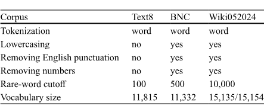

1 3

<!-- page: 16 -->

**Table 2.** Datasets for word similarity evaluation

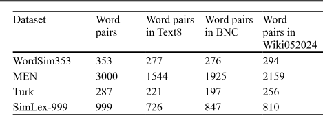

al., 2015) between these cosine similarities and the human similarity scores is calculated to evaluate these word embedding methods. Larger values are better.

## 6 Study setup

### 6.1 SVD-based methods

CA, PMI-SVD, PPMI-SVD, PMI-GSVD, ROOT-CA, ROOTROOT-CA, and ROOT-CCA are SVD-based dimensionality reduction methods. First, we create a word-context matrix of size 11,815×11,815, 11,332×11,332, and 15,135×15,135 based on Text8, BNC, and Wiki052024, respectively. We use a symmetric context window of size 2, i.e., two words on each side of the target word. Co-occurrence counts were weighted by distance: a context word one token away from the target word contributes a weight of 1, while a context word two tokens away contributes a weight of 1/2. For example, in the text “the cat sat on the mat”, if “sat” is the target word, then “cat” and “on” contribute weight 1, whereas the two occurrences of “the” contribute weight 1/2 each. Therefore, the co-occurrence counts are (sat,cat)=1,(sat,on)=1,(sat,the)=1. On HP EliteBook 840 G10 (Windows 11, 16 CPUs, ∼2.2 GHz, 16384MB RAM), it takes around 36 hours to create the word-context matrix for the largest corpus (Wiki052024). Then we perform SVD on the related matrices using the svd function from scipy.linalg in Python 3.11.4 to obtain singular values $\sigma_{k}$, left singular vectors $u_{ik}$, and right singular vectors $v_{jk}$. On HP EliteBook 840 G10 (Windows 11, 16 CPUs, ∼2.2 GHz, 16384MB RAM), it takes around 18 minutes to perform SVD for a matrix of size 15,135 × 15,135 about the largest corpus (Wiki052024). Word embeddings are conp p p T structed as $e_{i}$ = [ $u_{i1}$ $\sigma_{1}$ $,u_{i2}$ $\sigma_{2}$, · · · $,u_{iK}$ $\sigma_{K}$ ]. For example, for PMI-GSVD, first we construct a word-context cooccurrence matrix X. Next, we construct the WPMI matrix with

√ elements $p_{i+}$ $p_{+j}$ log ( $p_{ij}$ /( $p_{i+}$ $p_{+j}$ )) based on X. Then, we apply SVD on this matrix to obtain $\sigma_{k}$, $u_{ik}$, and $v_{jk}$ by using the svd function from scipy.linalg in Python 3.11.4. Finally, p p p T the word embeddings are given by $e_{i}$ = [ $u_{i1}$ $\sigma_{1}$ $,u_{i2}$ $\sigma_{2}$, · · · $,u_{iK}$ $\sigma_{K}$ ]. For all SVD-based methods, including PMI-GSVD, cosine similarity is calculated on the embedding vectors p p p T $e_{i}$ = [ $u_{i1}$ $\sigma_{1}$ $,u_{i2}$ $\sigma_{2}$, · · · $,u_{iK}$ $\sigma_{K}$ ]. The vectors are not additionally normalized or rescaled before computing cosine similarity, since cosine similarity itself is scale invariant. Furthermore, the embeddings were not mean-centered.

The choices of the exponent weighting p and the number of dimensions k are important for SVD-based methods. In the context of PPMI-SVD and ROOT-CCA p is regularly set to p = 0 or p = 0.5 (Levy & Goldberg, 2014; Levy et al., 2015; Stratos et al., 2015). For p = 0, we have the standard coordinates with $U^{T}$ U = $V^{T}$ V = I. For p = 0.5, we

1/2 1/2 T 1/2 have $A_{k}$ = $U_{k}$ $\Sigma_{k}$ $V_{k}^{T}$ = ( $U_{k}$ $\Sigma_{k}$ )( $V_{k}$ $\Sigma_{k}$ ). That is, the target words $U_{k}$ $\Sigma_{k}$ and

1/2 context words $V_{k}$ $\Sigma_{k}$ reconstruct the decomposed matrix $A_{k}$. The three created word- 1 3 context matrices based on Text8, BNC, and Wiki052024 are symmetric, so the matrices to be decomposed are also symmetric. For the SVD of a symmetric matrix, using the target

<!-- page: 17 -->

1/2 1/2 words $U_{k}$ $\Sigma_{k}$ for word embeddings is equivalent to using the context words $V_{k}$ $\Sigma_{k}$ for word embeddings. We vary the number of dimensions k from 2, 50, 100, 200, · · ·, 1,000, 2,000, · · ·, 10,000 to seek the optimal Spearman’s correlation coefficient in Table 5 and fix k = 300 in Table 6.

### 6.2 GloVe and SGNS

We use the public implementation by Pennington et al. (2014) to perform GloVe and choose the default hyperparameters. Pennington et al. (2014) proposed to use the context vectors $o_{j}$ in addition to target word vectors $e_{i}$. Here, we only use target word vectors $e_{i}$, set window size to 2 and set vocab minimum count to 100 for Text8, 500 for BNC, and 10,000 for Wiki052024, in the same way as for the SVD-based methods to keep the settings consistent. We vary the dimension k of word embeddings from 200 to 600 with intervals of 100 to seek the optimal Spearman’s correlation coefficient in Table 5 and fix k = 300 in Table 6.

We use the public implementation by Mikolov et al. (2013b) to perform SGNS, and use the vocabulary created by GloVe as the input of SGNS. We choose the default values except for the dimensions k of word embeddings and window size, which are chosen in the same way as in GloVe, to keep the settings consistent.

### 6.3 BERT

$WeusetwoBERTmodelsinourexperiments:pre-trainedBERT_{BASE}$ and fine-tuned $BERT_{BASE}$. We extract the word embeddings from the last layer as well as the first layer, because Bommasani et al. (2020) show that there is a clear preference towards the first quarter of the model layers. The dimensionality used is 768 by default. To be consistent with SVD-based methods, we use the same vocabulary constructed from Wiki052024 as in $SVD-basedmethodstoevaluatepre-trainedBERT_{BASE}$.

$Fine-tunedBERT_{BASE}$ $isthefine-tuningofBERT_{BASE}$ on Wiki052024. Specifically, $becauseBERT_{BASE}$ is a very large neural network model containing about 110 million parameters and computationally it will be very expensive to run on a large corpus, thus we $chooseasamplefromtheWiki052024tofine-tuneBERT_{BASE}$. That is, we choose 0.02% from the total 144,581,193 sentences. I.e., we use 28,916 sentences from Wiki052024. It $isworthnotingthatinthefine-tunedBERT_{BASE}$, we choose the max length for sentences is 128 instead of the default 512, because each sentence in Wiki052024 is an average of around 113 words. And we only use the MLM task instead of MLM and NSP, because 28,916 sentences are randomly chosen and are not necessary connecting the previous and next sentences. The dimensionality used is 768 by default. After we obtain the fine-tuned $BERT_{BASE}$, we extract word embedding from the last layer as well as first layer, and use $thesamevocabularyasinSVD-basedmethodstoevaluatefine-tunedBERT_{BASE}$. Table 3 summarizes the hyperparameter setting described in this section.

1 3

<!-- page: 18 -->

## 7 Results

We make a distinction between conditions where no dimensionality reduction takes place, and conditions where dimensionality reduction is used. For no dimensionality reduction we compare TTEST, PMI, PPMI, WPMI, ROOT-TTEST, ROOTROOT-TTEST, STRATOS- TTEST. For dimensionality reduction we first compare CA with PMI-SVD, PPMI-SVD, PMI-GSVD, GloVe, SGNS, and then compare variants of CA as well as BERT.

### 7.1 TTEST, PMI, PPMI, WPMI, ROOT-TTEST, ROOTROOT-TTEST, and STRATOS-TTEST

First, we compare methods where no dimensionality reduction takes place. We show the Spearman’s correlation coefficient ρ for the TTEST, PMI, PPMI, WPMI, ROOT-TTEST, ROOTROOT-TTEST, and STRATOS-TTEST matrices in Table 4 for Text8, BNC, and Wiki052024. The results for Text8 show that either ROOT-TTEST or ROOTROOT-TTEST is best across the four word similarity datasets. For BNC, ROOT-TTEST achieves the best performance across all four word similarity datasets. For Wiki052024, either ROOT-TTEST or PPMI performs best across the four word similarity datasets. In the Total block at the

**Table 3.** Summary of hyperparameters and experimental settings

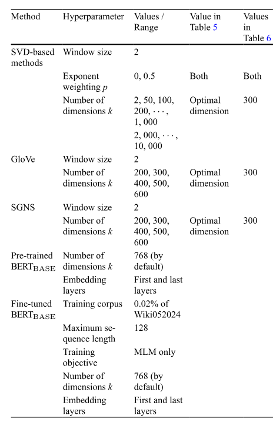

1 3 bottom of the table, we provide the sum of ρ-values for all four datasets. In the column of Total of Table 4, we provide the sum of Spearman’s correlation coefficients over Text8, BNC, and Wiki052024. Overall, ROOT-TTEST perform best, followed by PPMI, and ROOTROOT-TTEST.

<!-- page: 19 -->

### 7.2 CA, PMI-SVD, PPMI-SVD, PMI-GSVD, GloVe, and SGNS

Next, we compare CA (RAW-CA in Table 5) with the PMI-based methods PMI-SVD, PPMI-SVD, PMI-GSVD, GloVe, and SGNS for Text8, BNC, and Wiki052024. Table 5 has a left part, where p = 0, and a right part, where p = 0.5. As p does not exist in GloVe and SGNS, these methods have identical values for p = 0 and p = 0.5. Plots for ρ as a function of k and confidence intervals of k = 300 for SVD-based methods about Text8, BNC, and Wiki052024 are in Supplementary materials A.

Comparing the last block of Table 5 with the last block of Table 4 reveals that, overall, dimensionality reduction is beneficial for the size of ρ, as CA, PMI-SVD, PPMI-SVD, PMI-GSVD, ROOT-CA, ROOTROOT-CA, and ROOT-CCA do better than their respective counterparts TTEST, PMI, PPMI, WPMI, ROOT-TTEST, ROOTROOT-TTEST, and STRATOS-TTEST.

For an overall comparison of the dimensionality reduction methods, we study the block at the bottom of Table 5, which provides the sum of the ρ-values over the four word similarity datasets. In the column of Total of Table 5, we provide the sum of Spearman’s correlation coefficients over Text8, BNC, and Wiki052024. For both p = 0 and p = 0.5, among RAW- CA, PMI-SVD, PPMI-SVD, PMI-GSVD, GloVe, and SGNS, overall PPMI-SVD performs best, closely followed by PMI-SVD and SGNS. RAW-CA, PMI-GSVD, and GloVe follow at some distance. The popular method GloVe does not perform well especially in Text8 and BNC. Possibly the conditions of the study are not optimal for GloVe, as the Text8 and BNC corpora are, with 11,815 and 11,332 terms respectively, possibly too small to obtain reliable results (Jiang et al., 2018).

Table 5 shows the highest Spearman’s correlation coefficient ρ where the number of dimensions varies with 2, 50, 100, 200,...1,000, 2,000,..., 10,000 for SVD-based methods and with 200, 300, · · ·, 600 for GloVe and SGNS, while Table 6 shows the Spearman’s correlation coefficient ρ for the number of dimensions 300. Table 6 has a left part, where p = 0, and a right part, where p = 0.5. In Table 6, similar results are found: for both p = 0 and p = 0.5, among RAW-CA, PMI-SVD, PPMI-SVD, PMI-GSVD, GloVe, and SGNS, overall PPMI-SVD performs best, closely followed by PMI-SVD and SGNS. RAW-CA, PMI-GSVD, and GloVe follow at some distance.

As the focus in this paper is on the performance of CA, we give some extra attention to RAW-CA and the similar PMI-GSVD. Even though CA and PMI-GSVD have the same weighting function $p_{i+}$ $p_{+j}$, and should be close when $p_{ij}$ / ( $p_{i+}$ $p_{+j}$ ) − 1 is small (compare the discussion around (15, 16)) their performances are rather different. This may be because there are extremely large values (larger than 35,000) in the fitting function ( $p_{ij}$ / ( $p_{i+}$ $p_{+j}$ ) − 1) of CA for Text8, BNC, and Wiki052024, which makes the fitting function of CA not close to the fitting function log ( $p_{ij}$ / ( $p_{i+}$ $p_{+j}$ )) of PMI-GSVD.

When we compare PMI-GSVD with PMI-SVD, we are surprised to find that weighting rows and columns appears to decrease the values of ρ. This is in contrast with the reliability principle of Salle and Villavicencio (2023) discussed above.

1 3

<!-- page: 20 -->

**Table 4.** Text8, BNC, and Wiki052024: correlation coefficient ρ for TTEST, PMI, PPMI, WPMI, ROOT-TTEST, ROOTROOT-TTEST, and STRATOS-TTEST matrices

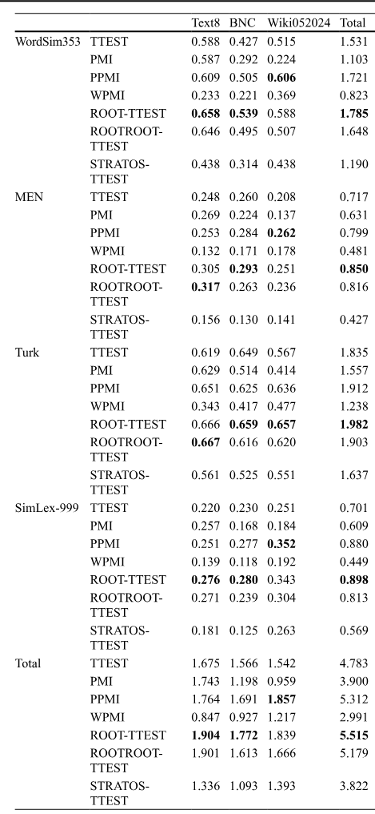

To better interpret the contribution of each cell to total inertia and the contribution of each row to each dimension for SVD-based methods, we report the average contribution of each cell to total inertia and the average contribution of each row to each dimension for Text8, BNC, and Wiki052024. For the three corpora, vocabulary size is 11,815,

1 3

<!-- page: 21 -->

**Table 5 (part 1).** Table 5

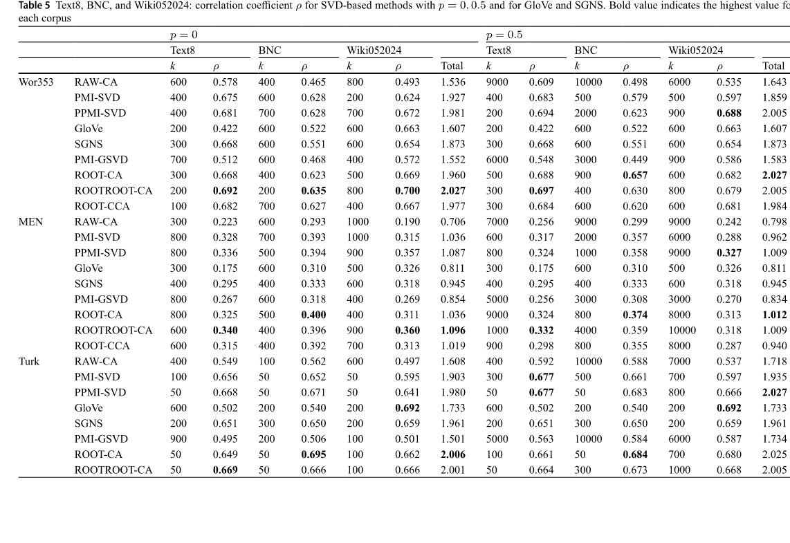

1 3

<!-- page: 22 -->

**Table 5 (part 2).** Table 5 1 3

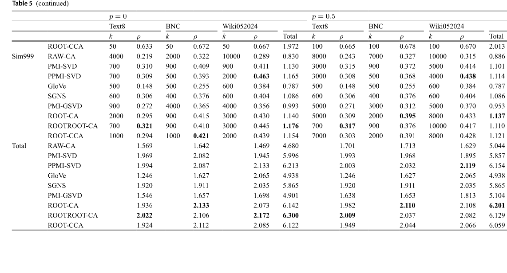

<!-- page: 23 -->

**Table 6.** Text8, BNC, and Wiki052024: correlation coefficient ρ for SVD-based methods with p = 0 (or p = 0.5) and k = 300 and for GloVe and SGNS with k = 300. Bold value indicates the highest value for each corpus

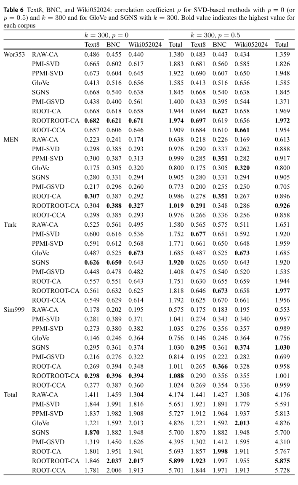

1 3

<!-- page: 24 -->

11,332, and 15,135, respectively. Thus, the average contribution of each cell to the total inertia is 1/(11, 815 × 11, 815) ≈ 7.2 × 10−9, 1/(11, 332 × 11, 332) ≈ 7.8 × 10−9, 1/(15, 135 × 15, 135) ≈ 4.4 × 10−9 for Text8, BNC, and Wiki052024, respectively; similarly, the average contribution of each row to each dimension is 1/11, 815 ≈ 8.5 × 10−5, 1/11, 332 ≈ 8.8 × 10−5, and 1/15, 135 ≈ 6.6 × 10−5 for Text8, BNC, and Wiki052024, respectively. These values are summarized in Table 7.

We now discuss why PMI-SVD and PPMI-SVD do better than PMI-GSVD. It turns out that the number and sizes of extreme values in the matrix WPMI decomposed by PMI- GSVD are much larger than in PMI and PPMI, and this results in PMI-GSVD dimensions being dominated by single words. We only include non-zero elements in the PMI matrix as the PMI matrix is sparse: 94.2% of the entries are zero for Text8; for a fair comparison, the corresponding 94.2% of entries in the PPMI and WPMI matrices are also ignored. Following Dodge (2008); Schwertman et al. (2004); Tukey (1977), we use the boxplot method to identify extreme values. Let $q_{1}$ and $q_{3}$ denote the first and third sample quartiles, and let $f_{1}$ = $q_{1}$ − 1.5( $q_{3}$ − $q_{1}$ ), $f_{3}$ = $q_{3}$ + 1.5( $q_{3}$ − $q_{1}$ ). Then, extreme values are defined as values smaller than $f_{1}$ (LT $f_{1}$ ) or larger than $f_{3}$ (GT $f_{3}$ ). The factor 1.5 is the conventional threshold used in the boxplot methodology for identifying outliers (Dodge, 2008; Schwertman et al., 2004). Boxplot-based outlier detection is widely used because of its simplicity and robustness. In particular, it relies on quartiles and the interquartile range $q_{3}$ − $q_{1}$, making it less sensitive to extreme observations that could otherwise distort the assessment of data spread and influence outlier detection (Schwertman et al., 2004). The first three rows in Table 8 show the number of extreme elements in the PMI, PPMI, WPMI matrices. The number of extreme values of the WPMI matrix (1,384,231) is much larger than that of PMI and PPMI (32,319 and 27,984). Furthermore, in WPMI the extremeness of values is much larger than in PMI and PPMI. As shown in Table 7, the average contribution for each cell is around 7.2 × 10−9. However, in WPMI, the most extreme entry, found for (the, the), contributes around 0.01126 to the total inertia, which is substantially larger than the average value of 7.2 × 10−9. In PMI (PPMI) the most extreme entry is (guant, namo) or (namo, guant) and contributes around 3.1 × 10−6 (3.2 × 10−6) to the total inertia.

Figure 1 shows the contribution of the rows, corresponding to top 10 extreme values, to the first 100 dimensions of PMI-SVD, PPMI-SVD, PMI-GSVD. The 2nd, 3rd, and 4th columns of Table 9 display the contributions of the row, corresponding to the 1st extreme value, to the first 30 dimensions of PMI-SVD, PPMI-SVD, and PMI-GSVD, respectively. The rows, corresponding to the top extreme values in the WPMI matrix, take up a much bigger contribution to the first dimensions of PMI-GSVD. For example, in PMI-GSVD, the “the” row contributes around 0.36022 to the third dimension (compared with the average 8.5 × 10−5 in Table 7), while in PMI-SVD and PPMI-SVD, the contributions are much more even. Thus the PMI-GSVD solution is hampered by extreme cells in the WPMI matrix that is decomposed. Similar results can be found for BNC and Wiki052024 in Supplementary materials B and C, respectively.

**Table 7.** Average contribution for each cell to the total inertia and average contribution of each row to each dimension for each corpora

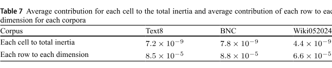

1 3

<!-- page: 25 -->

**Table 8.** Text8: the number of extreme values

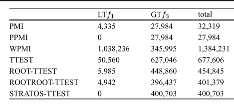

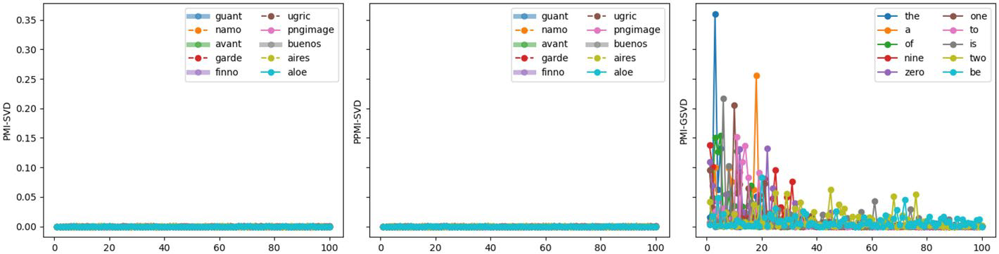

**Figure 1.** Text8: the contribution of the rows, corresponding to the top 10 extreme values, to the first 100 dimensions of PMI-SVD, PPMI-SVD, PMI-GSVD

A large contribution (e.g., &gt; 0.3) of a single row to a dimension indicates that this dimension is dominated by a single row, meaning the dimension is strongly driven by a small number of highly influential terms rather than a distributed semantic pattern. This may lead to overemphasis on specific terms and reduce generalization performance in natural language processing tasks.

### 7.3 The results for three variants of CA as well as BERT

Now we compare the three variants of CA (ROOT-CA, ROOTROOT-CA, ROOT-CCA) with RAW-CA and the winner of the PMI-based methods, PPMI-SVD.

First, in Table 5 for Text8, BNC, and Wiki052024, the three variants of CA perform much better than RAW-CA in each word similarity dataset and each corpus, both for p = 0 and p = 0.5. In the block at the bottom of Table 5, overall, the performance of the three variants is similar, where ROOT-CA and ROOTROOT-CA outperform ROOT-CCA slightly. In Table 6 with the number of dimensions being 300, similar results are found: the three variants of CA perform better than RAW-CA in each word similarity dataset and each corpus both for p = 0 and p = 0.5, except for Turk, BNC and p = 0. In the block at the bottom of Table 6, overall, the performance of the three variants is similar, where ROOTROOT-CA outperforms ROOT-CA and ROOT-CCA slightly.

The lower part of Table 8 shows the number of extreme values of TTEST, ROOT- TTEST, ROOTROOT-TTEST and STRATOS-TTEST matrices for Text8. Similar with PMI, PPMI, WPMI, 94.2% of entries are ignored. The number of extreme values of the TTEST matrix (677,606) is larger than that of ROOT-TTEST, ROOTROOT-TTEST and STRATOS-TTEST (454,845, 401,379, and 400,703). Furthermore, in TTEST the extremeness of the extreme values is larger than those in ROOT-TTEST, ROOTROOT-TTEST, and STRATOS-TTEST. For example, in TTEST the most extreme entry (agave, agave) contrib- 1 3

<!-- page: 26 -->

**Table 9.** Text8: the contribution of the row, corresponding to the 1st extreme value, to the first 30 dimensions

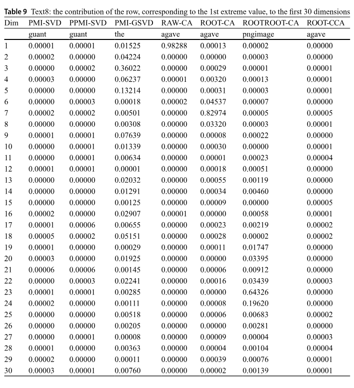

utes around 0.02117 to the total inertia with the average around 7.2 × 10−9, while in ROOT- TTEST, ROOTROOT-TTEST, and STRATOS-TTEST, the most extreme entries (agave, agave), (pngimage, pngimage), and (agave, agave) contribute around 0.00325, 0.00119, and 0.00017, respectively. Figure 2 shows the contribution of the rows for the top 10 extreme values, to the first 100 dimensions of RAW-CA, ROOT-CA, and ROOTROOT-CA (The corresponding plot about ROOT-CCA is in Supplementary materials D). The 5th, 6th, 7th, and 8th columns of Table 9 display the contributions of the row, corresponding to the 1st extreme value, to the first 30 dimensions of RAW-CA, ROOT-CA, ROOTROOT-CA, and ROOT-CCA, respectively. In RAW-CA, the rows, corresponding to top extreme values of TTEST, take up a big contribution to the first dimensions of RAW-CA. For example, in RAW-CA, the “agave” row contributes around 0.983 to the first dimension with the average around 8.5 × 10−5, while in ROOT-CA and ROOTROOT-CA, the contributions are much smaller which also holds for ROOT-CCA. Similar results can be found for BNC

1 3 and Wiki052024 in Supplementary materials E and F, respectively. Thus, we infer that the extreme values in TTEST are the important reason that RAW-CA performs badly.

<!-- page: 27 -->

Second, in the rows of the block at the bottom of Table 5, the overall performances of ROOT-CA, ROOTROOT-CA, ROOT-CCA are comparable to or sometimes slightly better than PPMI-SVD. Specifically, for both p = 0 and p = 0.5, ROOTROOT-CA and ROOT- CA achieve the highest ρ for Text8 and BNC corpora, respectively. For Wiki052024, when p = 0, ROOTROOT-CA performs best with ρ = 2.172; when p = 0.5, PPMI-SVD achieves the highest value with ρ = 2.119. In the last block of Table 6, ROOTROOT-CA achieves best performance for both p = 0 and p = 0.5 by looking at “Total” column. Based on these results, no matter what we know about the corpus, ROOTROOT-CA and ROOT-CA appear to have the potential to improve performance in some NLP tasks.

Table 10 $showsresultsforBERT.BERT_{BASE}$ in the last layer is worst, but in the first layer is best by comparing last block of Table 5 with last block of Table 10. Although BERT in the first layer is the best, ROOTROOT-CA and ROOT-CA provide a competitive result, such as, ROOTROOT-CA with score 2.172 in Table 5 $VSBERT_{BASE}$ 2.191. In addition, BERT is not always better than other methods. For example, ROOTROOT-CA in Tables 5 and 6 with p = 0.5 is better than BERT in the Turk dataset, which indicates that different methods are suitable to different datasets.

## 8 Text classification for BBCNews dataset

In this section, we evaluate RAW-CA, PMI-SVD, PPMI-SVD, PMI-GSVD, GloVe, SGNS, ROOT-CA, ROOTROOT-CA, ROOT-CCA, and BERT on text classification using the BBC- News dataset, a standard benchmark consisting of 2,225 documents across five categories: Business with 510 documents, Entertainment with 386, Politics with 417, Sport with 511, and Technology with 401 (Barman & Chowdhury, 2020; Greene & Cunningham, 2006).

We use the Random Forest as a classification algorithm, which is a widely used machine learning method for classification tasks (Cutler et al., 2007; Speiser et al., 2019). We randomly choose 80% of the data set as the training set and the remaining as the test set. We preprocess the data using word tokenization, lemmatization, lowercasing, and the removal of stop words, numerical tokens, and the isolated token “s”. We use accuracy, precision, recall, and the F1 score to compare the performance of different methods, where higher values indicate better performance (Bagheri et al., 2020).

For SVD-based methods, GloVe, and SGNS, document-term matrices are constructed separately for the training set and the test set based on word counts. Each method is used

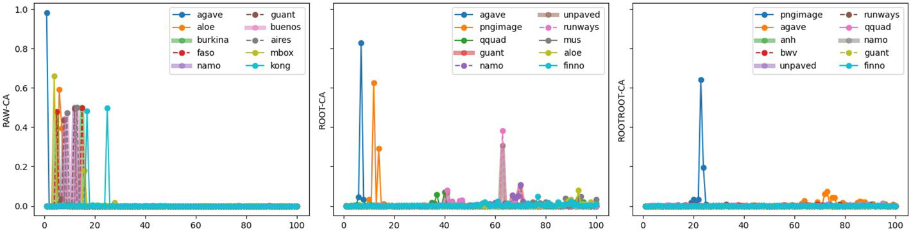

**Figure 2.** Text8: the contribution of the rows, corresponding to top 10 extreme values, to first 100 dimensions of RAW-CA, ROOT-CA, ROOTROOT-CA

1 3

<!-- page: 28 -->

**Table 10.** Correlation coefficient ρ for BERT WordSim353

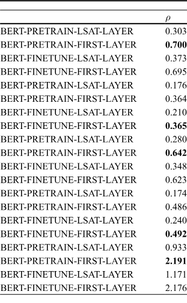

on the training set to obtain word embeddings, where words occurring less than five times are removed and the window size is set to 2. Document embeddings for the training set are then computed by averaging word embeddings weighted by term frequencies in the training document-term matrix, while document embeddings for the test set are computed by averaging word embeddings weighted by term frequencies in the test document-term matrix. For BERT, documents in training set and documents in test set are respectively encoded using the function SentenceTransformer in the sentence_transformers library of Python 3.11.4. For all methods, the document embeddings obtained from the training set are used to train a Random Forest classifier. Subsequently, we use the trained Random Forest classifier to evaluate the method on the document embeddings from the test set.

For the static embeddings (SVD-based methods, GloVe, and SGNS), the word embedding dimension is set to 100 to reduce the risk of overfitting on a relatively small dataset. For SVD-based methods, we consider the singular value exponential weighting p = 0 and p = 0.5. For BERT, we use the 768-dimensional embeddings by default.

Table 11 reports the results for SVD-based methods with p = 0, as well as GloVe, SGNS, and BERT. Results for SVD-based methods with p = 0.5 are omitted because the performance is similar to that of p = 0. In addition, the first row of Table 11 presents the results obtained when the text classification task is performed directly on the original documentterm matrix. According to the table, ROOTROOT-CA achieves the best performance across all metrics, followed by ROOT-CA, PPMI-SVD, SGNS, PMI-SVD, ROOT-CCA, RAW- CA, RAW, and PMI-GSVD. BERT performs less well, possibly because the default parameter settings used are not suitable for this classification. GloVe yields the lowest performance, which may be due to the relatively small size of the BBCNews dataset for learning reliable word embeddings. Overall, these results suggest that ROOT-CA and ROOTROOT-CA

1 3

<!-- page: 29 -->

**Table 11.** Text classification for BBCNews dataset; values in Bold are highest for each metric

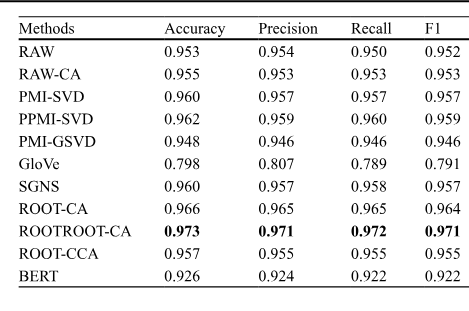

may be promising approaches for some tasks in natural language processing, information retrieval, and text mining.

## 9 Discussion

PMI is an important concept in natural language processing. In this paper, we theoretically compare CA with three PMI-based methods with respect to their objective functions. CA is a weighted factorization of a matrix where the fitting function is ( $p_{ij}$ / ( $p_{i+}$ $p_{+j}$ ) − 1) and the weighting function is the product of row margins and column margins $p_{i+}$ $p_{+j}$ . When the elements in the fitting function ( $p_{ij}$ / ( $p_{i+}$ $p_{+j}$ ) − 1) of CA are small, CA is close to a weighted factorization of the PMI matrix where the weighting function is the product $p_{i+}$ $p_{+j}$. This is because ( $p_{ij}$ / ( $p_{i+}$ $p_{+j}$ ) − 1) is close to log ( $p_{ij}$ / ( $p_{i+}$ $p_{+j}$ )) when ( $p_{ij}$ / ( $p_{i+}$ $p_{+j}$ ) − 1) is small. This theoretical link places CA and PMI-based approaches within a unified analytical framework.

Extracted word-context matrices are prone to overdispersion. To remedy the overdispersion, we presented ROOTROOT-CA. That is, we perform CA on the root-root transformation of the word-context matrix. We also apply CA to the square-root transformation of the word-context matrix (ROOT-CA) to stabilize the variance of the matrix entries. In addition, we present ROOT-CCA, described in Stratos et al. (2015), which is similar with ROOT-CA. The empirical comparison on word similarity tasks shows that sometimes the performance of ROOT-CA and ROOTROOT-CA is slightly better than the performance of PMI-based methods. Results on text classification for BBCNews dataset show that ROOT-CA and ROOTROOT-CA outperform PMI-based methods under certain experimental settings. In CA-based methods, it is no logarithm, which avoid the illness for 0 element compared with PMI. Therefore, CA-based methods could become an alternative of PMI-based methods, and facilitate the development of NLP.

A key explanation for the performance differences lies in the influence of extreme values. PMI-GSVD performs worse than PMI-SVD/PPMI-SVD and CA performs worse than ROOT-CA, ROOTROOT-CA, and ROOT-CCA, because the extreme values take up large contribution to the first dimensions of PMI-GSVD and RAW-CA. This gives a direction to improve the performance of SVD-based methods, such as by removing the effect of extreme values.

1 3

<!-- page: 30 -->

Interesting, our results show PMI-SVD performs better than PMI-GSVD, where PMI- SVD has equally weighting function in the objective function with 1 and PMI-GSVD has unequal weighting function with the product of the marginal frequencies of word and of context. This phenomenon is in contrast with the reliability principle, proposed by Salle and Villavicencio (2023). The reliability principle refers to that the objective function should have a weight on the reconstruction error that is a monotonically increasing function of the marginal frequencies of word and of context. This phenomenon in our results inspires researcher to rethink about the theory of NLP.

Although transformer-based encoders such as BERT are dominant in modern NLP, our results show that traditional static word embedding methods remain competitive. The results on word similarity tasks for Wiki052024 corpus show BERT is not always better than other methods and results on text classification for BBCNews dataset show that ROOT-CA and ROOTROOT-CA outperform BERT under the experimental settings, which indicates that different methods are suitable for different datasets. This also suggests that simpler methods can sometimes outperform more complex models for highly specialized tasks.

Moreover, static embedding methods continue to play an important role in NLP for several reasons. First, different models are suitable for different tasks and different datasets. For example, Aida et al. (2021) show PMI-based methods are better than BERT in measuring semantic differences across corpora. Second, integrating static word embedding models and transformer-based models can improve the performance of both (Mištera & Král, 2026). Third, the transformer-based models are often less interpretable (Lai-Dang et al., 2025). This lack of explainability is significantly limiting used in domains where decisions are critical such as the medical and legal fields. In contrast, the co-occurrence-based model is more explainable. Last, transformer-based models require substantial computational resources and large corpora (Banerjee & Banik, 2025), making traditional embedding methods more suitable for low-resource settings. Overall, static word embeddings are not outdated and are still active in NLP.

In this paper, we explore ROOT-CA and ROOTROOT-CA, where ROOT-CA uses a power of 0.5 of the original elements $x_{ij}$ while ROOTROOT-CA uses 0.25 of the original elements $x_{ij}$. Our aim was to study the performance of CA with respect to the other methods, and for this purpose, focusing on values 0.25 and 0.5 was sufficient. It may be of interest to study a general power transformation $x_{ij}^{\delta}$ (or other power versions such as ( $p_{ij}$ /( $p_{i+}$ $p_{+j}$ $))^{\delta}$ ) where δ could range between any two non-negative values (Beh & Lombardo, 2024; Beh et al., 2023; Cuadras & Cuadras, 2006; Greenacre, 2009). Here 0.5 and 0.25 are special cases of this general transformation.

For non-negative or positive-valued matrices, there are specific low-rank decomposition approaches, such as non-negative matrix factorization (NMF) (Lee & Seung, 1999; Saberi-Movahed et al., 2025) and probabilistic latent semantic analysis (PLSA) (Figuera & Bringas, 2024; Hofmann, 2001, 2017). NMF imposes non-negativity constraints on the low-dimensional word embeddings, which enhances interpretability through nonnegative representations. In addition to nonnegative constraints on word embeddings, PLSA enforces the sum-to-1 constraints, yielding a probabilistic interpretation. In this paper, we focus on the PMI-based methods; therefore, these approaches are beyond the scope of this study.

When the entries of the word-context co-occurrence matrix are 0, the corresponding PMI values, log( $p_{ij}$ /( $p_{i+}$ $p_{+j}$ )), become negative infinity. In this study, we replace such values

1 3 with 0. There are smoothing methods from NLP (Bouma, 2009; Levy & Goldberg, 2014; Milajevs et al., 2016; Salle & Villavicencio, 2023). For example, zero elements may be replaced with very small non-zero elements; or log(1 + $p_{ij}$ /( $p_{i+}$ $p_{+j}$ )) may be used instead of log( $p_{ij}$ /( $p_{i+}$ $p_{+j}$ )). The investigations of these smoothing methods are valuable and are beyond the scope of this study.

<!-- page: 31 -->

## 10 Conclusion

In this paper, we provided a unified theoretical and empirical comparison between correspondence analysis (CA) and PMI-based methods for static word embeddings, and introduced two CA variants, ROOT-CA and ROOTROOT-CA, to the NLP domain. We showed that CA can be interpreted as a weighted factorization of PMI matrix when deviations from independence are small, thereby clarifying the connection of CA-, PMI-, and SVD-based methods. To mitigate overdispersion in word–context matrices, we presented ROOTROOT- CA based on power transformation of the matrix entries; to stabilize variance, we presented ROOT-CA. Experimental results on word similarity tasks across multiple corpora and multiple word similarity datasets demonstrate that these variants sometimes slightly perform better than the PMI-based methods and BERT. The analysis found that the performance of SVD-based methods (including CA, ROOT-CA, ROOTROOT-CA, PMI-SVD, PPMI-SVD, and PMI-GSVD) is largely influenced by extreme values in decomposed matrices before SVD. Experimental results on text classification for the BBCNews dataset show that these variants outperform other methods under certain experimental settings. Overall, our results highlight and suggest that ROOT-CA and ROOTROOT-CA may be promising approaches for some tasks in natural language processing, information retrieval, and text mining, and inspire researchers to improve SVD-based methods by controlling extreme values of the decomposed matrix. The code is available at https://github.com/qianqianqi28/ca-pmi-wor d-embeddings.

This paper has several limitations. First, it does not clearly answer when one should use CA vs PPMI-SVD and what the trade-offs are. This is because, from the experimental results, there is no method that is consistently better than others across multiple corpora and multiple word similarity datasets. Second, it only validates word similarity and text classification tasks on English data and does not cover multilingual scenarios. Third, the vocabulary used to evaluate word embeddings is limited. For example, we omitted the word in Wiki052024 with a frequency of less than 10, 000 due to the restriction of computing power. Fourth, the mathematical link between CA and PMI is limited, which only holds when target words and context words tend to be independent. Fifth, we do not consider modern embeddings such as GPT (Peng et al., 2026).

Supplementary Information The online version contains supplementary material available at https://doi.org /10.1007/s10844-026-01076-1.

Author Contributions All authors contributed to the design and conception of the study. Author Q.Q. performed the experiments. All authors contributed to the final analysis and discussion, and reviewed and edited the text.

Funding Author Qianqian Qi is supported by the China Scholarship Council (CSC202007720017).

1 3

<!-- page: 32 -->

Data Availability The Text8 corpus and BNC corpus that support the findings of this study are openly available by http://mattmahoney.net/dc/text8.zip and http://hdl.handle.net/20.500.14106/2554, respectively. Wiki052024 is from the "enwiki-20240501-pages-articles-multistream.xml.bz2" which is downloaded from https://dumps.wikimedia.org/enwiki/. The four word similarity datasets for word similarity tasks are from https://github.com/valentinp72/svd2vec/tree/master/svd2vec/datasets/similarities. The BBCNews dataset that supports the findings of this article is available at http://mlg.ucd.ie/datasets/bbc.html.

Declarations

Competing Interests The authors declare no competing interests.

Open Access This article is licensed under a Creative Commons Attribution 4.0 International License, which permits use, sharing, adaptation, distribution and reproduction in any medium or format, as long as you give appropriate credit to the original author(s) and the source, provide a link to the Creative Commons licence, and indicate if changes were made. The images or other third party material in this article are included in the article’s Creative Commons licence, unless indicated otherwise in a credit line to the material. If material is not included in the article’s Creative Commons licence and your intended use is not permitted by statutory regulation or exceeds the permitted use, you will need to obtain permission directly from the copyright holder. To view a copy of this licence, visit http://creativecommons.org/licenses/by/4.0/.

## References

Agresti A (2007) An introduction to categorical data analysis. John Wiley & Sons, Inc. https://doi.org/10.10 02/0470114754

Aida, T., Komachi, M., Ogiso, T., et al. (2021). A comprehensive analysis of PMI-based models for measuring semantic differences. In Proceedings of the 35th Pacific Asia Conference on Language, Information and Computation, Shanghai, China, pp. 21–31. https://aclanthology.org/2021.paclic-1.3/

Alqahtani, Y., Al-Twairesh, N., & Alsanad, A. (2023). Improving sentiment domain adaptation for Arabic using an unsupervised self-labeling framework. Information Processing & Management, 60(3), Article 103338. https://doi.org/10.1016/j.ipm.2023.103338

Attardi, G. (2015). Wikiextractor. Retrieved August, 2024, from https://github.com/attardi/wikiextractor

Bae, Y. S., Kim, K. H., Kim, H. K., et al. (2021). Keyword extraction algorithm for classifying smoking status from unstructured bilingual electronic health records based on natural language processing. Applied Sciences, 11(19), 8812. https://doi.org/10.3390/app11198812

Bagheri, A., Sammani, A., Van der Heijden, P. G. M., et al. (2020). ETM: Enrichment by topic modeling for automated clinical sentence classification to detect patients’ disease history. Journal of Intelligent Information Systems, 55, 329–349. https://doi.org/10.1007/s10844-020-00605-w

Banerjee, A., & Banik, D. (2025). A comprehensive survey on transformer-based machine translation: Identifying research gaps and solutions for large language models. ACM Computing Surveys, 58(5). https:/ /doi.org/10.1145/3773076

Barman, D., & Chowdhury, N. (2020). A novel semi supervised approach for text classification. International Journal of Information Technology, 12, 1147–1157. https://doi.org/10.1007/s41870-018-0137-9

Bartlett, M. S. (1936). The square root transformation in analysis of variance. Supplement to the Journal of the Royal Statistical Society, 3(1), 68–78. https://doi.org/10.2307/2983678

Beh, E. J., & Lombardo, R. (2021). An introduction to correspondence analysis. John Wiley & Sons Ltd.

Beh, E. J., & Lombardo, R. (2024). Correspondence analysis using the Cressie-Read family of divergence statistics. International Statistical Review, 92, 17–42. https://doi.org/10.1111/insr.12541

Beh, E. J., Lombardo, R., & Alberti, G. (2018). Correspondence analysis and the Freeman-Tukey statistic: A study of archaeological data. Computational Statistics & Data Analysis, 128, 73–86. https://doi.org/10 .1016/j.csda.2018.06.012

Beh, E. J., Lombardo, R., & Wang, T. W. (2023). Power transformations and reciprocal averaging, pp. 173–199. Springer Nature. https://doi.org/10.1007/978-981-99-5329-5_11

Benzécri, J.P. (1973). L’analyse des données. Tôme 2: L’analyse des correspondances. Dunod. https://archiv e.org/details/lanalysedesdonne0000unse 1 3

BNC Consortium (2007) British national corpus, XML edition. Retrieved October, 2023, from http://hdl.ha ndle.net/20.500.14106/2554

Bommasani, R., Davis, K., & Cardie, C. (2020). Interpreting pretrained contextualized representations via reductions to static embeddings. In Proceedings of the 58th Annual Meeting of the Association for Computational Linguistics, Online, pp. 4758–4781.https://doi.org/10.18653/v1/2020.acl-main.431

Bouma G (2009) Normalized (pointwise) mutual information in collocation extraction. In Proceedings of the International Conference of the German Society for Computational Linguistics and Language Technology, Tübingen, pp. 31–40. https://svn.spraakdata.gu.se/repos/gerlof/pub/www/Docs/npmi-pfd.pdf

Bruni, E., Boleda, G., Baroni, M., et al. (2012). Distributional semantics in technicolor. In Proceedings of the 50th Annual Meeting of the Association for Computational Linguistics (Volume 1: Long Papers), Jeju Island, Korea, pp. 136–145. https://aclanthology.org/P12-1015/

Bullinaria, J. A., & Levy, J. P. (2007). Extracting semantic representations from word co-occurrence statistics: A computational study. Behavior Research Methods, 39, 510–526. https://doi.org/10.3758/BF03193020

Cuadras, C. M., & Cuadras, D. (2006). A parametric approach to correspondence analysis. Linear Algebra and its Applications, 417(1), 64–74. https://doi.org/10.1016/j.laa.2005.10.029

Curran, J.R. (2004). From distributional to semantic similarity. PhD thesis, University of Edinburgh, https: //discovered.ed.ac.uk/discovery/fulldisplay?docid=alma9924614364402466&vid=44UOE_INST:44U OE_VU2

Curran, J.R., & Moens, M. (2002). Improvements in automatic thesaurus extraction. In Proceedings of the ACL-02 Workshop on Unsupervised Lexical Acquisition - Volume 9, USA, pp. 59–66. https://doi.org/1 0.3115/1118627.1118635

Cutler, D. R., Edwards, T. C., Jr., Beard, K. H., et al. (2007). Random forests for classification in ecology. Ecology, 88, 2783–2792. https://doi.org/10.1890/07-0539.1

Deerwester, S., Dumais, S. T., Furnas, G. W., et al. (1990). Indexing by latent semantic analysis. Journal of the American Society for Information Science, 41(6), 391–407. https://doi.org/10.1002/(SICI)1097-457 1(199009)41:6&lt;391::AID-ASI1&gt;3.0.CO;2-9

Devlin, J., Chang, M.W., Lee, K., et al. (2019). BERT: Pre-training of deep bidirectional transformers for language understanding. In Proceedings of the 2019 Conference of the North American Chapter of the Association for Computational Linguistics: Human Language Technologies, Volume 1 (Long and Short Papers), Minneapolis, Minnesota, pp. 4171–4186. https://doi.org/10.18653/v1/N19-1423

Dodge, Y. (2008). The concise encyclopedia of statistics. Springer, New York, NY. https://doi.org/10.1007/9 78-0-387-32833-1

Duchi, J., Hazan, E., & Singer, Y. (2011) Adaptive subgradient methods for online learning and stochastic optimization. Journal of Machine Learning Research, 12(61), 2121–2159. http://jmlr.org/papers/v12/ duchi11a.html

Dumais, S. T., Furnas, G. W., & Landauer, T. K. (1988). Using latent semantic analysis to improve access to textual information. Proceedings of the SIGCHI Conference on Human Factors in Computing Systems, pp. 281–285. New York, NY, USA. https://doi.org/10.1145/57167.57214

Egleston, B. L., Bai, T., Bleicher, R. J., et al. (2021). Statistical inference for natural language processing algorithms with a demonstration using type 2 diabetes prediction from electronic health record notes. Biometrics, 77(3), 1089–1100. https://doi.org/10.1111/biom.13338

Fačevicová, K., Filzmoser, P., & Hron, K. (2025). Correspondence analysis from the viewpoint of compositional tables. Statistical Analysis and Data Mining: An ASA Data Science Journal, 18(4), Article e70023. https://doi.org/10.1002/sam.70023

Field, J., Clarke, K., & Warwick, R. M. (1982). A practical strategy for analysing multispecies distribution patterns. Marine Ecology - Progress Series, 8, 37–52. https://doi.org/10.3354/meps008037

Figuera, P., Bringas, G., & P. (2024). Revisiting probabilistic latent semantic analysis: Extensions, challenges and insights. Technologies, 12(1). https://doi.org/10.3390/technologies12010005

Finkelstein, L., Gabrilovich, E., Matias, Y., et al. (2002). Placing search in context: The concept revisited. ACM Transactions on Information Systems, 20(1), 116–131. https://doi.org/10.1145/503104.503110

Goodman, L. A. (1996). A single general method for the analysis of cross-classified data: Reconciliation and synthesis of some methods of Pearson, Yule, and Fisher, and also some methods of correspondence analysis and association analysis. Journal of the American Statistical Association, 91(433), 408–428.

Greenacre, M. (1984). Theory and applications of correspondence analysis. Academic Press https://www. ogi-nic.net/CARME-N/download/theory%20and%20applications%20of%20correspondence%20analy sis.pdf

Greenacre, M. (2009). Power transformations in correspondence analysis. Computational Statistics & Data Analysis, 53(8), 3107–3116. https://doi.org/10.1016/j.csda.2008.09.001

Greenacre, M. (2010). Log-ratio analysis is a limiting case of correspondence analysis. Mathematical Geosciences, 42, 129–134. https://doi.org/10.1007/s11004-008-9212-2 1 3

Greenacre,M.(2017).Correspondenceanalysisinpractice.CRCPress.https://doi.org/10.1201/9781315369983

Greenacre, M., & Hastie, T. (1987). The geometric interpretation of correspondence analysis. Journal of the American Statistical Association, 82(398), 437–447. https://doi.org/10.1080/01621459.1987.10478446

Greene, D., & Cunningham, P. (2006). Practical solutions to the problem of diagonal dominance in kernel document clustering. In Proceedings of the 23rd International Conference on Machine Learning, pp. 377–384. New York, NY, USA. https://doi.org/10.1145/1143844.1143892

Guo, S., & Yao, N. (2021). Document vector extension for documents classification. IEEE Transactions on Knowledge and Data Engineering, 33(8), 3062–3074. https://doi.org/10.1109/TKDE.2019.2961343

Handan-Nader, C. (2026). Correspondence analysis on sparse bipartite graphs with hyperspecialization. Journal of Computational and Graphical Statistics, 35(1), 461–469. https://doi.org/10.1080/106186 00.2025.2546451

Hill, F., Reichart, R., & Korhonen, A. (2015). SimLex-999: Evaluating semantic models with (genuine) similarity estimation. Computational Linguistics, 41(4), 665–695. https://doi.org/10.1162/COLI_a_00237

Hofmann, T. (2001). Unsupervised learning by probabilistic latent semantic analysis. Machine Learning, 42, 177–196. https://doi.org/10.1023/A:1007617005950

Hofmann, T. (2017). Probabilistic latent semantic indexing. SIGIR Forum, 51(2), 211–218. https://doi.org/1 0.1145/3130348.3130370

Hollander, M., Wolfe, D.A., & Chicken, E. (2015). Nonparametric statistical methods. John Wiley & Sons, Inc. https://doi.org/10.1002/9781119196037

Hsu, L. L., & Culhane, A. C. (2023). Correspondence analysis for dimension reduction, batch integration, and visualization of single-cell RNA-seq data. Scientific Reports, 13. https://doi.org/10.1038/s41598-0 22-26434-1

Jiang, C., Yu, H.F., Hsieh, C.J., et al. (2018). Learning word embeddings for low-resource languages by PU learning. In Proceedings of the 2018 Conference of the North American Chapter of the Association for Computational Linguistics: Human Language Technologies, Volume 1 (Long Papers), New Orleans, Louisiana, pp. 1024–1034. https://doi.org/10.18653/v1/N18-1093

Johnson, S. J., Murty, M. R., & Navakanth, I. (2024). A detailed review on word embedding techniques with emphasis on word2vec. Multimedia Tools and Applications, 83, 37979–38007. https://doi.org/10.1007 /s11042-023-17007-z

Jurafsky, D., & Martin, J.H. (2023). Vector semantics and embeddings. https://web.stanford.edu/~jurafsky/ slp3/old_aug24/6.pdf

Khan, A., Majumdar, D., & Mondal, B. (2025). A hybrid transformer based model for sarcasm detection from news headlines. Journal of Intelligent Information Systems, 63, 1339–1359. https://doi.org/10.1007/s1 0844-025-00941-9

Kiyama, H., Aida, T., Komachi, M., et al. (2025). Analyzing continuous semantic shifts with diachronic word similarity matrices. In Proceedings of the 31st International Conference on Computational Linguistics, Abu Dhabi, UAE, pp. 1613–1631. https://aclanthology.org/2025.coling-main.109/

Lai-Dang, Q.V., Kang, T., & Son, S. (2025). Adaptive transformer programs: Bridging the gap between performance and interpretability in transformers. In The 13th International Conference on Learning Representations. https://openreview.net/forum?id=W8K8slZ73R

Lee, D. D., & Seung, H. S. (1999). Learning the parts of objects by non-negative matrix factorization. Nature, 401, 788–791. https://doi.org/10.1038/44565

Levy, O., & Goldberg, Y. (2014). Neural word embedding as implicit matrix factorization. In Proceedings of the 28th International Conference on Neural Information Processing Systems - Volume 2, Cambridge, MA, USA, pp. 2177–2185. https://doi.org/10.5555/2969033.2969070

Levy, O., Goldberg, Y., & Dagan, I. (2015). Improving distributional similarity with lessons learned from word embeddings. Transactions of the Association for Computational Linguistics, 3, 211–225. https:// doi.org/10.1162/tacl_a_00134

Mahoney, M. (2006). Text8 dataset. Retrieved October, 2023, from http://mattmahoney.net/dc/text8.zip Mikolov, T., Chen, K., Corrado, G., et al. (2013a). Efficient estimation of word representations in vector space. In Proceedings of the International Conference on Learning Representations. https://doi.org/10 .48550/arXiv.1301.3781 Mikolov, T., Sutskever, I., Chen, K., et al. (2013b). Distributed representations of words and phrases and their compositionality. In Advances in Neural Information Processing Systems. https://proceedings.neurips.c c/paper_files/paper/2013/file/9aa42b31882ec039965f3c4923ce901b-Paper.pdf

Milajevs, D., Sadrzadeh, M., & Purver, M. (2016). Robust co-occurrence quantification for lexical distributional semantics. In Proceedings of the ACL 2016 Student Research Workshop, Berlin, Germany, pp. 58–64. https://doi.org/10.18653/v1/P16-3009

Mištera, A., & Král, P. (2026). Enhancing masked language modeling in BERT models using pretrained static embeddings, pp. 216–227. Springer Nature Switzerland. https://doi.org/10.1007/978-3-032-02551-7_19 1 3

MohammadiBaghmolaei, R., & Ahmadi, A. (2023). Word embedding for mixed-emotions analysis. Journal of Intelligent Information Systems, 60, 49–72. https://doi.org/10.1007/s10844-022-00720-w

Nishisato, S., Beh, E. J., & Lombardo, R. (2021). On the analysis of over-dispersed categorical data, Springer Singapore, pp. 215–231. https://doi.org/10.1007/978-981-16-2470-4_11

Orebi, S.M., & Naser, A.M. (2025). Opinion mining in text short by using word embedding and deep learning. Journal of Applied Data Sciences, 6(1), 526–535.https://doi.org/10.47738/jads.v6i1.438

Pakzad, A., & Analoui, M. (2021). A word selection method for producing interpretable distributional semantic word vectors. Journal of Artificial Intelligence Research, 72, 1281–1305. https://doi.org/10.1613/j air.1.13353

Peng, J., & Feldman, A. (2017). Automatic idiom recognition with word embeddings, Springer International Publishing, pp. 17–29. https://doi.org/10.1007/978-3-319-55209-5_2

Peng, X., Jiang, H., Chen, J., et al. (2026). Leveraging large language models and embedding representations for enhanced word similarity computation. Scientific Reports, 16. https://doi.org/10.1038/s41598-02 5-31102-1

Pennington, J., Socher, R., & Manning, C. (2014). GloVe: Global vectors for word representation. In Proceedings of the 2014 Conference on Empirical Methods in Natural Language Processing (EMNLP), Doha, Qatar, pp. 1532–1543. https://doi.org/10.3115/v1/D14-1162

Podkorytov, M., Biś, D., & Cai, J. (2020). Effects of architecture and training on embedding geometry and feature discriminability in BERT. In 2020 International Joint Conference on Neural Networks (IJCNN), Glasgow, UK, pp. 1–8. https://doi.org/10.1109/IJCNN48605.2020.9206645 Qi, Q., Hessen, D. J., Deoskar, T., et al. (2024a). A comparison of latent semantic analysis and correspondence analysis of document-term matrices. Natural Language Engineering, 30(4), 722–752. https://do i.org/10.1017/S1351324923000244 Qi, Q., Hessen, D. J., & Van der Heijden, P. G. M. (2024b). Improving information retrieval through correspondence analysis instead of latent semantic analysis. Journal of Intelligent Information Systems, 62, 209–230. https://doi.org/10.1007/s10844-023-00815-y

Radinsky, K., Agichtein, E., & Gabrilovich, E. (2011). A word at a time: Computing word relatedness using temporal semantic analysis. In Proceedings of the 20th International Conference on World Wide Web, New York, NY, USA, pp. 337–346. https://doi.org/10.1145/1963405.1963455

Raphael, E.B. (2023). Gendered representations in language: A corpus-based comparative study of adjectivenoun collocations for marital relationships. Theory and Practice in Language Studies, 13(5):1191–1196. https://doi.org/10.17507/tpls.1305.12

Ravenda, F., Bahrainian, S., Raballo, A., et al. (2025). A self-supervised seed-driven approach to topic modelling and clustering. Journal of Intelligent Information Systems, 63, 333–353. https://doi.org/10.1007/s 10844-024-00891-8

Roesler, O., Aly, A., & Taniguchi, T. (2019). Evaluation of word representations in grounding natural language instructions through computational human-robot interaction. In 14th ACM/IEEE International Conference on Human-Robot Interaction (HRI), pp. 307–316. https://doi.org/10.1109/HRI.2019.8673121

Rong, X. (2014). Word2vec parameter learning explained. https://doi.org/10.48550/arXiv.1411.2738

Rumelhart, D. E., Hinton, G. E., & Williams, R. J. (1986). Learning representations by back-propagating errors. Nature, 323, 533–536. https://doi.org/10.1038/323533a0

Saberi-Movahed, F., Berahmand, K., & Sheikhpour, R. (2025). Nonnegative matrix factorization in dimensionality reduction: A survey. ACM Computing Surveys, 58(5). https://doi.org/10.1145/3767726

Salle, A., & Villavicencio, A. (2023). Understanding the effects of negative (and positive) pointwise mutual information on word vectors. Journal of Experimental & Theoretical Artificial Intelligence, 35(8), 1161–1199. https://doi.org/10.1080/0952813X.2022.2072004

Salle, A., Villavicencio, A., & Idiart, M. (2016). Matrix factorization using window sampling and negative sampling for improved word representations. In Proceedings of the 54th Annual Meeting of the Association for Computational Linguistics (Volume 2: Short Papers), Berlin, Germany, pp. 419–424. https://d oi.org/10.18653/v1/P16-2068

Samuel, D., Kutuzov, A., Øvrelid, L., et al. (2023). Trained on 100 million words and still in shape: BERT meets British national corpus. In Findings of the Association for Computational Linguistics: EACL 2023, Dubrovnik, Croatia, pp. 1954–1974. https://doi.org/10.18653/v1/2023.findings-eacl.146

Schwertman, N. C., Owens, M. A., & Adnan, R. (2004). A simple more general boxplot method for identifying outliers. Computational Statistics & Data Analysis, 47(1), 165–174. https://doi.org/10.1016/j.csda .2003.10.012

Shazeer, N., Doherty, R., Evans, C., et al. (2016). Swivel: Improving embeddings by noticing what’s missing.

Shi, T., & Liu, Z. (2014). Linking GloVe with word2vec. https://doi.org/10.48550/arXiv.1411.5595 1 3

Speiser, J. L., Miller, M. E., Tooze, J., et al. (2019). A comparison of random forest variable selection methods for classification prediction modeling. Expert Systems with Applications, 134, 93–101. https://doi. org/10.1016/j.eswa.2019.05.028

Stratos, K., Collins, M., & Hsu, D. (2015). Model-based word embeddings from decompositions of count matrices. In Proceedings of the 53rd Annual Meeting of the Association for Computational Linguistics and the 7th International Joint Conference on Natural Language Processing (Volume 1: Long Papers), Beijing, China, pp. 1282–1291. https://doi.org/10.3115/v1/P15-1124

Toprak, A., & Toprak, F.S. (2025). A comparative study of PMI and its variants for meaningful word selection. In 2025 Innovations in Intelligent Systems and Applications Conference (ASYU), Bursa, Turkiye, pp. 1–6. https://doi.org/10.1109/ASYU67174.2025.11208273

Tukey, J.W. (1977). Exploratory data analysis. Addison-Wesley. https://archive.org/details/exploratorydataa 0000tuke_7616

Turney, P. D., & Pantel, P. (2010). From frequency to meaning: Vector space models of semantics. Journal of Artificial Intelligence Research, 37, 141–188. https://doi.org/10.1613/jair.2934

Van der Heijden, P. G. M., De Falguerolles, A., & De Leeuw, J. (1989). A combined approach to contingency table analysis using correspondence analysis and loglinear analysis. Journal of the Royal Statistical Society: Series C (Applied Statistics), 38(2), 249–273. https://doi.org/10.2307/2348058

Wiki052024 dataset (2024). Retrieved August, 2024, from https://dumps.wikimedia.org/enwiki/

Xin, X., Yuan, F., He, X., et al. (2018). Batch is not heavy: Learning word representations from all samples. In Proceedings of the 56th Annual Meeting of the Association for Computational Linguistics (Volume 1: Long Papers), Melbourne, Australia, pp. 1853–1862. https://doi.org/10.18653/v1/P18-1172

Zhang, M., Palade, V., Wang, Y., et al. (2022). Word representation using refined contexts. Applied Intelligence, 52, 12347–12368. https://doi.org/10.1007/s10489-021-02898-y

Zhang, C., Tian, Y., & Hu, A. (2025). Utilizing textual data from online reviews for daily tourism demand forecasting: A deep learning approach leveraging word embedding techniques. Expert Systems with Applications, 260, Article 125439. https://doi.org/10.1016/j.eswa.2024.125439 Publisher's Note Springer Nature remains neutral with regard to jurisdictional claims in published maps and institutional affiliations. Authors and Affiliations 1,2 2 2 2,3 Qianqian Qi · Robert A. Bagheri · David J. Hessen · Peter G. M. van der Heijden Qianqian Qi q.qi@hdu.edu.cn Robert A. Bagheri a.bagheri@uu.nl David J. Hessen d.j.hessen@uu.nl Peter G. M. van der Heijden p.g.m.vanderheijden@uu.nl Department of Mathematics, Faculty of Sciences, Hangzhou Dianzi University, Hangzhou, China Department of Methodology and Statistics, Faculty of Social Sciences, Utrecht University, Utrecht, The Netherlands Southampton Statistical Sciences Research Institute, University of Southampton, Highfield, Southampton, UK 1 3

---

*本文档由 pdf-parse-x 自动转换生成，共 36 页。*
