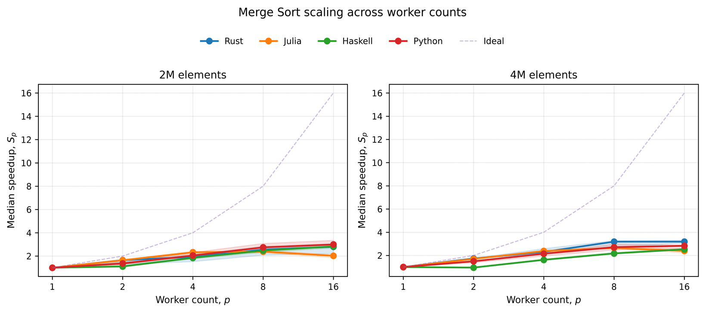
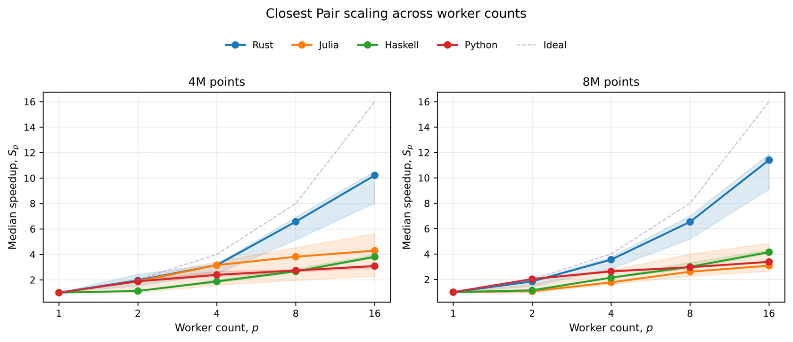
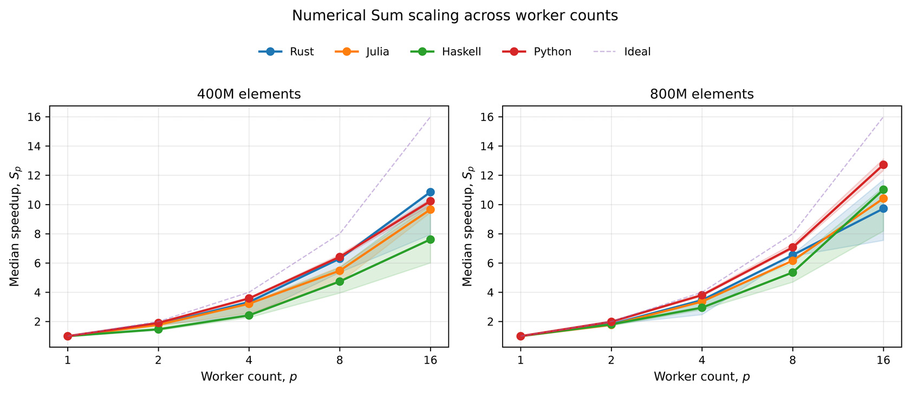
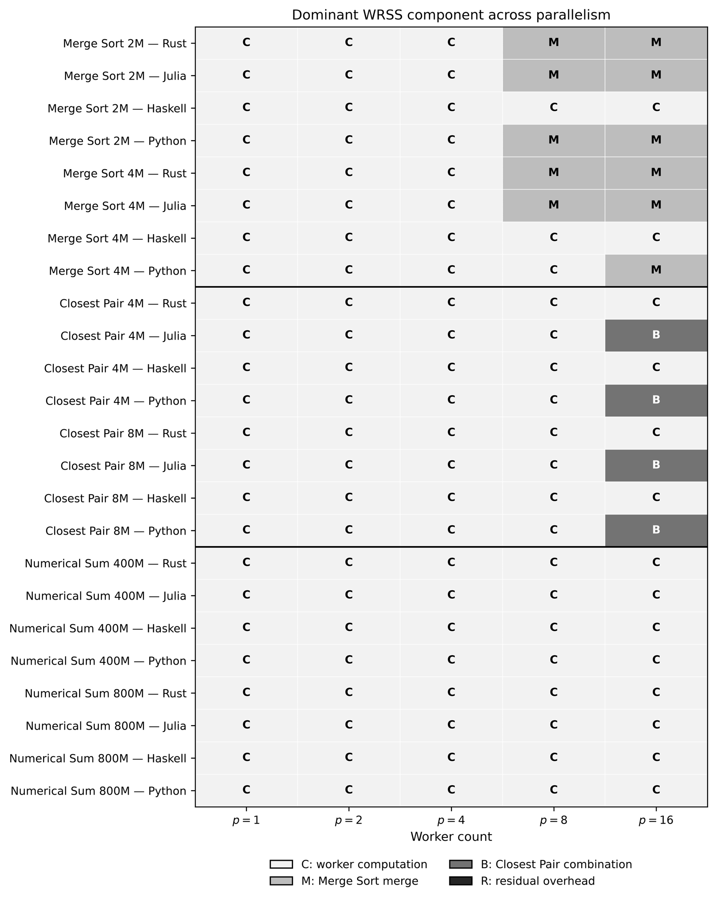
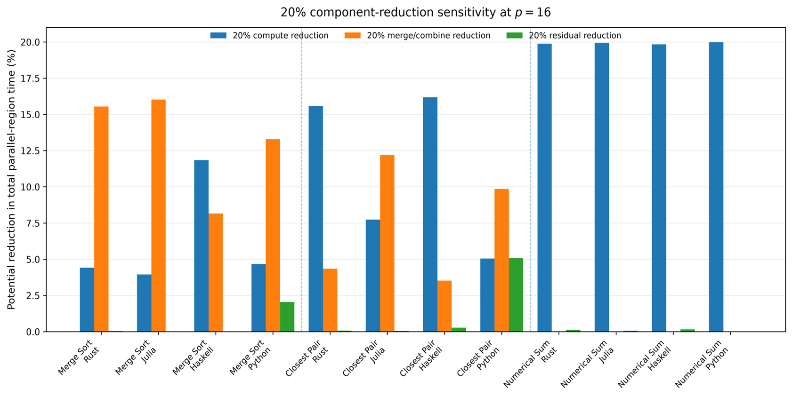
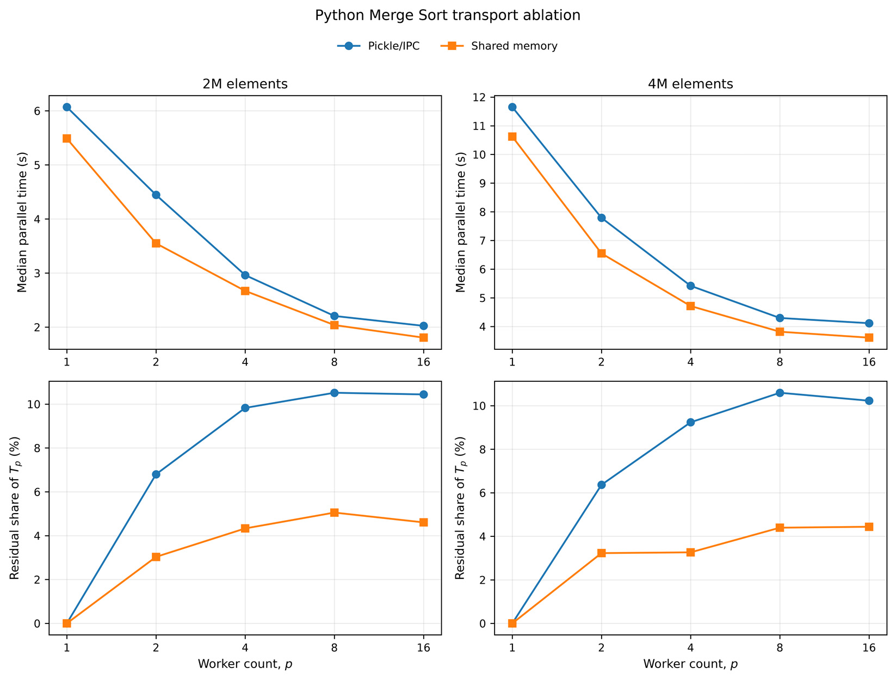

<!-- page: 1 -->

# Investigating Parallel Scaling Bottlenecks Across Rust, Julia, Haskell, and Python: Workload–Runtime Signatures

Muhammad Hassam Aslam Khan 1,*, Daniel Stapleton 2, Medha Kulkarni 2, Isaac Manring 3, Md Rifat Ullah 2 and Rajeev R. Raje 4

*1 Department of Computer Science, University of Arkansas at Little Rock, Little Rock, AR 72202, USA*  
*2 Department of Computer and Information Science, Indiana University Purdue University Indianapolis, Indianapolis, IN 46202, USA; d_stape85@yahoo.com (D.S.); medha.662000@gmail.com (M.K.); rifatullah21@gmail.com (M.R.U.)*  
*3 Computer Information Science & Engineering, University of Florida, Gainesville, FL 32611, USA; imanring@ufl.edu*  
*4 Department of Computer Science, Indiana University Indianapolis, Indianapolis, IN 46202, USA; rraje@iu.edu*  
*Correspondence: mkhan5@ualr.edu*

> **Academic Editor:** Ian Gorton  
> **Received:** 27 July 2026  
> **Revised:** 26 August 2026  
> **Accepted:** 28 August 2026  
> **Published:** 30 August 2026  
> **Copyright:** © 2026 by the authors.  
> Licensee MDPI, Basel, Switzerland.  
> This article is an open access article  
> distributed under the terms and  
> conditions of the Creative Commons  
> Attribution (CC BY) license.

## Abstract

Parallel performance depends not only on programming language and runtime design, but also on how the dominant execution bottleneck changes as parallelism increases. We present a controlled cross-language study of Rust, Julia, Haskell, and Python using Merge Sort, Closest Pair of Points, and Numerical Sum in a multicore environment. For each of the three workloads, we evaluate four language-based implementations at five worker counts p ∈ {1, 2, 4, 8, 16} using two input sizes and 10 untrimmed trials per configuration, yielding 3 × 4 × 5 × 2 × 10 = 1200 benchmark observations. We propose a decomposition-based diagnostic framework built on three measured components: slowest-worker computation (Cp), algorithmic merge/combine work (Bp), and residual parallel overhead (Rp). Their normalized fractions, together with observed speedup, form a Workload–Runtime Scaling Signature (WRSS). Tracking WRSS across worker counts identifies Bottleneck Transition Points (BTPs). We additionally apply a standardized 20% component-reduction sensitivity analysis to express how strongly total parallel-region time depends on each measured component under an explicit ceteris-paribus assumption. Across the 3 × 2 × 4 = 24 workload–size–implementation conditions, each tracked over p ∈ {1, 2, 4, 8, 16}, 10 (41.67%) exhibit a bottleneck transition: six of eight Merge Sort conditions and four of eight Closest Pair conditions, whereas none of the eight Numerical Sum conditions exhibits a transition. At p = 16, Merge Sort reaches only 2.02–3.19× median speedup because merge work dominates several configurations; Numerical Sum reaches 7.61–12.72× while remaining almost entirely computation-dominant. A separate 100-observation Python shared-memory ablation reduces Merge Sort residual overhead substantially, but leaves the merge stage dominant. The results show that useful parallelism depends on how workload structure and runtime mechanisms shape the evolution of the dominant bottleneck as worker count increases.

**Keywords:** parallel computing; programming languages; scaling diagnosis; workload–runtime scaling signature; bottleneck transition; component sensitivity; runtime overhead; Rust; Julia; Haskell; Python

<!-- page: 2 -->

## 1. Introduction

Multicore processors make parallel execution available to a wide range of scientific, engineering, and data-intensive applications, but parallel speedup is not determined by programming language alone. A program can scale well when each parallel unit performs enough useful work to amortize coordination and data movement, while the same runtime can scale poorly when workers exchange or reorganize substantial data relative to the amount of computation performed [1–3]. Consequently, comparisons that report a single language ranking from one workload or one core count can obscure the interaction between workload structure, input size, and runtime design.

This study examines this interaction across Rust, Julia, Haskell, and Python. The four language ecosystems represent substantially different execution models: native shared-memory threads without garbage collection in Rust, JIT-compiled tasks with garbage collection in Julia, a lazy functional runtime with lightweight capabilities in Haskell, and process-based parallelism in Python. Rather than treating these properties as fixed indicators of performance, we evaluate how they interact with three workloads whose communication and combination structures differ: Merge Sort, Closest Pair of Points, and Numerical Sum.

This study is organized around four research questions:

- **RQ1:** How do speedup and parallel efficiency change with worker count and input size within each language-based implementation?

- **RQ2:** How does the measured composition of parallel time evolve across worker counts, and when does the dominant bottleneck change?

- **RQ3:** How do bottleneck transitions differ across workloads and runtime mechanisms?

- **RQ4:** Under a standardized 20% component-reduction perturbation, how sensitive is total parallel-region time to each measured component?

The methodological contribution of this study is a decomposition-based framework for diagnosing cross-runtime parallel scaling. First, we define a Workload–Runtime Scaling Signature (WRSS) that summarizes each workload–implementation–size configuration at worker count p through normalized worker-computation, merge/combine, and residual fractions together with observed speedup. Tracking this signature across p ∈ {1, 2, 4, 8, 16} exposes how the source of parallel time changes as worker computation is divided among more cores.

Second, we define a Bottleneck Transition Point (BTP) as the first tested worker count at which the dominant WRSS component differs from its p = 1 value. This provides a mechanism-level description of bottleneck evolution as worker count increases rather than treating all departures from ideal speedup as generic scheduling overhead.

Third, we apply a standardized 20% component-reduction sensitivity analysis that asks how much total parallel-region time would decrease if one measured component were reduced while the other measured components remained unchanged. The analysis is intended to express the magnitude of dependence on an already identified component rather than to serve as a causal performance predictor. We evaluated the framework using 1200 benchmark observations and a separate 100-observation Python shared-memory ablation that provided a mechanism-level check on the interpretation of process-transport overhead.

The contribution is therefore not a universal ranking of programming languages. Rather, it is a reproducible measurement-to-diagnosis procedure that connects scaling outcomes to the evolving composition of parallel execution. This emphasis is consistent with prior work showing that experimental choices can materially affect systems-performance conclusions and that variability and experimental controls should be reported explicitly [4,5].

<!-- page: 3 -->

Workload Computation-to-Communication Structure

Computation-to-communication ratio (CCR) is commonly used to describe the balance between useful computation and the communication required to parallelize it. In a cross-language experiment, however, runtime-specific quantities such as garbage-collection pauses, scheduler latency, process serialization, or inter-process communication (IPC) cost cannot be part of the workload definition because their values depend on the implementation being evaluated.

We therefore use an algorithmic computation-to-communication structure rather than assigning each workload a timing-derived CCR value or imposing universal numerical thresholds. The characterization is determined before examining performance outcomes and depends only on the common decomposition used by the four implementations.

Merge Sort represents the most combination-intensive condition. Each worker sorts a local partition, but all sorted partitions subsequently participate in pairwise merge levels until one globally ordered result remains. Closest Pair contains substantial independent geometric search within each partition, followed by selective boundary-strip examination when adjacent regions are combined. Numerical Sum has the simplest cross-worker state: each worker scans an independent region and returns only a scalar partial sum.

Accordingly, the three workloads provide distinct structural conditions: Merge Sort requires global pairwise merging, Closest Pair combines substantial local search with boundary-sensitive refinement, and Numerical Sum requires only scalar reduction after independent local scans. These descriptions are based on algorithmic dataflow rather than on observed timing or speedup. Whether computation, combination, or residual overhead dominates execution is determined subsequently from the measured timing decomposition. Table 1 summarizes these language-independent structural characteristics.

**Table 1.** Language-independent structural characteristics of the three benchmark workloads.

| Workload | Local Parallel Work | Combination Operation | Workload Structure |
| --- | --- | --- | --- |
| Merge Sort | Sort one contiguous partition per worker | Pairwise merging of sorted partitions | Global merge intensive |
| Closest Pair | Search for one spatial region per worker | Boundary-strip refinement between adjacent regions | Local search with boundary combination |
| Numerical Sum | Scan and accumulate one region per worker | Scalar reduction of worker partial sums | Minimal combination |

[查看表格原图](tables/table-01.png)

## 2. Related Work

Cross-language benchmarking has long been used to compare execution time, memory behavior, and implementation trade-offs. The Computer Language Benchmarks Game provides a broad collection of small cross-language programs [6], while Nanz and Furia used Rosetta Code to compare language characteristics across common tasks [7]. More recent parallel comparisons likewise show that language rankings are workload dependent. Lewis et al. compared shared-memory N-body implementations across several languages and reported that runtimes were relatively similar for direct numerical kernels, but diverged much more strongly when a kD-tree changed the data-structure and memory-access profile [8]. This observation motivates examining workload structure rather than treating language as the sole explanatory variable.

A second body of work studies computation/communication balance and scalability. Amdahl’s Law formalizes the effect of a non-parallelizable fraction on speedup [1], while Hill and Marty discuss its implications for multicore processors [2]. Topcuoglu et al. use computation-to-communication characteristics in heterogeneous scheduling [9], and Yavits et al. explicitly analyze how communication and synchronization extend classical scaling limits [3]. Our study adopts this workload-aware perspective, but keeps the workload descriptor independent of language-specific garbage collection (GC), scheduler, and serialization times.

<!-- page: 4 -->

A third approach cited in the literature concerns the benchmarking methodology itself. Mytkowicz et al. demonstrated that apparently innocuous experimental factors can change measured system performance enough to alter conclusions [4]. Kalibera and Jones developed a statistically rigorous methodology for repeated performance experiments and uncertainty reporting [5]. Following these principles, our study used deterministic randomized run order, fixed CPU affinity, an explicit machine-load admission gate, all 10 measured observations, and measures of dispersion and confidence without performance-based trimming.

Data-driven diagnostic methods have also been investigated in adjacent application domains. Zhang et al. [10] proposed a data-driven fault-diagnosis approach for air-handling units that combine feature extraction with graph-based learning. Although this work demonstrates the use of data-driven methods for diagnostic analysis, its application domain and research objectives differ substantially from the cross-language parallel-performance diagnosis considered in this study. Consequently, its methodological approach is not directly used in the present analysis.

Performance diagnosis has also been addressed by various researchers using analytical and empirical models. The Roofline model relates computational throughput to operational intensity and hardware ceilings [11], while the Execution–Cache–Memory (ECM) model decomposes single-core and multicore kernel behavior using architectural execution and data-transfer contributions [12]. Extra-P automatically derives empirical performance models to expose scalability bugs as input size and process count vary [13], and Scalasca identifies communication, synchronization, and wait-state bottlenecks from parallel execution measurements and traces [14]. Coz takes a causal-profiling approach, using controlled virtual speedups to estimate where code optimization can affect end-to-end performance [15].

The present study is complementary to these approaches. It does not model architectural FLOP/byte ceilings, fit asymptotic scaling functions, or claim causal optimization effects. Instead, it uses an explicitly instrumented timing decomposition that is available across four different runtime models, normalizes the measured components into WRSS, tracks dominant-component transitions across worker counts, and applies a fixed 20% sensitivity perturbation to quantify how strongly total parallel time depends on each component. The purpose is to control cross-runtime diagnosis under algorithmically aligned workloads rather than detailed microarchitectural or trace-based profiling.

## 3. Materials and Methods

### 3.1. Performance Metrics

Let $T_{p,r}$ denote the measured parallel-region time for repetition r ∈ {1,..., 10} at worker count p ∈ {1, 2, 4, 8, 16}. For each workload, input size, language-based implementation, and worker count, 10 benchmark trials were performed. We denote the median of these 10 measured times at worker count p by $T_{p}$:

$$
\begin{gathered} \widetilde{T}_p = \mathrm{median}_r(T_{p,r}) \\ S_p = \frac{\widetilde{T}_1}{\widetilde{T}_p}, \end{gathered} \tag{1}
$$

$$
E_p = \frac{S_p}{p}, \tag{2}
$$

<!-- page: 5 -->

Here, $T_{1}$ is the median execution time of the one-worker configuration and serves as the baseline for computing speedup. A parallel efficiency of $E_{p}$ = 1 corresponds to ideal linear scaling, for which $S_{p}$ = p; $E_{p}$ &lt; 1 indicates sub-linear scaling. Values of $S_{p}$ &lt; 1 indicate that the corresponding parallel configuration was slower than the one-worker baseline.

The analysis does not fit a fixed Amdahl parallel fraction or infer a universal language-specific overhead coefficient. Amdahl’s Law is retained as theoretical context for scaling with increasing worker count, while input size is evaluated separately through the two workload-specific sizes. The empirical analysis is based on directly observed execution times, speedup, parallel efficiency, and timing decomposition across p ∈ {1, 2, 4, 8, 16}. This approach avoids conflating the workload’s parallel structure with runtime-specific effects.

### 3.2. Measured Timing Decomposition

For readability, the repetition index r is suppressed in the component-level notation below; $T_{p}$, $C_{p}$, $B_{p}$, and $R_{p}$ refer to quantities from an individual trial at worker count p, while an overbar denotes the arithmetic mean across the 10 trials.

For each workload implementation, the measured parallel-region time is decomposed into three non-overlapping timing components: slowest-worker computation ( $C_{p}$ ), algorithmic merge/combine work ( $B_{p}$ ), and residual parallel overhead ( $R_{p}$ ). The decomposition is additive because these components account for the measured parallel-region time as $T_{p}$ = $C_{p}$ + $B_{p}$ + $R_{p}$, apart from the non-negativity adjustment described below. For Merge Sort, $B_{p}$ represents the pairwise merging of sorted worker partitions. For Closest Pair, $B_{p}$ represents pairwise region combination and boundary-strip refinement. Numerical Sum has no comparable merge/combine stage beyond scalar reduction, so $B_{p}$ is effectively zero. The residual component is defined as

$$
R_p = \max(0, T_p - C_p - B_p). \tag{3}
$$

The max(0,.) operation prevents small negative residuals caused by timer resolution or measurement noise. Thus, $R_{p}$ captures measured parallel-region time not accounted for by worker computation or the explicitly timed algorithmic merge/combine stage. Depending on the runtime mechanism, $R_{p}$ may include synchronization, task release or retrieval, process dispatch, serialization or result transport, waiting, runtime bookkeeping, and other costs not separately isolated by the instrumentation. The residual is therefore descriptive and is not interpreted as a direct measurement of scheduling overhead.

### 3.3. Workload–Runtime Scaling Signature and Bottleneck Transition

For each workload w, language-based implementation l, input size n, and worker count p, the timing components defined in Section 3.2 are converted into normalized mean fractions as follows:

$$
\begin{aligned}
c_p &= \frac{\overline{C}_p}{\overline{T}_p}, & b_p &= \frac{\overline{B}_p}{\overline{T}_p}, & r_p &= \frac{\overline{R}_p}{\overline{T}_p},
\end{aligned} \tag{4}
$$

where the bar denotes the arithmetic mean across the 10 measured trials for the corresponding experimental configuration. Because the per-trial decomposition is additive, the mean fractions satisfy $c_{p}$ + $b_{p}$ + $r_{p}$ = 1 up to numerical precision. Median speedup $S_{p}$ remains defined by Equation (1). We define the Workload–Runtime Scaling Signature as:

$$
\mathrm{WRSS}_{w,l,n}(p) = [c_p, b_p, r_p, S_p]. \tag{5}
$$

<!-- page: 6 -->

Related performance-analysis approaches characterize bottlenecks through architectural models, execution/memory decomposition, trace-based analysis, or causal profiling [11,12,14,15]. WRSS is complementary to these approaches: unlike a static component-percentage table, it tracks normalized timing components together with median speedup across worker counts. This reveals how the dominant bottleneck evolves with increasing parallelism and enables identification of Bottleneck Transition Points (BTPs), giving practitioners a scaling-oriented view rather than a single-configuration snapshot.

Parallel efficiency is reported separately because $E_{p}$ = $S_{p}$ /p is directly determined by $S_{p}$ and p.

The dominant measured component at worker count p is:

$$
D_p = \arg\max \{c_p, b_p, r_p\}. \tag{6}
$$

For Merge Sort, the merge/combine component corresponds to merging; for Closest Pair, it corresponds to region combination; and for Numerical Sum, $b_{p}$ = 0 because no separately timed merge/combine stage is present. We define the Bottleneck Transition Point as:

$$
p_{\mathrm{BT}}=\min\{p>1:D_{p}\neq D_{1}\}, \tag{7}
$$

when such a tested worker count exists. BTP identifies the first tested worker count p &gt; 1 at which the dominant measured component differs from that at p = 1. It is therefore a descriptive observation within the tested worker counts rather than an extrapolated threshold.

### 3.4. Standardized 20% Component Sensitivity Analysis

To express the magnitude of each measured component on a common scale, we apply the same hypothetical 20% reduction to each component. For $X_{p}$ ∈ $C_{p}$, $B_{p}$, $R_{p}$, let $x_{p}$ = $X_{p}$ / $T_{p}$ denote its normalized share. If that component were reduced by fraction α = 0.20 while the remaining components were unchanged, the counterfactual parallel time would be

$$
T_p^{(X,20)} = T_p - 0.20\mathrm{X}_p \tag{8}
$$

The corresponding fractional reduction in total parallel time is therefore

$$
\mathrm{Sensitivity}_{X,p}^{20\%} = \frac{T_p - T_p^{(X,20)}}{T_p} = 0.20 x_p. \tag{9}
$$

We report this quantity as the percentage reduction in total parallel-region time under the standardized perturbation. The 20% value is applied uniformly across all workloads, runtimes, sizes, worker counts, and components to provide a common sensitivity scale; it does not imply that a concrete optimization will necessarily achieve that reduction. The assumption that one component can change while the others remain fixed is discussed as a limitation in Section 6.4.

### 3.5. Languages and Parallel Mechanisms

The experiments used Rust 1.97.1, Julia 1.12.7, GHC 9.10.3, and Python 3.13.5. To keep the implementations algorithmically aligned, all workloads used explicit language-level parallel mechanisms rather than substituting optimized numerical libraries for only one implementation. Table 2 summarizes the runtime characteristics and parallel mechanisms used for each implementation.

<!-- page: 7 -->

**Table 2.** Languages and parallel mechanisms used in the benchmark.

| Language | Runtime Characteristics | Parallel Mechanism Used |
| --- | --- | --- |
| Rust | Native code; static typing; ownership-based memory management; no tracing GC | Native scoped threads over pinned physical cores |
| Julia | LLVM-based JIT; task runtime; garbage collected | Threads.@spawn with explicit task synchronization |
| Haskell | Native code through GHC; lazy functional runtime; garbage collected | forkOn workers with MVar-based synchronization |
| Python | CPython interpreter; GIL for threads; process-based CPU parallelism | multiprocessing; pickle transport for Merge Sort/Closest Pair and inherited read-only mmap for Numerical Sum |

[查看表格原图](tables/table-02.png)

### 3.6. Experimental Platform and Core Scaling

The experimental design used two input sizes for each workload: 2 and 4 million elements for Merge Sort, 4 and 8 million points for Closest Pair, and 400 and 800 million elements for Numerical Sum. Each workload–size–implementation–worker-count configuration included 10 measured trials, yielding 400 observations per workload and 1200 observations across the three workloads.

All benchmark measurements were collected on a shared-memory dual-socket AMD EPYC 9454 system running Ubuntu 24.04.3. The machine provides 48 physical cores per socket with simultaneous multi-threading enabled and 1 TiB of memory. To avoid mixing NUMA effects with the implementation comparison, all benchmark configurations used physical cores from a single socket and excluded their simultaneous multi-threading (SMT) siblings. The tested worker counts were p ∈ {1, 2, 4, 8, 16}. CPU affinity was fixed across language-based implementations so that a given p used the same logical processor IDs for every workload and language-based implementation.

### 3.7. Benchmark Execution Protocol

Before each benchmark trial, a machine-load admission gate sampled the benchmark CPUs and the selected socket for three consecutive 5 s windows. A timed trial began only when average utilization was at most 5% and no benchmark CPU exceeded 20% utilization in each required window. If these criteria were not satisfied, the trial was delayed and the admission gate was evaluated again. A lightweight interference monitor ran on a core outside the benchmark socket during execution, and its telemetry was recorded as ancillary information. The monitor did not determine whether a completed timing observation was included in the analysis.

No performance-based trimming or post hoc exclusion based on execution time was applied. All 10 measured trials in each experimental configuration were included in the analysis, provided that the workload-specific correctness checks were satisfied. Input generation, file loading, deterministic preprocessing, worker/process creation where supported, and first-use JIT compilation were excluded from $T_{p}$. The timed region began immediately before the synchronized worker release or process dispatch, and ended after the required result collection and algorithmic merge/combine work.

For the Julia-based implementation, an untimed preliminary execution of the same computation routines and parallel task-orchestration code used in the benchmark was performed before each measured configuration. The preliminary execution used the same data types as the measured run and served only to trigger first-use JIT compilation. Garbage collection was invoked after this preliminary execution and before timing began. The benchmark was then executed using the full experimental input. Consequently, JIT compilation time was excluded from $T_{pr}$, while the computation and parallel-execution logic remained unchanged.

<!-- page: 8 -->

### 3.8. Correctness and Reproducibility Controls

Exact source versions, generated input files, validation artifacts, and experimental protocols were frozen and SHA-256 hashed before benchmark data collection. A timed run was included in the benchmark dataset only if its output passed the predefined correctness checks for the corresponding workload. For Merge Sort, correctness required preservation of output length, non-decreasing order, modular sum, and XOR. Closest Pair was first validated on a deterministic 5000-point dataset against an independent brute-force oracle, with all four implementations required to reproduce the exact squared distance and pair identifiers; final large-input runs additionally required cross-language result agreement. For Numerical Sum, the computed result was required to match the exact expected checksum of the deterministic input. Runs that did not satisfy the corresponding correctness criteria were excluded from the timing dataset; no run was excluded because of its measured execution time.

### 3.9. Statistical Analysis

All 10 measured trials in each experimental configuration were included in the statistical analysis without performance-based trimming or post hoc exclusion based on execution time. For each experimental configuration, we calculated the arithmetic mean, median, standard deviation (SD), interquartile range (IQR), coefficient of variation (CV), and a 95% confidence interval for the mean. The mean confidence interval was computed using the Student-t distribution with nine degrees of freedom. Median speedup is defined as

∼ ∼ $S_{p}$ = $T_{1}$ / $T_{p}$, with parallel efficiency $E_{p}$ = $S_{p}$ /p.

Uncertainty in median runtime and median speedup was additionally quantified using non-parametric percentile bootstrap confidence intervals with 10,000 resamples and a fixed random seed (2026081904). For each of the 24 workload–size-implementation conditions, a Kruskal–Wallis test was used to evaluate whether runtime distributions differ across p ∈ {1, 2, 4, 8, 16}. A two-sided Mann–Whitney U test was used to compare the p = 1 and p = 16 runtime distributions, and Cliff’s delta was reported as a non-parametric effect-size measure, with a positive value indicating larger runtimes at p = 1. To control the false-discovery rate across repeated comparisons, Benjamini–Hochberg correction was applied separately across the 24 tests within each statistical-test family. Statistical significance was assessed at α = 0.05 after Benjamini–Hochberg adjustment.

## 4. Benchmark Workloads and Implementations

### 4.1. Merge Sort

Merge Sort provides a communication- and combination-intensive divide-and-conquer workload. For both sizes (2 and 4 million unsigned 64-bit values), every language-based implementation received the same deterministic binary input. The input was partitioned into contiguous chunks outside the timed region. Inside $T_{p}$, each worker executed the same hand-written top-down Merge Sort on one chunk. After all workers completed their tasks, the sorted chunks were combined using pairwise hand-written merges until a single globally sorted array remained. No implementation used a built-in sort in the timed sorting routine.

The Rust-based implementation used native scoped threads over shared memory; the Julia-based implementation used Threads.@spawn; the Haskell-based implementation used forkOn and MVar; and the Python-based implementation used a pre-created multiprocessing.Pool. In the Python-based implementation, chunk materialization occurred before timing, whereas pool.map dispatch, pickle serialization, worker computation, result return, and pairwise merging was included in the measured region. A separate shared-memory Python ablation was analyzed independently so that the result did not assume that pickle transport is an unavoidable property of Python multiprocessing.

<!-- page: 9 -->

### 4.2. Closest Pair of Points

Closest Pair used deterministic 2D points stored as little-endian (x, y) unsigned 32-bit pairs. Coordinates were converted to Float64 in every implementation; the generator restricted coordinates so that all squared distances remained exactly representable below 253. Points were sorted by x coordinate outside the timed region and partitioned into p contiguous regions.

Each worker executed the same hand-written exact divide-and-conquer closest-pair variant on its region. Local candidates were then combined pairwise using deterministic boundary-strip refinement across adjacent regions. Ties were resolved deterministically by squared distance and point identifiers. A separate brute-force oracle on 5000 deterministic points established the exact expected answer before final-sized runs. The final sizes used in the study were 4 and 8 million points.

### 4.3. Numerical Sum

Numerical Sum was used as a minimal-combination validation workload. The input consisted of deterministic unsigned 64-bit values generated by an indexed SplitMix64 procedure and stored in binary form. Final sizes used in experiments were 400 and 800 million elements. Each worker scanned a disjoint contiguous region and accumulated an unsigned 64-bit partial sum; the final result was computed as the exact modular sum of all partials.

The Rust-based implementation used native threads, the Julia-based implementation used Julia threads, the Haskell-based implementation used pinned runtime workers, and the Python-based implementation used pure multiprocessing with an inherited read-only memory map. Thus, the Python-based Numerical Sum implementation did not rely on NumPy or another native numerical library. Input loading, memory mapping, and page-prefaulting occurred outside $T_{p}$, while the worker computation and synchronization required for the parallel reduction were also measured. Numerical Sum was not used to define workload thresholds from observed speedup; its algorithmic dataflow identifies it as the minimal-combination condition, while whether worker computation dominates measured execution is determined from the timing decomposition.

## 5. Results

### 5.1. Merge Sort Scaling

The Merge Sort experiment comprises 400 benchmark observations: 2 input sizes, 5 worker counts, 4 language-based implementations, and 10 measured trials per configuration (2 ×5 × 4 × 10 = 400). Table 3 summarizes the median speedup and parallel efficiency at p = 16, while Figure 1 shows the scaling behavior across all tested worker counts.

**Table 3.** Merge Sort median speedup and parallel efficiency at p = 16.

| Language | 2M Speedup | 2M Eff. (%) | 4M Speedup | 4M Eff. (%) |
| --- | --- | --- | --- | --- |
| Rust | 2.797 | 17.48 | 3.188 | 19.92 |
| Julia | 2.024 | 12.65 | 2.395 | 14.97 |
| Haskell | 2.825 | 17.66 | 2.533 | 15.83 |
| Python | 2.998 | 18.74 | 2.832 | 17.70 |

[查看表格原图](tables/table-03.png)

<!-- page: 10 -->

**Figure 1.** Median speedup of Merge Sort across worker counts for the 2M- and 4M-element inputs.

At p = 16, Merge Sort is primarily limited by the global merge stage. For the 4M input, the merge accounts for 77.68% of mean parallel time in Rust, 80.13% in Julia, 40.78% in Haskell, and 66.43% in Python. The corresponding residual components are 0.21%, 0.11%, 0.01%, and 10.23%, respectively. Thus, poor parallel efficiency cannot generally be attributed to scheduler overhead: for Rust and Julia in particular, the measured residual is negligible while algorithmic merging dominates.

Figure 1 shows how median speedup changed as worker count increased from p = 1 to p = 16. Each point was based on 10 measured trials, and the shaded bands represent non-parametric bootstrap 95% confidence intervals computed using 10,000 resamples. The dashed line represents ideal linear speedup. Across all four implementations, the incremental speedup gains became progressively smaller at higher worker counts. The timing decomposition in Section 5.2 identifies the measured components responsible for these diminishing gains.

### 5.2. Merge Sort Timing Decomposition

Table 4 reports the mean timing components across the 10 measured trials for each configuration. Means are used for this decomposition so that the component averages remain consistent with the measured parallel-region time, $T_{p}$ = $C_{p}$ + $B_{p}$ + $R_{p}$.

**Table 4.** Merge Sort p = 16 mean timing decomposition. Percentages are shares of mean parallel-region time.

| Size | Language | Tp (s) | Compute (%) | Merge (%) | Residual (%) |
| --- | --- | --- | --- | --- | --- |
| 2M | Rust | 0.120375 | 24.32 | 75.30 | 0.37 |
| 2M | Julia | 0.162307 | 29.04 | 70.75 | 0.21 |
| 2M | Haskell | 1.956103 | 53.17 | 46.80 | 0.03 |
| 2M | Python | 2.016898 | 22.64 | 66.92 | 10.44 |
| 4M | Rust | 0.223986 | 22.11 | 77.68 | 0.21 |
| 4M | Julia | 0.295381 | 19.76 | 80.13 | 0.11 |
| 4M | Haskell | 4.555595 | 59.21 | 40.78 | 0.01 |
| 4M | Python | 4.098960 | 23.34 | 66.43 | 10.23 |

[查看表格原图](tables/table-04.png)

The timing decomposition shows that the diminishing speedup gains of Merge Sort at higher worker counts arise from different measured components across the four implementations. At p = 16, the Rust-based and Julia-based implementations are strongly merge-dominated, while their residual fractions remain below 0.4%. The Python-based implementation is also merge-dominated, but retains a residual fraction of approximately 10%, which may include process dispatch, serialization or transport, synchronization, waiting, and other costs not separately isolated by the instrumentation. In contrast, the Haskell-based implementation remains computation-dominated at both input sizes. These differences motivate examining how the dominant WRSS component changes with worker count rather than attributing all departures from ideal speedup to a generic runtime-overhead term.

<!-- page: 11 -->

### 5.3. Closest Pair Scaling

Closest Pair achieved higher median speedup at larger worker counts than Merge Sort for several of the evaluated implementations. At p = 16, the 4-million-point input achieved median speedups of 10.21, 4.30, 3.81, and 3.09 for the Rust-based, Julia-based, Haskell-based, and Python-based implementations, respectively. For the 8-million-point input, the corresponding median speedups were 11.41, 3.08, 4.15, and 3.39, respectively. Table 5 reports the corresponding execution times and efficiencies, while Figure 2 shows how median speedup changed across the tested worker counts.

**Table 5.** Closest Pair median execution time, speedup, and parallel efficiency at (p = 16) for the 4M- and 8M-point inputs.

| Size | Language | T1 (s) | T16 (s) | S16 | E16 (%) |
| --- | --- | --- | --- | --- | --- |
| 4M | Rust | 1.1301 | 0.1107 | 10.211 | 63.82 |
| 4M | Julia | 0.2212 | 0.0515 | 4.296 | 26.85 |
| 4M | Haskell | 2.1084 | 0.5534 | 3.810 | 23.81 |
| 4M | Python | 24.5370 | 7.9548 | 3.085 | 19.28 |
| 8M | Rust | 2.3606 | 0.2070 | 11.405 | 71.28 |
| 8M | Julia | 0.2721 | 0.0883 | 3.082 | 19.26 |
| 8M | Haskell | 4.8088 | 1.1591 | 4.149 | 25.93 |
| 8M | Python | 53.1045 | 15.6755 | 3.388 | 21.17 |

[查看表格原图](tables/table-05.png)

**Figure 2.** Median speedup of Closest Pair across worker counts for the 4M- and 8M-point inputs.

At p = 16, the mean-component decomposition further separates the limiting mechanisms. For 8M points, worker computation contributes 77.92% of parallel time in the Rust-based implementation and 80.97% in the Haskell-based implementation, whereas the Julia-based implementation is combine-dominated, with the combination stage accounting for 61.02% of parallel time. The Python-based implementation divides its parallel time among worker computation (25.27%), combination (49.32%), and residual overhead (25.42%). The residual is therefore consequential for Python Closest Pair, but it is still not the largest measured component.

<!-- page: 12 -->

Figure 2 shows the median speedup of the four implementations as worker count increases from p = 1 to p = 16. Each plotted point is based on 10 measured trials, and the shaded bands represent non-parametric bootstrap 95% confidence intervals computed using 10,000 resamples. The dashed line represents ideal linear speedup. Compared with Merge Sort, Closest Pair achieves higher median speedup at larger worker counts for several implementations, although the magnitude and shape of the speedup curves remain implementation dependent. The Rust-based implementation continues to gain substantial speedup through p = 16, whereas the Julia-based, Haskell-based, and Python-based implementations depart from ideal linear speedup at lower worker counts.

### 5.4. Compute-Dominant Numerical Sum

Numerical Sum achieves the highest median speedups at p = 16 among the three evaluated workloads. For the 400M input, median speedup ranges from 7.61 to 10.85 across the four language-based implementations, while for the 800M input, it ranges from 9.72 to 12.72. At p = 16, worker computation accounts for 98.5–99.9% of mean parallel-region time across the eight implementation–size conditions, with residual overhead below 1.5%. These results show that speedup continues to increase with worker count when independent worker computation remains the dominant measured component. Table 6 summarizes the corresponding median speedup and parallel efficiency at.

**Table 6.** Numerical Sum median speedup and parallel efficiency at p = 16 for the 400M- and 800M-element inputs.

| Language | 400M Speedup | 400M Eff. (%) | 800M Speedup | 800M Eff. (%) |
| --- | --- | --- | --- | --- |
| Rust | 10.854 | 67.84 | 9.723 | 60.77 |
| Julia | 9.661 | 60.38 | 10.416 | 65.10 |
| Haskell | 7.613 | 47.58 | 11.020 | 68.88 |
| Python | 10.233 | 63.96 | 12.722 | 79.51 |

[查看表格原图](tables/table-06.png)

All four language-based implementations achieve substantial median speedup on the computation-dominant Numerical Sum workload. The larger 800M condition improves p = 16 efficiency for Julia, Haskell, and Python, illustrating the expected effect of increased work per parallel unit, although Rust does not show the same monotonic size effect. The result therefore supports a workload-granularity interpretation without implying that higher algorithmic CCR produces a universal monotonic ranking across languages.

Figure 3 shows how median speedup changes as worker count increases from p = 1 to p = 16. Each plotted point is based on 10 measured trials, and the shaded bands represent non-parametric bootstrap 95% confidence intervals computed using 10,000 resamples. The dashed line represents ideal linear speedup. In contrast to the more combination-intensive workloads, Numerical Sum continues to achieve substantial speedup at higher worker counts because worker computation remains the dominant measured component across all four language-based implementations.

### 5.5. WRSS and Bottleneck Transitions

Tracking the dominant WRSS component across p ∈ {1, 2, 4, 8, 16} reveals 10 bottleneck transitions among the 24 workload–size–implementation conditions (41.67%). The transitions are structured by workload rather than occurring uniformly. Six of eight Merge Sort conditions transition away from their p = 1 compute-dominant state: five first become merge dominated at p = 8, while Python 4M first becomes merge-dominated at p = 16. Four of eight Closest Pair conditions transition, all at p = 16 and all from compute to combination; these are the Julia and Python configurations at both sizes. Numerical Sum exhibits no transition in any of its eight conditions, remaining computation-dominated through p = 16. Table 7 summarizes these results.

<!-- page: 13 -->

**Figure 3.** Median speedup of Numerical Sum across worker counts for the 400M- and 800M-element inputs.

**Table 7.** Summary of Bottleneck Transition Points across the 24 workload–size–implementation conditions.

| Workload | Conditions | Transitions | First at p = 8 | First at p = 16 |
| --- | --- | --- | --- | --- |
| Merge Sort | 8 | 6 | 5 | 1 |
| Closest Pair | 8 | 4 | 0 | 4 |
| Numerical Sum | 8 | 0 | 0 | 0 |

[查看表格原图](tables/table-07.png)

Figure 4 summarizes the dominant WRSS component across all 24 workload–size–implementation conditions and across the tested worker counts p ∈ {1, 2, 4, 8, 16}. In the figure, C denotes worker computation, M denotes the Merge Sort merge component, B denotes the Closest Pair boundary-combination component, and R denotes residual parallel overhead. The merge and boundary-combination labels are workload-specific forms of the measured algorithmic merge/combine component $B_{p}$. Letter labels are used together with different fill levels so that the figure remains interpretable in grayscale.

The figure shows that Merge Sort frequently changes from computation dominance to merge dominance as worker count increases. Five of the six observed Merge Sort transitions first occur at p = 8, while the remaining transition occurs at p = 16. Closest Pair retains computation dominance for longer; its four observed transitions occur only at p = 16 in the Julia-based and Python-based implementations at both input sizes. In contrast, Numerical Sum remains computation-dominated for every implementation, input size, and tested worker count.

This pattern helps explain the different median-speedup trends observed as worker count increased. Increasing p reduces local worker computation, but algorithmic merge or combination work does not necessarily shrink at the same rate. A transition therefore identifies a change in the measured performance regime rather than merely departure from ideal speedup.

### 5.6. Component-Reduction Sensitivity

The standardized sensitivity analysis quantifies how total parallel-region time would change under the same hypothetical 20% reduction in each measured component. Table 8 reports results for the larger input size of each workload. For the Rust-based and Julia-based Merge Sort implementations, merging accounts for 77.68% and 80.13% of mean parallel-region time, respectively; consequently, a hypothetical 20% reduction in merge time corresponds to potential reductions in total parallel-region time of 15.54% and 16.03%. The Python-based Merge Sort implementation is also merge-dominated: the same standardized perturbation corresponds to a 13.29% reduction in total parallel-region time, compared with only 2.05% for an equivalent reduction in residual overhead. The Haskell-based Merge Sort implementation remains computation-dominated, so its sensitivity to worker computation is larger than its sensitivity to merge or residual overhead.

<!-- page: 14 -->

**Figure 4.** Dominant WRSS component across worker counts for all workload–size–implementation conditions.

Closest Pair yields a different runtime-specific profile. For the 8M input, the Rust-based and Haskell-based implementations are computation-dominated, whereas the Julia-based and Python-based implementations are combination-dominated. The Python-based implementation has a substantial residual share (25.42%), although its combination share is larger (49.32%); a 20% reduction in these components corresponds to potential total-runtime reductions of 5.08% and 9.86%, respectively. Numerical Sum is nearly entirely computation dominated, so a 20% reduction in worker computation maps to approximately a 20% total-runtime reduction, while residual optimization has negligible sensitivity.

<!-- page: 15 -->

**Table 8.** Standardized component-reduction sensitivity at p = 16 for the larger input of each workload. Entries report the percentage reduction in total parallel-region time under a hypothetical 20% reduction in the indicated component while the remaining measured components are held unchanged.

| Workload | Language | Dominant | Compute | Merge/Combine | Residual |
| --- | --- | --- | --- | --- | --- |
| Merge Sort | Rust | merge | 4.42 | 15.54 | 0.04 |
| Merge Sort | Julia | merge | 3.95 | 16.03 | 0.02 |
| Merge Sort | Haskell | compute | 11.84 | 8.16 | 0.00 |
| Merge Sort | Python | merge | 4.67 | 13.29 | 2.05 |
| Closest Pair | Rust | compute | 15.58 | 4.35 | 0.07 |
| Closest Pair | Julia | combine | 7.74 | 12.20 | 0.05 |
| Closest Pair | Haskell | compute | 16.19 | 3.53 | 0.28 |
| Closest Pair | Python | combine | 5.05 | 9.86 | 5.08 |
| Numerical Sum | Rust | compute | 19.88 | 0.00 | 0.12 |
| Numerical Sum | Julia | compute | 19.94 | 0.00 | 0.06 |
| Numerical Sum | Haskell | compute | 19.84 | 0.00 | 0.16 |
| Numerical Sum | Python | compute | 19.99 | 0.00 | 0.01 |

[查看表格原图](tables/table-08.png)

Figure 5 compares the sensitivity of total parallel-region time to a standardized 20% reduction in worker computation, merge/combine work, or residual overhead, while the other measured components are held unchanged. For Merge Sort, reducing the merge component has the largest estimated effect for the Rust, Julia, and Python implementations, whereas the Haskell-based implementation is more sensitive to worker computation. For Closest Pair, the Rust-based and Haskell-based implementations are most sensitive to worker computation, while the Julia-based and Python-based implementations are more sensitive to the combination stage. Numerical Sum is almost entirely sensitive to worker computation because the other measured components account for only a small fraction of parallel-region time.

**Figure 5.** Standardized 20% component-reduction sensitivity at p = 16 for the larger input size of each workload.

Because the perturbation magnitude is fixed, the sensitivity measure is directly proportional to the corresponding WRSS component share. It therefore does not provide an independent bottleneck-selection criterion. Instead, it translates the measured share into an interpretable change in total parallel-region time under a common perturbation and should be viewed as a quantitative complement to WRSS rather than as a replacement for causal profiling or implementation-specific optimization experiments.

<!-- page: 16 -->

### 5.7. Python Shared-Memory Ablation

To separate Python multiprocessing from the specific cost of transferring large Python lists through pickle-based IPC, we repeated Merge Sort using multiprocessing.shared_memory. The hand-written sorting kernel, input files, worker counts, affinity policy, pairwise merge procedure, and timing boundary were otherwise retained. Figure 6 compares the baseline pickle-based multiprocessing implementation with the shared-memory variant across worker counts.

**Figure 6.** Python Merge Sort transport ablation. The upper panels compare median parallel-region time between ordinary pickle-based multiprocessing and the shared-memory variant across worker counts. The lower panels show the corresponding residual share of total parallel-region time.

At p = 16, the shared-memory implementation reduces the mean residual share from 10.44% to 4.60% for the 2M input and from 10.23% to 4.44% for the 4M input, corresponding to residual-time reductions of 63.66% and 63.54%, respectively. In comparison, median speedup increases only from 2.998 to 3.038 for 2M and from 2.832 to 2.942 for 4M. After the transport overhead is reduced, the pairwise merger still accounts for approximately 69% of mean parallel-region time at p = 16 for both input sizes. These results are consistent with the WRSS diagnosis: reducing Python process-transport overhead lowers the residual component substantially, but the algorithmic merge stage remains the dominant measured bottleneck.

Because the baseline and shared-memory campaigns were collected separately, the ablation was not treated as a causal validation of the standardized 20% component-reduction counterfactual.

<!-- page: 17 -->

### 5.8. Statistical Variation

The full result tables report the standard deviation (SD), interquartile range (IQR), coefficient of variation (CV), 95% confidence intervals for the mean, and bootstrap confidence intervals for median execution time and speedup using all 10 measured trials in each experimental configuration. Variability differed across workloads and configurations. Across all 120 configurations, CV ranged from 0.29% to 43.02%, with a median of 6.68% and an interquartile range of 2.19–12.50%. The median CV was 6.58% for Merge Sort, 7.68% for Closest Pair, and 3.95% for Numerical Sum. The lowest observed CV was 0.29% for the Julia-based Numerical Sum implementation with the 800M input at (p = 8), whereas the highest was 43.02% for the Julia-based Numerical Sum implementation with the 400M input at (p = 16).

Despite this variability, the worker-count effect remained statistically strong. All 24 workload–size–implementation conditions showed a significant difference across the tested worker counts in the Kruskal–Wallis analysis after Benjamini–Hochberg correction. For the p = 1 versus p = 16 comparisons, all 24 conditions yielded U = 100, a Benjamini–Hochberg-adjusted p = 1.83 × 10−4, and Cliff’s δ = 1.0. Thus, in every tested condition, all sampled p = 1 execution times exceeded all sampled p = 16 execution times. This complete sample separation provides strong evidence that the observed reduction in execution time at p = 16 was not attributable to trial-to-trial variation alone.

## 6. Discussion

### 6.1. From Scaling Curves to Bottleneck Evolution

The above results support a narrower and more reproducible conclusion than a universal language ranking. The same runtime can occupy different WRSS regimes depending on the workload, input size, and worker count. All 24 conditions begin computation-dominated, but 10 conditions later change the dominant component. Most Merge Sort transitions occur by p = 8, reflecting the increasing importance of global merging as local sorting is divided among more workers. Closest Pair retains compute dominance longer, with only Julia and Python becoming combine dominated at p = 16. Numerical Sum never leaves the compute-dominant regime in the tested range.

This bottleneck-evolution view explains why the same worker count can produce different performance outcomes across workloads and implementations. For the Rust-based and Julia-based Merge Sort implementations, the residual fraction at p = 16 is negligible, while the global merge stage is the dominant measured component. For the Python-based Closest Pair implementation, by contrast, both the combination stage and residual process/runtime overhead make substantial contributions to parallel-region time. At the 8M input and p = 16, they account for 49.32% and 25.42% of mean parallel-region time, respectively. WRSS therefore distinguishes configurations that may show similar departures from ideal speedup, but are limited by different measured components.

The component-reduction analysis adds a standardization to this diagnosis. It does not claim that a 20% optimization is achievable or independent in a real implementation. Instead, it answers a controlled sensitivity question: if one measured component were 20% smaller while the others remained unchanged, how much would total parallel time change? This is deliberately more limited than causal profiling such as Coz [15], but it provides a directly comparable interpretation across the four runtime models because it is derived from the same measured decomposition.

<!-- page: 18 -->

### 6.2. Language-Specific Observations

#### 6.2.1. Rust

The Rust-based implementation achieved low absolute execution times and substantial median speedup on the computation-dominant Numerical Sum workload. On Merge Sort, however, its parallel efficiency at p = 16 remained below 20% because the pairwise merge became the dominant stage. The small measured residual shows that non-ideal scaling in this case should not be attributed primarily to scheduler overhead; the algorithmic combination stage is the more direct bottleneck.

#### 6.2.2. Julia

The Julia-based implementation achieved low absolute execution times for several workloads, but short parallel measurements required explicit control of JIT compilation. The experimental protocol therefore used the untimed preliminary execution described in Section 3.7 to complete first-use JIT compilation before each measured configuration. At (p = 16), the Merge Sort implementation was strongly merge-dominated, and the Closest Pair implementation was combine-dominated, whereas Numerical Sum remained almost entirely worker-computation dominated. These results indicate that the observed limitations at higher worker counts were not primarily attributable to residual runtime overhead. The analysis therefore distinguishes steady-state runtime behavior from first-use compilation effects.

#### 6.2.3. Haskell

The Haskell-based implementation used explicit pinned runtime workers rather than workload-specific spark-depth tuning. Merge Sort showed sub-linear median-speedup growth across the tested worker counts, with worker computation and pairwise merging both making substantial contributions to the measured interval. Numerical Sum scales much more strongly at the larger size, indicating that the runtime benefits when each worker receives a longer compute interval relative to coordination.

#### 6.2.4. Python

Python-based implementation illustrates why the parallel mechanism must be described together with the language. Merge Sort and Closest Pair use process-based parallelism in which dispatch and object serialization are part of $T_{p}$, while Numerical Sum uses pure Python multiprocessing over inherited read-only memory mapping, and therefore avoids transferring the complete input through pickle. The benchmark comparison did not substitute NumPy/native execution for the Python-based implementation. A targeted shared-memory Merge Sort ablation is reported separately to quantify how much of Python’s process-based cost is due to the selected data-transport strategy rather than the algorithm alone.

### 6.3. Practical Interpretation

The proposed framework is intended for performance diagnosis after a representative parallel implementation or prototype is available, rather than for predicting performance before implementation. A practitioner can first execute the implementation across a small range of worker counts to observe how median speedup changes. The measured timing components can then be summarized using WRSS to determine how worker computation, algorithmic combination, and residual overhead evolve as parallelism increases. A BTP identifies whether the dominant measured component changes within the tested worker range, while the standardized component-reduction analysis quantifies how strongly total parallel-region time depends on each component. Together, these steps can guide decisions about worker count and identify which part of an existing implementation is the most relevant target for further optimization.

<!-- page: 19 -->

For example, for the Julia-based Merge Sort implementation with the 4M input at p = 16, a 20% reduction in merge time corresponds to a 16.03% potential reduction in total parallel-region time, whereas an equivalent reduction in residual overhead corresponds to only 0.02%. For the Python-based Closest Pair implementation with the 8M input, the corresponding potential reductions are 9.86% for the combination stage and 5.08% for residual overhead. These measurements indicate which components of the evaluated implementations warrant further investigation or optimization rather than relying only on absolute execution time or speedup.

The framework therefore provides implementation-level diagnostic guidance rather than prescribing a programming language before development begins. Within the implementations evaluated in this study, shared-memory mechanisms reduce the need to serialize large intermediate data structures, while process-based implementations benefit when data can be inherited or shared rather than repeatedly transferred. JIT-based implementations require appropriate control of first-use compilation when measured intervals are short, and algorithmic combine stages can become dominant regardless of runtime mechanism when worker computation decreases faster than the combine cost.

### 6.4. Limitations and Threats to Validity

Construct validity. WRSS is an instrumentation-based decomposition of the measured parallel region, not a complete physical model of communication or hardware resource contention. ( $R_{p}$ ) intentionally remains a residual category and may combine synchronization, waiting, serialization, process transport, runtime bookkeeping, and other unisolated effects. The dominant WRSS component therefore identifies the largest measured category under the chosen timing boundaries, not necessarily a unique microarchitectural root cause.

BTP interpretation. BTP is defined only over the tested worker set {1, 2, 4, 8, 16}. A transition between two tested values may occur at an unobserved intermediate core count, and no-transition conditions may transition beyond p = 16. BTP should therefore be inter-preted as the first observed transition in this experiment rather than a universal threshold.

Component-sensitivity interpretation. The 20% component-reduction analysis is a standardized counterfactual sensitivity calculation, not a causal performance model. It assumes that one measured component can be reduced while the remaining components stay fixed. Real optimizations can alter several components simultaneously, change memory behavior, or introduce new costs. Because the same perturbation was applied to every component, the reported sensitivity is monotonic in component share; its purpose is to express total-runtime dependence in a common unit rather than to identify a bottleneck independently of WRSS. The Python shared-memory experiment is therefore used only as a mechanism-level check and not as numerical validation of the counterfactual calculation.

Internal validity. All measured runs used fixed physical-core affinity within one NUMA socket, randomized run order, a pre-run load admission gate, deterministic inputs, and 10 measured trials per configuration. Operating-system activity, cache state, memory-controller effects, and runtime nondeterminism could nevertheless contribute variation. The ancillary interference-monitor telemetry was recorded for transparency and was not used to exclude observations after timing.

Implementation equivalence. The same high-level algorithm, deterministic input, partitioning policy, and correctness criterion are used across languages, but exact data representations and runtime mechanisms necessarily differ. These differences are part of the phenomenon under study and are reported explicitly. For Python, process serialization is distinguished from shared-memory access through a targeted transport ablation.

<!-- page: 20 -->

External validity. This study uses one shared-memory x86-64 system. Scaling is evaluated over five worker counts and two sizes per workload, but results may differ on other processors, NUMA topologies, memory systems, operating systems, or distributedmemory platforms. The three workloads span distinct decomposition patterns but do not represent all classes of parallel software, such as graph analytics, irregular sparse kernels, or stencil computations.

Conclusion validity. Ten trials per experimental configuration provide substantially more distributional information than a single point estimate, but the sample remains finite. We therefore report variation, confidence intervals, and multiplicity-aware tests and avoid interpreting small runtime differences as universal language effects. Conclusions are limited to the tested implementations, versions, workload sizes, and hardware configuration.

Reproducibility. Final source trees, deterministic inputs, validation outputs, run schedules, raw trial logs, derived WRSS/BTP/component-sensitivity tables, analysis scripts, and SHA-256 manifests are retained. These artifacts allow the exact benchmark configuration and the analysis pipeline to be reconstructed without relying on undocumented environment state.

## 7. Conclusions

This study presents a decomposition-based framework for diagnosing parallel scaling across Rust, Julia, Haskell, and Python. The experimental design evaluates three algorithmically aligned workloads at p = 1, 2, 4, 8, 16, two input sizes per workload, and 10 measured trials per workload–size–implementation–worker-count configuration, yielding 1200 benchmark observations. Instead of fitting a fixed Amdahl parallel fraction or labeling all non-ideal scaling as scheduler overhead, the framework measures worker computation, algorithmic merge/combine work, and residual parallel overhead directly.

The Workload–Runtime Scaling Signature (WRSS) converts those measurements into a common representation across runtimes, while the Bottleneck Transition Point (BTP) identifies when the dominant measured component changes as parallelism increases. Across the 24 workload–size–implementation conditions, 10 exhibit a transition. Six of eight Merge Sort conditions transition, mostly from computation to merge at p = 8; four of eight Closest Pair conditions transition from computation to combination at p = 16; and none of the Numerical Sum conditions transition. These patterns align with the very different scaling outcomes: global combination becomes limiting for several Merge Sort and Closest Pair configurations, whereas Numerical Sum remains almost entirely computation dominated and achieves the highest median speedup at p = 16.

The standardized component-reduction analysis complements the signature by expressing measured component share as an interpretable total-runtime sensitivity. At p = 16 and the larger Merge Sort size, a 20% merge reduction corresponds to potential total-runtime reductions of 15.54% for Rust, 16.03% for Julia, and 13.29% for Python, whereas equivalent residual reductions are much smaller. For Python Closest Pair, both combination and residual remain meaningful, while Numerical Sum is almost completely sensitive to worker computation. The separate Python shared-memory ablation is consistent with this mechanism-level diagnosis: reducing process-transport residual substantially does not remove Merge Sort’s merge-dominated scaling ceiling.

The principal implication of this study is that optimization and parallel-configuration decisions should be informed by measured bottleneck diagnosis rather than by language-level expectations alone. Scaling curves show whether additional workers help; WRSS shows where parallel time is spent; BTP identifies when the dominant measured component changes; and the standardized component-reduction analysis expresses the magnitude of those components on a common total-runtime sensitivity scale. The findings remain limited to one shared-memory platform and three workloads, so future work should test whether the same diagnostic framework remains useful for irregular algorithms, accelerators, alternative NUMA systems, and distributed-memory execution.

<!-- page: 21 -->

Author Contributions: Conceptualization, M.H.A.K. and D.S.; methodology, M.H.A.K., D.S., M.K., I.M. and M.R.U.; software, M.H.A.K., D.S., M.K., I.M. and M.R.U.; validation, M.H.A.K.; formal analysis, M.H.A.K., D.S. and M.K.; investigation, M.H.A.K., D.S., M.K., I.M. and M.R.U.; writing—original draft preparation, M.H.A.K., D.S. and M.K.; writing–review and editing, R.R.R.; supervision, R.R.R. All authors have read and agreed to the published version of the manuscript.

Funding: This research received no external funding.

Institutional Review Board Statement: Not applicable.

Informed Consent Statement: Not applicable.

Data Availability Statement: A public project repository is available at https://github.com/ hassamaslamkhan/Parallel-Programming-A-Case-Study (accessed on 15 August 2026). The final revised benchmark source, deterministic inputs, raw trial logs, validation artifacts, and analysis scripts underlying the results reported here will be deposited in the repository as part of the reproducibility package.

Acknowledgments: The authors thank the Indiana University Purdue University Indianapolis (IUPUI) Department of Computer and Information Science for providing access to the computing resources used in this study. This work was also motivated by programming languages coursework taught by Rajeev R. Raje, whose guidance and feedback helped shape the development of this study. It should be noted that IUPUI was realigned in 2024 and the CIS department became part of Purdue University.

Conflicts of Interest: The authors declare no conflicts of interest.

## Abbreviations

The following abbreviations are used in this manuscript:

BTP Bottleneck Transition Point CCR Computation-to-communication ratio GC Garbage collection GIL Global Interpreter Lock IPC Inter-process communication JIT Just-in-time compilation WRSS Workload–Runtime Scaling Signature

## References

1. Amdahl, G.M. Validity of the single processor approach to achieving large scale computing capabilities. In Proceedings of the AFIPS Spring Joint Computer Conference, Atlantic City, NJ, USA, 18–20 April 1967; pp. 483–485. [CrossRef]
2. Hill, M.D.; Marty, M.R. Amdahl’s Law in the multicore era. Computer 2008, 41, 33–38. [CrossRef]
3. Yavits, L.; Morad, A.; Ginosar, R. The effect of communication and synchronization on Amdahl’s law in multicore systems. Parallel Comput. 2014, 40, 1–16. [CrossRef]
4. Mytkowicz, T.; Diwan, A.; Hauswirth, M.; Sweeney, P.F. Producing wrong data without doing anything obviously wrong! In Proceedings of the 14th International Conference on Architectural Support for Programming Languages and Operating Systems (ASPLOS XIV), Washington, DC, USA, 7–11 March 2009; pp. 265–276. [CrossRef]
5. Kalibera, T.; Jones, R.E. Rigorous benchmarking in reasonable time. In Proceedings of the 2013 International Symposium on Memory Management (ISMM’13), Seattle, WA, USA, 20 June 2013; pp. 63–74. [CrossRef]
6. Fulgham, B.; Gouy, I. The Computer Language Benchmarks Game. Available online: https://benchmarksgame-team.pages. debian.net/benchmarksgame/ (accessed on 1 March 2025).
7. Nanz, S.; Furia, C.A. A comparative study of programming languages in Rosetta Code. In Proceedings of the 37th IEEE/ACM International Conference on Software Engineering, Florence, Italy, 16–24 May 2015; Volume 1, pp. 778–788. [CrossRef]
8. Lewis, M.C.; Garcia, C.; Tollett, A.; Aguirre, S.; Hafner, H.; McMahon, J.; Sickafoose, A.A. Parallel N-Body Performance Comparison: Julia, Rust, and More. In Parallel and Distributed Processing Techniques; Communications in Computer and Information Science; Springer: Cham, Switzerland, 2025; Volume 2256, pp. 20–31. [CrossRef]
9. Topcuoglu, H.; Hariri, S.; Wu, M.-Y. Performance-effective and low-complexity task scheduling for heterogeneous computing. IEEE Trans. Parallel Distrib. Syst. 2002, 13, 260–274. [CrossRef]
10. Zhang, H.; Zhao, H.; Fu, Y.; Ma, J.; Xiang, Y. The class labels and spatial information based fault diagnosis of air handling unit via combining kernel Fischer discriminant analysis with an improved graph convolutional neural network. Measurement 2026, 257, 118622. [CrossRef]
11. Williams, S.; Waterman, A.; Patterson, D. Roofline: An insightful visual performance model for multicore architectures. Commun. ACM 2009, 52, 65–76. [CrossRef]
12. Hofmann, J.; Eitzinger, J.; Fey, D. Execution-Cache-Memory Performance Model: Introduction and Validation. arXiv 2015, arXiv:1509.03118.
13. Calotoiu, A.; Hoefler, T.; Poke, M.; Wolf, F. Using automated performance modeling to find scalability bugs in complex codes. In Proceedings of the International Conference on High Performance Computing, Networking, Storage and Analysis (SC’13), Denver, CO, USA, 17–22 November 2013; pp. 1–12. [CrossRef]
14. Geimer, M.; Wolf, F.; Wylie, B.J.N.; Abraham, E.; Becker, D.; Mohr, B. The Scalasca performance toolset architecture. Concurr. Comput. Pract. Exp. 2010, 22, 702–719. [CrossRef]
15. Curtsinger, C.; Berger, E.D. Coz: Finding code that counts with causal profiling. In Proceedings of the 25th Symposium on Operating Systems Principles (SOSP’15), Monterey, CA, USA, 4–7 October 2015; pp. 184–197. [CrossRef]

Disclaimer/Publisher’s Note: The statements, opinions and data contained in all publications are solely those of the individual author(s) and contributor(s) and not of MDPI and/or the editor(s). MDPI and/or the editor(s) disclaim responsibility for any injury to people or property resulting from any ideas, methods, instructions or products referred to in the content.

---

*本文档由 pdf-parse-x 自动转换生成，共 22 页。*
